# Лабораторная работа №2. Облачные вычислительные сервисы. Amazon EC2

- **Студент:** Splavski Maxim
- **Группа:** _указать_
- **Специальность:** Informatică
- **Уровень:** продвинутый (Часть 1 + Часть 2, задания 1-14)
- **Приложение:** TimeCapsule, `open_capsules_php_functional` (PHP без фреймворка, PostgreSQL)
- **Вариант деплоя:** B - скрипт [`deploy.sh`](deploy/deploy.sh), запускаемый со своего компьютера по SSH
- **Репозиторий:** https://github.com/USM-Labs/timecapsule (публичный, организация `USM-Labs`)
- **ADR:** [docs/adr/0001-deploy-method.md](docs/adr/0001-deploy-method.md)

Ресурсы AWS (регион `eu-central-1`, аккаунт `697194708124`, IAM-пользователь `maxsplavski_student` в группе `Admins`):

| Ресурс         | Значение                                                                                    |
| -------------- | ------------------------------------------------------------------------------------------- |
| EC2            | `webserver`, `i-05c5d025394c90815`, t3.micro, Amazon Linux 2023, AZ `eu-central-1b`         |
| Key pair       | `maxsplavski-keypair` (ED25519, `.pem`)                                                     |
| Security Group | `webserver-sg` (`sg-0b8e8b481d99c02d1`): 22/tcp - только мой IP `/32`, 80/tcp - `0.0.0.0/0` |
| Бюджет         | `ZeroSpend` (уведомление на email при фактических расходах > $0.01)                         |
| Публичный IP   | Часть 1: `63.176.93.67`; Часть 2 (после Stop/Start): `18.184.177.187`                       |

> Публичный IP меняется при каждом запуске остановленного экземпляра, поэтому в Части 1 и Части 2 адреса разные.
> Терминальные скриншоты - это реальный вывод команд, отрисованный в картинку; страницы сняты браузером Chromium.

---

## Часть 1. Базовый уровень

### Задание 1. Подготовка аккаунта

Работа ведётся под IAM-пользователем `maxsplavski_student` из группы `Admins` (политика `AdministratorAccess`), AWS CLI настроен ключами этого пользователя. Создан бюджет `ZeroSpend`.

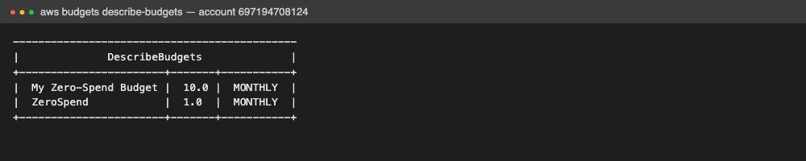
_Бюджет `ZeroSpend` в списке Budgets аккаунта 697194708124._

> **Что разрешает политика `AdministratorAccess`? Почему для повседневной работы нельзя использовать root?**
> `AdministratorAccess` разрешает все действия (`"Action": "*"`) над всеми ресурсами (`"Resource": "*"`), но это обычная политика IAM: её можно отозвать, ограничить SCP или permission boundary, а действия пользователя видны в CloudTrail под его именем. Root - владелец аккаунта, его права нельзя ограничить, он может закрыть аккаунт, сменить платёжные данные и поддержку. Утечка пароля или ключей root означает потерю всего аккаунта, поэтому root используют только для редких задач, которые требуют именно его, и защищают MFA.

### Задание 2. Запуск экземпляра EC2

Экземпляр `webserver` (AL2023, t3.micro, ключ `maxsplavski-keypair`, SG `webserver-sg`) запущен со скриптом User data, который ставит `htop` и `nginx`.

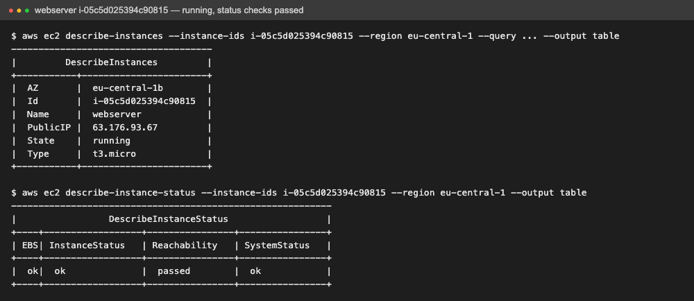
_`webserver` в состоянии `running`, System и Instance status checks - `ok`._

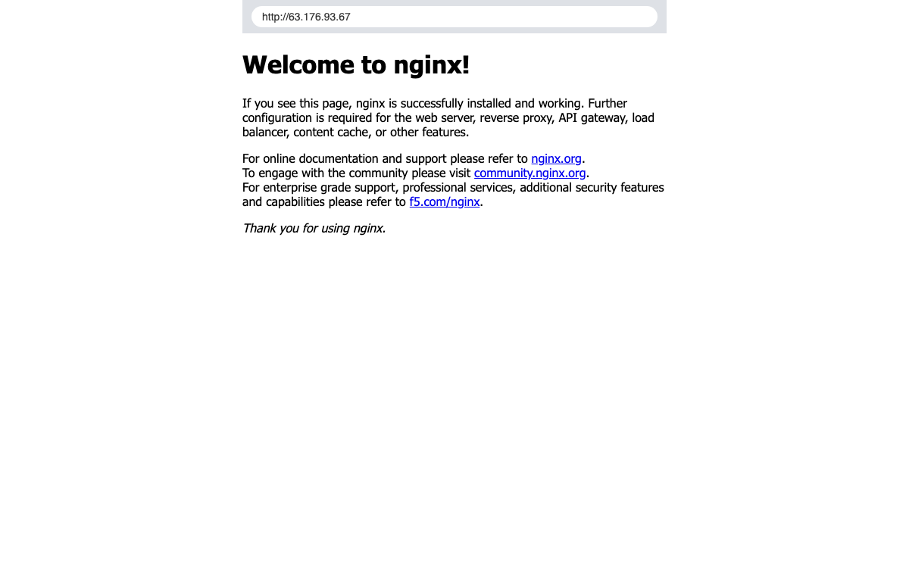
_Приветственная страница nginx по публичному IP `http://63.176.93.67`._

> **Что такое User data и когда выполняется этот скрипт? Выполнится ли он повторно после перезагрузки?**
> User data - данные, которые передаются экземпляру при запуске; если это скрипт с `#!/bin/bash`, его выполняет cloud-init от имени root при _первой_ загрузке экземпляра. После перезагрузки или Stop/Start скрипт повторно не выполняется (cloud-init отмечает, что экземпляр уже инициализирован), если специально не настроить запуск при каждой загрузке.

### Задание 3. Мониторинг и диагностика

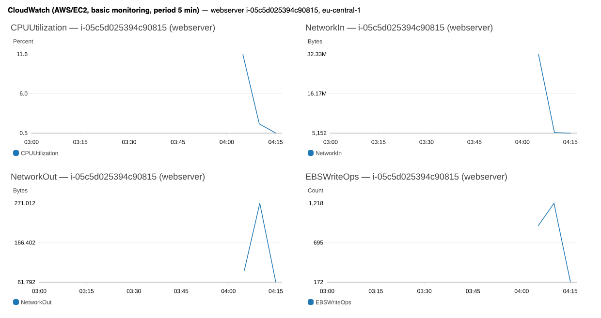
_Метрики CloudWatch экземпляра (CPU, сеть, запись на EBS), базовый мониторинг с периодом 5 минут._

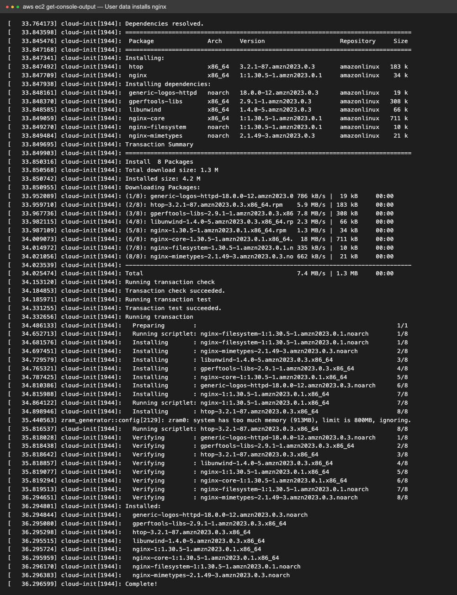
_Фрагмент System log (`get-console-output`): cloud-init выполняет User data и устанавливает пакеты nginx._

_Instance screenshot (`get-console-screenshot`): система загрузилась до приглашения входа._

> **Какая из проверок укажет на проблему, которую можете исправить вы, а какая на проблему на стороне AWS?**
> _System status check_ проверяет инфраструктуру AWS (физический хост, питание, сеть): при её сбое исправлять должна AWS, а пользователь может только перенести экземпляр на другой хост через Stop/Start. _Instance status check_ проверяет саму ОС: неверная сетевая конфигурация, переполненный диск, паника ядра, ошибка в fstab. Это проблемы, которые исправляет владелец экземпляра. _Attached EBS status check_ показывает недоступность подключённых томов EBS, обычно это тоже проблема на стороне AWS.

> **В каких случаях стоит включать детальный мониторинг?**
> Когда важны быстрые реакции: автомасштабирование Auto Scaling по CPU, алармы на короткие всплески нагрузки, поиск проблем производительности в продакшене. Метрики раз в минуту позволяют увидеть пики, которые при усреднении за 5 минут сглаживаются. Для учебного или тестового сервера хватает бесплатного базового мониторинга.

### Задание 4. Подключение по SSH

_Подключение `ssh -i ~/.ssh/maxsplavski-keypair.pem ec2-user@63.176.93.67` и `systemctl status nginx`: active (running)._

> **Почему для входа на экземпляр EC2 используется ключ, а не пароль?**
> Пароль можно подобрать перебором, а публичный сервер с открытым 22 портом постоянно сканируют боты. Приватный ключ ED25519 подобрать практически невозможно, он не передаётся по сети (сервер проверяет только подпись), а на сервере хранится лишь публичный ключ, утечка которого не опасна. AWS сам кладёт публичный ключ в `~ec2-user/.ssh/authorized_keys` при запуске, а вход по паролю в AL2023 по умолчанию выключен.

### Задание 5. Статический сайт

Созданы `index.html`, `about.html`, `contact.html` с общей навигацией, скопированы через `scp` и перенесены в `/usr/share/nginx/html`.

_Копирование файлов `scp` и вывод `ls -l /usr/share/nginx/html` на сервере._

| Главная                                    | О нас                                    | Контакты                                     |
| ------------------------------------------ | ---------------------------------------- | -------------------------------------------- |
| 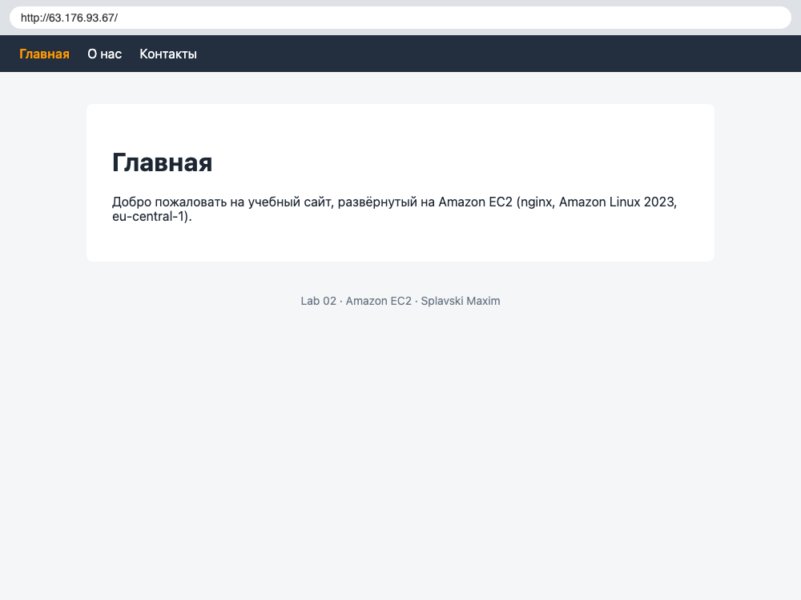 | 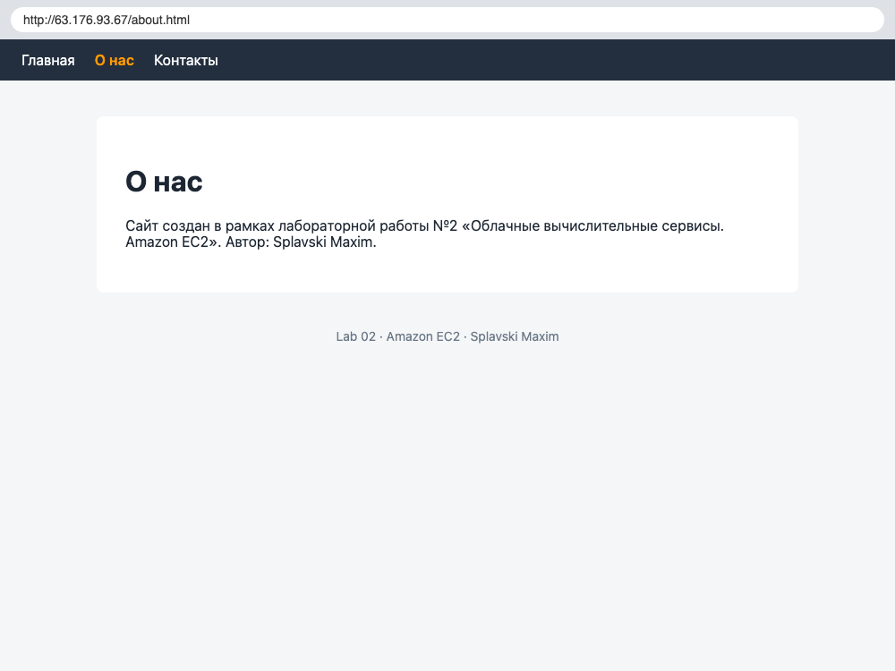 | 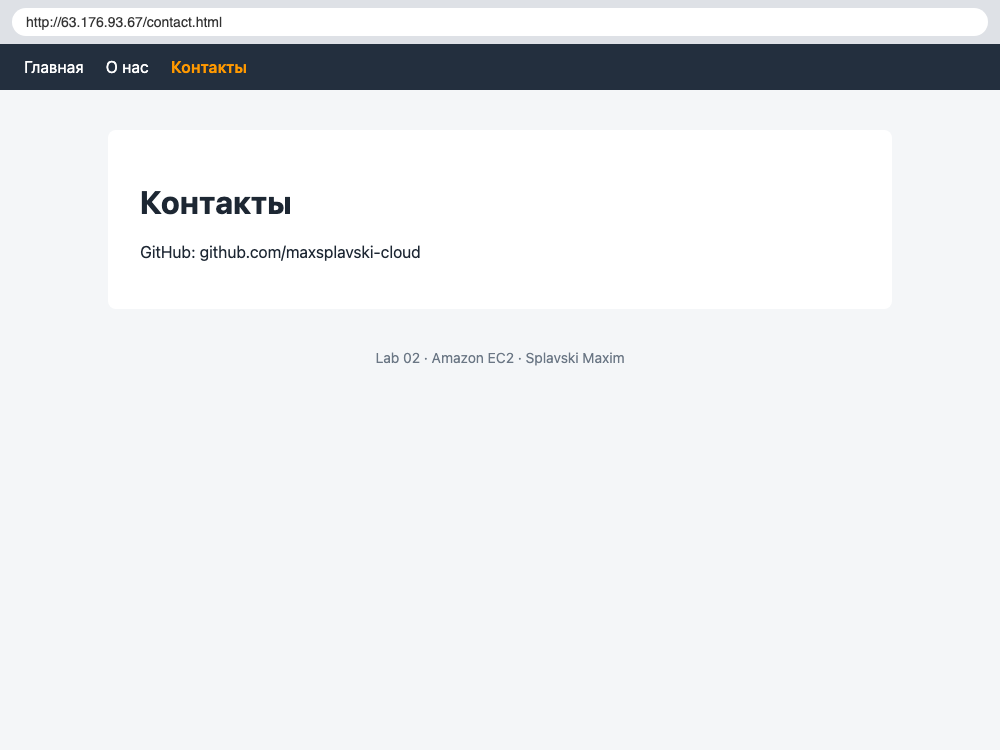 |

_Сайт открывается по `http://63.176.93.67`, ссылки между страницами работают._

> **Что делает команда `scp` и чем она похожа на `ssh`?**
> `scp` копирует файлы между компьютерами по сети. Она работает поверх того же протокола SSH: использует тот же порт 22, ту же аутентификацию по ключу (`-i`), тот же формат адреса `пользователь@хост`, и данные так же шифруются. По сути это SSH-соединение, по которому вместо команд передаются файлы.

### Задание 6. Остановка экземпляра через AWS CLI

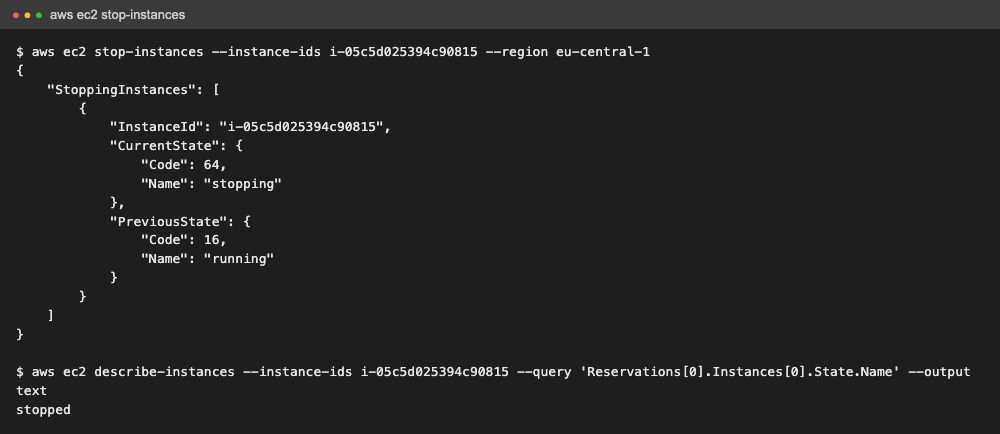
_`aws ec2 stop-instances`: состояние `running` → `stopping`, затем `stopped`._

> **Чем `Stop` отличается от `Terminate`? За что вы продолжаете платить, пока экземпляр остановлен?**
> `Stop` выключает виртуальную машину, но сохраняет её: корневой том EBS с данными остаётся, экземпляр можно снова запустить (на другом хосте и с новым публичным IP). `Terminate` удаляет экземпляр навсегда, и корневой том EBS по умолчанию удаляется вместе с ним. Пока экземпляр остановлен, оплата за вычисления не идёт, но продолжается оплата за тома EBS (и снапшоты), а также за Elastic IP или публичный IPv4, если они остаются закреплёнными.

---

## Часть 2. Продвинутый уровень

### Задание 7. Организация и репозиторий на GitHub

Код `open_capsules_php_functional` загружен в корень публичного репозитория [USM-Labs/timecapsule](https://github.com/USM-Labs/timecapsule) (`public`, `src`, `views`, `composer.json` лежат в корне). Используется уже существующая организация `USM-Labs`.

> **Почему папка `vendor/` и файл `.env` не попали в репозиторий?**
> Они перечислены в `.gitignore` (`/vendor/` и `/.env`). `vendor/` - это сторонние библиотеки, которые не нужно хранить в git: `composer install` скачивает их заново ровно тех версий, что записаны в `composer.lock`. `.env` содержит секреты и настройки конкретного сервера (пароль к базе), поэтому в публичный репозиторий он попадать не должен. Вместо него в репозитории лежит шаблон `.env.example`.

### Задание 8. Подготовка сервера

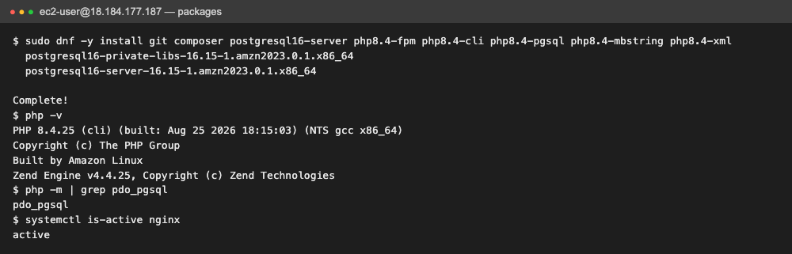
_Установлены git, composer, PostgreSQL 16, PHP 8.4 (FPM, CLI, pgsql, mbstring, xml); `php -m` показывает `pdo_pgsql`._

> **Почему мы устанавливаем эти пакеты вручную, а не добавляем их в User data?**
> User data выполняется только при первом запуске экземпляра, а наш `webserver` уже был создан в Части 1, поэтому изменённый скрипт на нём больше не выполнится. Кроме того, при ручной установке сразу видно ошибки и результат каждой команды, а сбой в User data пришлось бы искать в логах cloud-init. Для новых серверов эти шаги стоит переносить в User data, образ AMI или инструменты конфигурации.

### Задание 9. База данных PostgreSQL

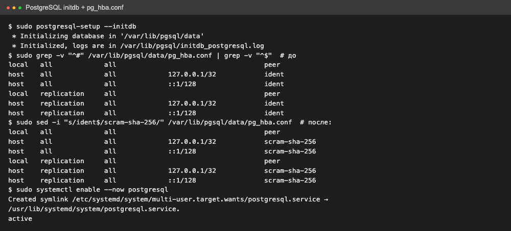
_Инициализация базы и замена `ident` на `scram-sha-256` в `pg_hba.conf`._

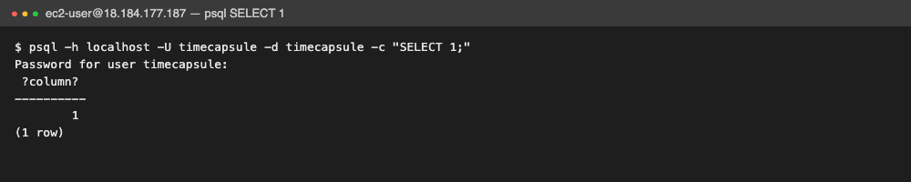
_`psql -h localhost -U timecapsule -d timecapsule -c "SELECT 1;"`: подключение по паролю работает._

### Задание 10. Развёртывание кода приложения на сервере

Код склонирован по HTTPS в `/var/www/timecapsule`, создан `.env` (права `640`, группа `apache`), папка `storage` передана пользователю `apache`.

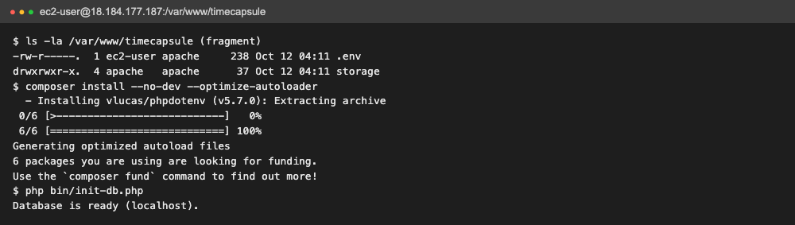
_Права на `.env` и `storage`, `composer install --no-dev` и `php bin/init-db.php` → `Database is ready`._

> **Почему пароль к базе данных хранится в файле `.env` на сервере, а не в коде в репозитории? Почему публичный репозиторий безопасен для этого приложения?**
> Репозиторий публичный: всё, что в него попало, может прочитать кто угодно, и это остаётся в истории git навсегда, даже если файл потом удалить. Пароль относится к конкретному окружению, а не к коду, поэтому его держат в `.env` на сервере, доступном только владельцу и PHP-FPM. Публичный репозиторий безопасен, потому что в нём только код без секретов; к тому же PostgreSQL слушает только `localhost`, порт 5432 закрыт Security Group, а знание кода не даёт доступа к данным.

### Задание 11. Настройка PHP-FPM и nginx

`upload_max_filesize = 6M`, конфигурация сайта `/etc/nginx/conf.d/timecapsule.conf` (root `public`, front controller, FastCGI через `/run/php-fpm/www.sock`, запрет скрытых файлов).

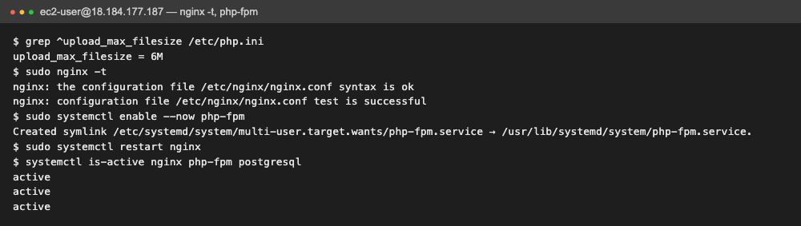
_`sudo nginx -t` - конфигурация корректна; php-fpm, nginx и postgresql активны._

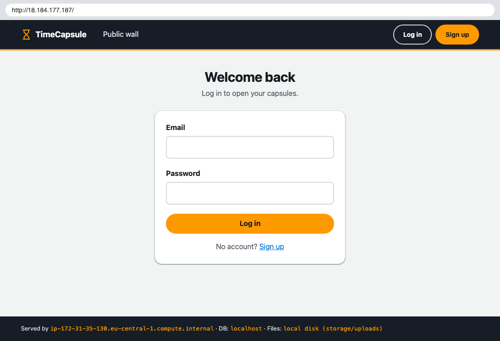
_Страница входа TimeCapsule по `http://18.184.177.187`._

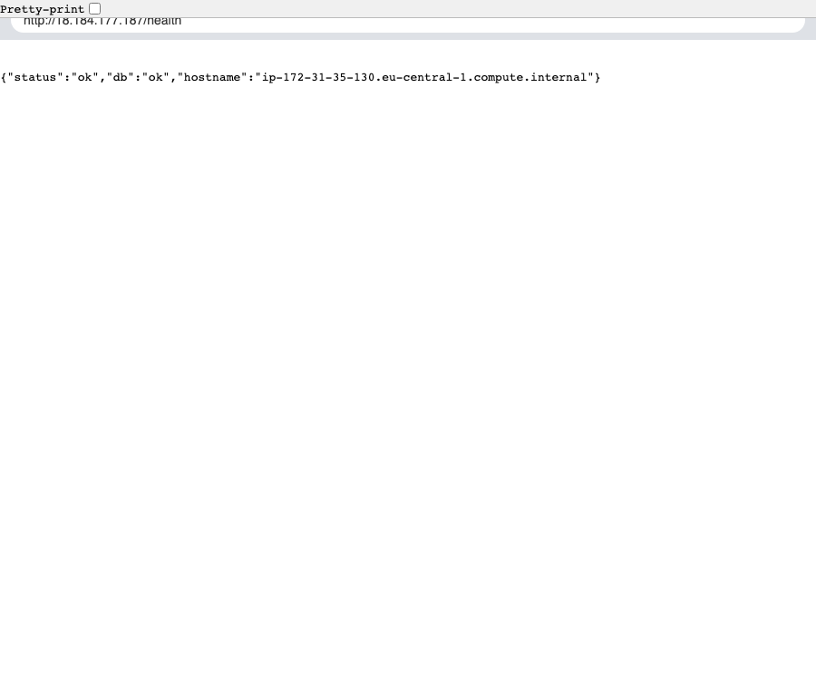
_`/health` возвращает `{"status":"ok","db":"ok",...}`._

Дополнительно проверено, что `http://18.184.177.187/.env` и `/.git/config` отдают `403 Forbidden`.

### Задание 12. Обновление приложения (вариант B)

Скрипт [`deploy.sh`](deploy/deploy.sh) лежит в `~/deploy.sh` на сервере и запускается со своего компьютера одной командой.

_`ssh -i ~/.ssh/maxsplavski-keypair.pem ec2-user@18.184.177.187 ./deploy.sh` - запуск деплоя с MacBook._

> **`git pull` заменяет файлы по одному, и это занимает несколько секунд. Что может увидеть посетитель, который откроет сайт в этот момент? Что случится с сайтом, если после `git pull` не выполнится `composer install`?**
> Посетитель может попасть на смесь старых и новых файлов: новый `index.php` вызывает функцию из ещё не обновлённого файла, и в ответ приходят ошибка 500, белая страница или неправильно собранная страница со старыми стилями. Если `composer install` не выполнится, новый код будет работать со старым `vendor/`: при добавленной или обновлённой зависимости автозагрузчик не найдёт класс, и приложение упадёт с ошибкой 500 (или покажет `vendor/ is missing`, если `vendor` нет совсем).

### Задание 13. Новая версия, поломка и откат

**1. Проверка приложения.** Зарегистрирован тестовый пользователь, создана капсула с прикреплённым изображением, которая открывается через 2 минуты.

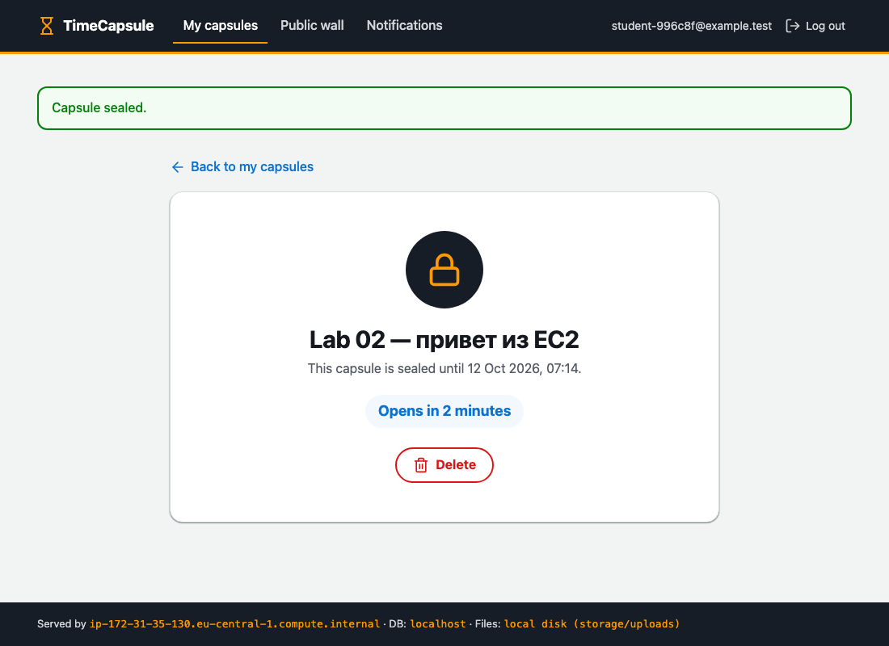
_Капсула «Lab 02 — привет из EC2» запечатана, файл сохранён в `storage/uploads`._

**2. Новая версия.** В подвал `views/layout.php` добавлена строка с именем автора, коммит `8d759b0 Show author in footer`.

_Деплой новой версии: на сервере коммит `8d759b0`._

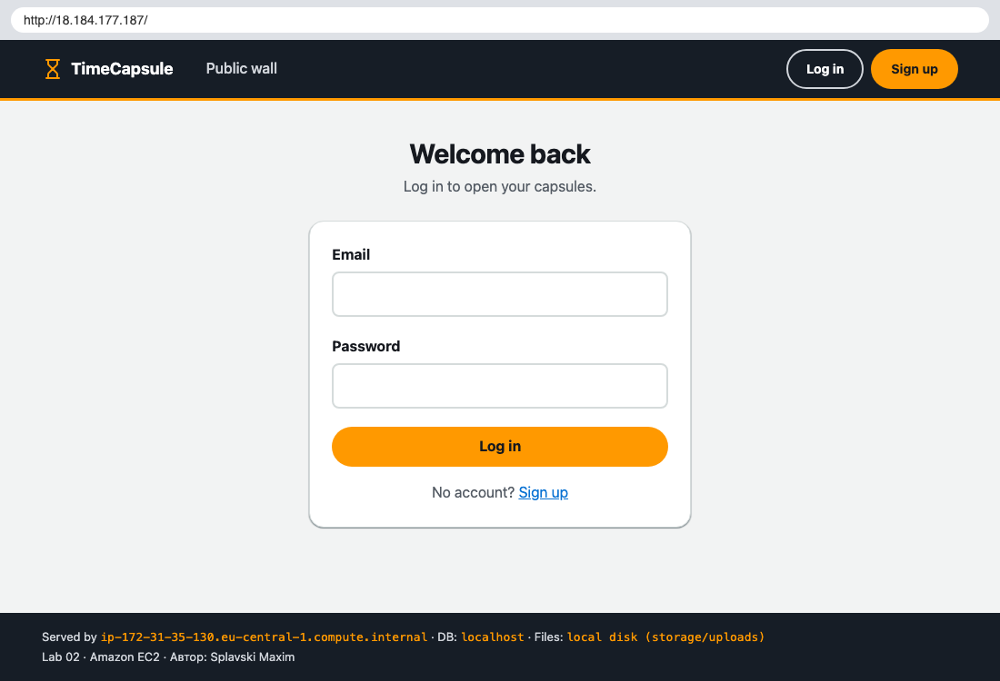
_Новая версия на `http://18.184.177.187`: в подвале «Lab 02 · Amazon EC2 · Автор: Splavski Maxim»._

**3. Поломка.** В конец `views/layout.php` добавлено `<?php broken(`, коммит `4735cf5`.

_Деплой сломанного коммита прошёл без ошибок: скрипт не проверяет, что PHP-код корректен._

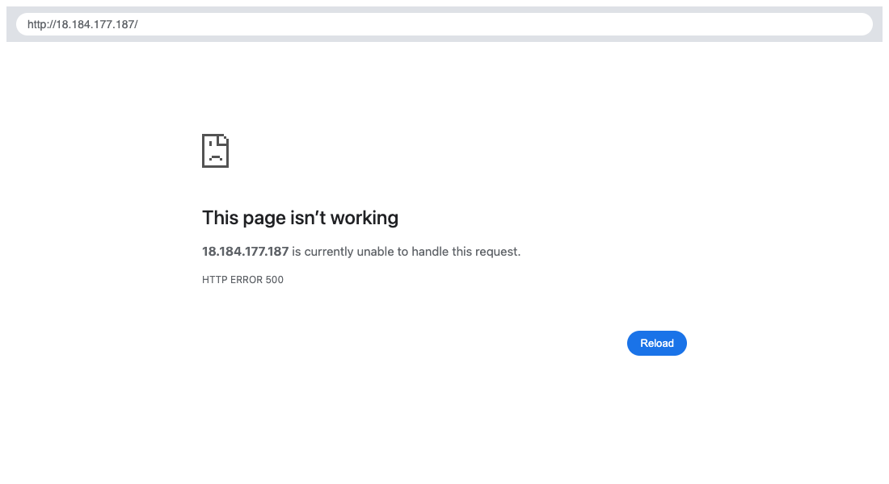
_Главная страница отвечает `HTTP ERROR 500`._

_Одновременно: `/` → `500 Internal Server Error`, `/health` → `{"status":"ok","db":"ok"}`, в логе PHP-FPM - `Parse error` в `layout.php`._

> **Почему `/health` отвечает `ok`, хотя главная страница не работает? Что на самом деле проверяет этот адрес? Чего не хватает такой проверке?**
> Контроллер `/health` отдаёт JSON сам и не подключает шаблон `views/layout.php`, где находится ошибка, поэтому он не замечает поломку. Он проверяет только, что nginx передаёт запросы в PHP-FPM, PHP выполняет код и база отвечает на запрос. Такой проверке не хватает проверки того, что реально видит пользователь (рендер главной страницы, шаблоны, статика), то есть smoke-теста ключевых страниц после деплоя.

**4. Откат.** `git revert --no-edit HEAD` → `git push` → `deploy.sh`.

_`git revert` создаёт коммит `4b5de04`, после деплоя сайт снова работает._

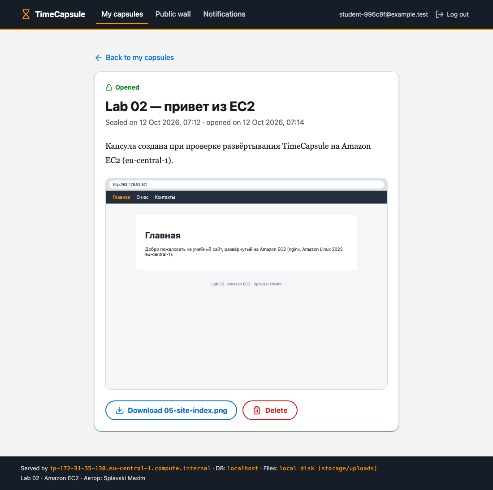
_После отката капсула открылась, прикреплённый файл на месте, подвал с именем сохранился: данные пережили все деплои._

История коммитов: `d8ef23b Initial import` → `8d759b0 Show author in footer` → `4735cf5 Break layout` → `4b5de04 Revert "Break layout"`.

> **Сколько времени сайт был сломан? Из каких шагов сложилось это время? Как можно было бы сократить его?**
> Деплой сломанного коммита закончился в 04:13:05 UTC, деплой отката - в 04:13:40 UTC, то есть сайт был сломан около 35 секунд. Время сложилось из обнаружения ошибки (открыть страницу, увидеть 500, найти причину в логе), `git revert` и `git push`, и повторного `deploy.sh` (`git pull`, `composer install`, `init-db`, reload). В реальной жизни дольше всего длится обнаружение, потому что `/health` ошибку не видит. Сократить время можно проверкой `php -l` и тестами до деплоя (в CI), smoke-тестом главной страницы сразу после деплоя с автоматическим откатом и выкладкой релизов в отдельные папки, чтобы откат был просто переключением симлинка на предыдущую версию.

### Задание 14. Архитектура и решение

_Схема развёртывания: пользователи → HTTP :80 → EC2 `webserver` (nginx → PHP-FPM → PostgreSQL) в Security Group, default subnet, AZ `eu-central-1b`, default VPC, регион `eu-central-1`; разработчик делает `git push` в GitHub и запускает `deploy.sh` по SSH, сервер забирает код из GitHub по HTTPS._

Схема построена кодом ([`diagrams`](https://diagrams.mingrammer.com/), официальные иконки AWS Architecture Icons).

ADR о способе деплоя: [docs/adr/0001-deploy-method.md](docs/adr/0001-deploy-method.md). В нём сравниваются `scp`, ручной `git pull`, `deploy.sh` и CI/CD.

---

## Контрольные вопросы

**1. Как проходит запрос от браузера до базы данных в вашем развёртывании? Какую роль играет каждая программа?**
Браузер отправляет HTTP-запрос на публичный IP, порт 80; Security Group пропускает его к экземпляру. nginx принимает запрос: статические файлы (`css`, `js`) из `public/` отдаёт сам, а всё остальное через `try_files` передаёт в `index.php` и по FastCGI через unix-сокет `/run/php-fpm/www.sock` в PHP-FPM. PHP-FPM выполняет код приложения от имени `apache`, а тот через PDO делает SQL-запросы к PostgreSQL на `localhost:5432`. Готовый HTML возвращается по той же цепочке обратно в браузер.

**2. Почему сервер может скачивать код из репозитория, но не может отправлять в него изменения? Почему для сервера это правильно?**
Репозиторий публичный, поэтому чтение по HTTPS доступно без учётных данных, а запись требует входа в GitHub с правами в организации. Таких учётных данных (токена, SSH-ключа) на сервере нет. Это принцип наименьших привилегий: если сервер взломают, злоумышленник не сможет подменить код в репозитории и через следующий деплой распространить вредоносный код. Изменения попадают в код только через разработчиков и историю git.

**3. Что произойдёт с загруженными пользователями файлами, если удалить экземпляр EC2? Как это связано с тем, что вы знаете об EBS?**
Файлы лежат в `storage/uploads`, а база PostgreSQL в `/var/lib/pgsql` - всё на корневом томе EBS экземпляра. У корневого тома по умолчанию включён `DeleteOnTermination`, поэтому при Terminate том удалится вместе с файлами и базой, и данные будут потеряны безвозвратно (при Stop том сохраняется). Чтобы этого избежать, нужны снапшоты EBS или отдельный том с выключенным удалением, а правильнее - вынести файлы в S3, а базу в RDS, что и будет сделано в следующих работах.

**4. Что общего у вашего `deploy.sh` с тем, что делают системы CI/CD? Чего в вашем процессе ещё не хватает?**
Как и CD-конвейер, скрипт берёт код из репозитория как единственного источника, выполняет одинаковые шаги в фиксированном порядке (получение кода, установка зависимостей, миграции, перезапуск), останавливается при ошибке и сообщает, какая версия выпущена. Не хватает автоматического запуска по `git push`, этапа CI со сборкой и тестами (хотя бы `php -l`), проверки после деплоя с автоматическим откатом, атомарной выкладки без простоя, журнала выпусков и уведомлений, а также раздельных окружений (staging / production).

---

## Вывод

В работе с нуля поднят сервер Amazon EC2 в `eu-central-1`: экземпляр с ключом ED25519, Security Group с минимально необходимыми правилами и скриптом User data. Изучены инструменты диагностики (status checks, CloudWatch, system log, снимок экрана), выполнено подключение по SSH и выкладка статического сайта через `scp`. Во второй части на тот же экземпляр развёрнуто монолитное приложение TimeCapsule (nginx + PHP-FPM + PostgreSQL), код которого сервер забирает из публичного репозитория GitHub. Выпуск версий автоматизирован скриптом `deploy.sh`, запускаемым по SSH. На практике проверены выпуск новой версии, поломка и откат через `git revert`. Эксперимент показал ограничения подхода: неатомарная выкладка и `/health`, который не замечает ошибку в шаблоне. Решение и альтернативы зафиксированы в ADR.

## Источники

1. Задание: [MSU-Courses/cloud-computing, Lab 02](https://github.com/MSU-Courses/cloud-computing/tree/main/Lab/02_Compute_Services).
2. Лекция 4 «Вычислительные сервисы. Amazon EC2 и machine identity», Hands-on 4.1-4.3.
3. [Amazon EC2 User Guide](https://docs.aws.amazon.com/AWSEC2/latest/UserGuide/): status checks, user data, Stop/Terminate.
4. [AWS CLI Command Reference](https://docs.aws.amazon.com/cli/latest/reference/): `ec2`, `budgets`, `cloudwatch`.
5. [nginx documentation](https://nginx.org/en/docs/), [PostgreSQL 16: pg_hba.conf](https://www.postgresql.org/docs/16/auth-pg-hba-conf.html).
6. Приложение-образец: [msu-cloud-course/app-samples](https://github.com/msu-cloud-course/app-samples) (исходный README приложения - [docs/APP_README.md](docs/APP_README.md)).
