# Лабораторная работа №3. Облачные сети. Amazon VPC

- **Студент:** Splavski Maxim
- **Группа:** I2402
- **Специальность:** Informatică
- **Номер в группе:** `k = 16`, `X = 16 % 30 = 16`
- **Уровень:** продвинутый (Часть 1 + Часть 2, задания 1-14)
- **Репозиторий:** https://github.com/USM-Labs/timecapsule
- **Вариант NAT Gateway:** B - скрипты [`scripts/nat-up.sh`](../../scripts/nat-up.sh) и [`scripts/nat-down.sh`](../../scripts/nat-down.sh)
- **ADR:** [docs/adr/0002-database-placement.md](../adr/0002-database-placement.md)
- **Отчёт ЛР2:** [README.md](../../README.md) в корне репозитория

Все ресурсы в `eu-central-1`, имена по шаблону `timecapsule-dev-<роль>[-<зона>]`, теги `Name`, `Project=timecapsule`, `Environment=dev`, `Owner=maxsplavski`, `Lab=lab3`.

| Ресурс                    | Имя                                                  | ID / адрес                                           |
| ------------------------- | ---------------------------------------------------- | ---------------------------------------------------- |
| VPC                       | `timecapsule-dev-vpc`                                | `vpc-0bb39db4ac3ae4578`, `10.16.0.0/16`              |
| Internet Gateway          | `timecapsule-dev-igw`                                | `igw-0bcddeeb5fd1b8102`                              |
| Таблицы маршрутов         | `timecapsule-dev-public-rt`, `timecapsule-dev-private-rt` | `rtb-0e278641af17b4ff1`, `rtb-06aebc01e03f7ed9f` |
| bastion                   | `timecapsule-dev-bastion` (`public-b`)               | `i-0593e2bbcca978f6c`, `10.16.1.215`                 |
| web-server (Часть 1)      | `timecapsule-dev-web` (`public-a`)                   | `i-00a89b602d5c4b5dc`, `10.16.0.80` - завершён в задании 8 |
| db-server                 | `timecapsule-dev-db` (`private-a`)                   | `i-070eabed30106bf34`, `10.16.10.70`                 |
| app-server                | `timecapsule-dev-app` (`public-a`)                   | `i-0f8c75a3113691a46`, `10.16.0.104`                 |
| Elastic IP                | `timecapsule-dev-app-eip`                            | `3.127.61.245`                                       |
| Приватная зона Route 53   | `timecapsule.internal`                               | `Z0783983R8BOKW7C227C`, `db` → `10.16.10.70`         |

> Терминальные скриншоты - реальный вывод команд (ssh, curl, dig, psql, скрипты) и ответов AWS API
> (`Describe*`), отрисованный в картинку; страницы сняты браузером Chromium. Мой домашний IP замаскирован (`94.243.69.x`).

---

## Часть 1. Базовый уровень

### Задание 1. План адресов

| Подсеть     | Зона доступности | Диапазон        | Первый и последний адрес, доступный экземплярам | Сколько адресов доступно экземплярам |
| ----------- | ---------------- | --------------- | ----------------------------------------------- | ------------------------------------ |
| `public-a`  | `eu-central-1a`  | `10.16.0.0/24`  | `10.16.0.4` - `10.16.0.254`                     | 251                                  |
| `public-b`  | `eu-central-1b`  | `10.16.1.0/24`  | `10.16.1.4` - `10.16.1.254`                     | 251                                  |
| `private-a` | `eu-central-1a`  | `10.16.10.0/24` | `10.16.10.4` - `10.16.10.254`                   | 251                                  |
| `private-b` | `eu-central-1b`  | `10.16.11.0/24` | `10.16.11.4` - `10.16.11.254`                   | 251                                  |

> **Почему доступных адресов не 256? Какие адреса подсети `10.16.0.0/24` занимает AWS и для чего? Сколько ещё подсетей `/24` поместится в VPC?**
> AWS резервирует в каждой подсети 5 адресов: `10.16.0.0` - адрес сети, `.1` - маршрутизатор VPC, `.2` - DNS-сервер VPC (база VPC + 2), `.3` - зарезервирован на будущее, `.255` - широковещательный (в VPC broadcast не поддерживается, но адрес занят). Остаётся 256 - 5 = 251. В `/16` помещается 2^(24-16) = 256 подсетей `/24`; четыре заняты, поэтому поместится ещё **252**.

### Задание 2. VPC и подсети

Создана `timecapsule-dev-vpc` (`10.16.0.0/16`, без IPv6), включены `DNS resolution` и `DNS hostnames`, созданы четыре подсети из таблицы.

> **Является ли подсеть `public-a` сейчас публичной? Почему?**
> Нет. Подсеть становится публичной не из-за названия, а из-за маршрута `0.0.0.0/0` в Internet Gateway в её таблице маршрутов. Сразу после создания она связана с основной таблицей VPC, где есть только маршрут `local`, и Internet Gateway ещё не существует, поэтому выхода в интернет у неё нет.

### Задание 3. Internet Gateway и таблицы маршрутов

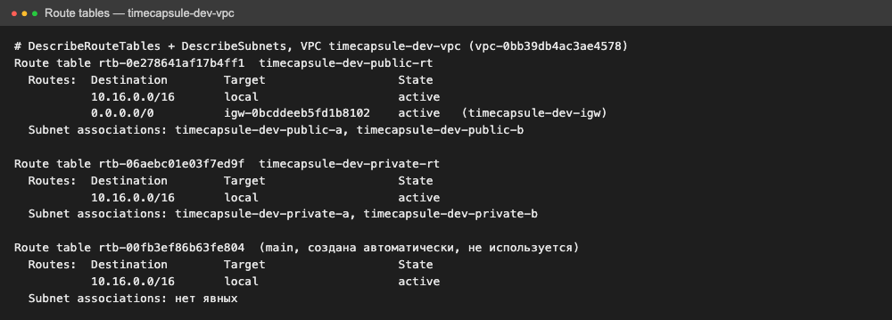
_`public-rt`: `local` + `0.0.0.0/0 → timecapsule-dev-igw`, связана с `public-a`, `public-b`; `private-rt`: только `local`, связана с `private-a`, `private-b`._

> **Какой маршрут есть в обеих таблицах, хотя вы его не добавляли? Что он даёт? Куда уйдёт пакет из `private-a`, адресованный `8.8.8.8`?**
> Маршрут `10.16.0.0/16 → local`. Его AWS добавляет в каждую таблицу VPC, удалить его нельзя: он обеспечивает связь между всеми подсетями VPC, в том числе из разных зон доступности. Для `8.8.8.8` в `private-rt` нет подходящего маршрута (только `local`), поэтому пакет никуда не уйдёт: маршрутизатор VPC его отбросит.

### Задание 4. Security Group

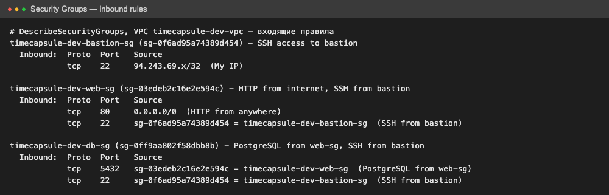
_Входящие правила `bastion-sg` (22 с моего IP), `web-sg` (80 отовсюду, 22 от `bastion-sg`), `db-sg` (5432 от `web-sg`, 22 от `bastion-sg`)._

> **Почему в `db-sg` источником указана группа `web-sg`, а не адрес веб-сервера или диапазон `10.16.0.0/16`?**
> Ссылка на группу разрешает доступ всем экземплярам, у которых есть `web-sg`, независимо от их адресов. Если веб-сервер пересоздать (как в задании 8, где `web-server` заменил `app-server` с другим IP) или добавить второй, правило менять не нужно. Диапазон `10.16.0.0/16` был бы слишком широким: к базе смог бы подключиться любой сервер VPC, в том числе bastion.

### Задание 5. Экземпляры

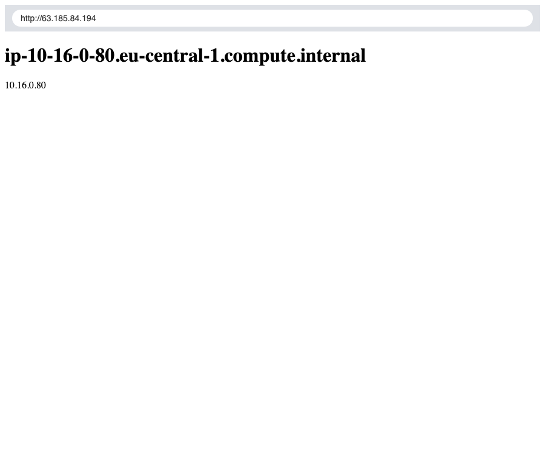
_Страница `web-server` по публичному IP: имя `ip-10-16-0-80` и приватный адрес `10.16.0.80` из `10.16.0.0/24`._

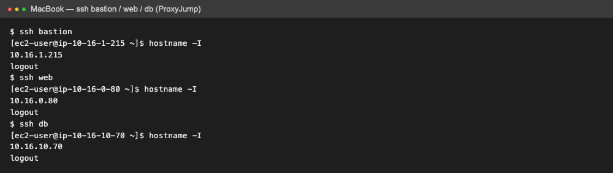
_`ssh bastion`, `ssh web`, `ssh db` через `ProxyJump bastion` из `~/.ssh/config`._

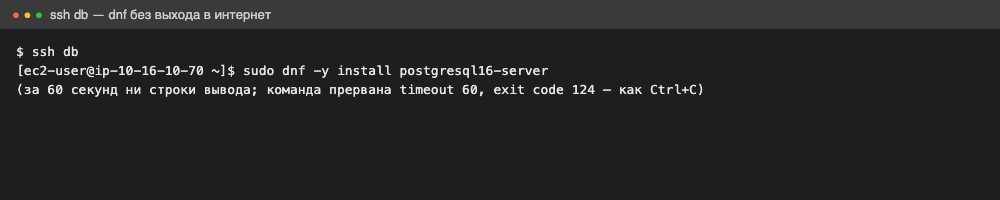
_`sudo dnf -y install postgresql16-server` на `db-server` зависает: за 60 секунд нет ни строки вывода._

> **Почему `db-server` не может скачать пакеты, хотя `web-server` это делает? Что нужно добавить в сеть, чтобы это стало возможно, и при этом `db-server` остался недоступным из интернета?**
> У `db-server` нет публичного адреса, а в `private-rt` нет маршрута `0.0.0.0/0`, поэтому пакеты к репозиториям никуда не уходят. У `web-server` есть публичный IP и маршрут в Internet Gateway. Нужен NAT Gateway в публичной подсети и маршрут `0.0.0.0/0 → NAT` в `private-rt`: NAT выпускает исходящие соединения, подменяя адрес на свой, но не принимает новых соединений снаружи.

### Задание 6. Временный NAT Gateway

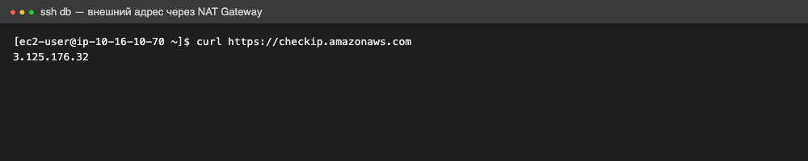
_`curl https://checkip.amazonaws.com` на `db-server` вернул `3.125.176.32` - это Elastic IP `timecapsule-dev-nat-a-eip`._

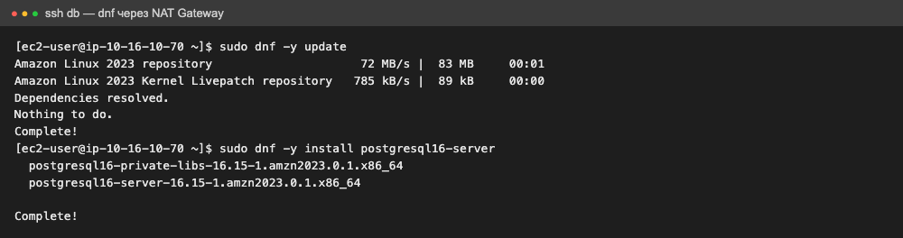
_Через NAT Gateway `dnf update` и установка `postgresql16-server` проходят._

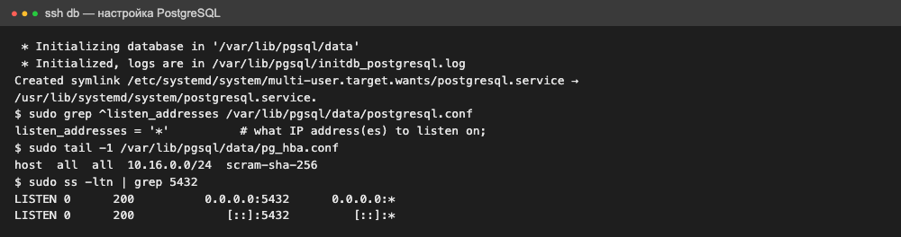
_`listen_addresses = '*'`, строка `host all all 10.16.0.0/24 scram-sha-256` в `pg_hba.conf`, PostgreSQL слушает `0.0.0.0:5432`._

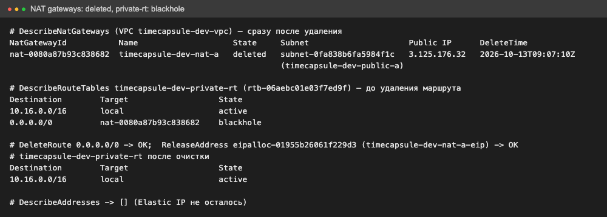
_После удаления: шлюз `timecapsule-dev-nat-a` в состоянии `deleted`, маршрут `0.0.0.0/0` в `private-rt` в состоянии `blackhole`; маршрут удалён, Elastic IP освобождён._

> **Какой адрес вернула первая команда? Почему это не адрес `db-server`?**
> `3.125.176.32` - Elastic IP NAT Gateway. У `db-server` только приватный адрес `10.16.10.70`, который в интернете не маршрутизируется. NAT Gateway заменяет адрес отправителя на свой публичный, поэтому внешний сервис видит адрес шлюза, а ответы возвращаются через NAT обратно к `db-server`.

> **Доступ к базе ограничивают три механизма: отсутствие публичного адреса и маршрута в Internet Gateway, Security Group `db-sg` и `pg_hba.conf`. Что делает каждый из них? Что произойдёт, если ошибиться только в одном?**
> Маршрутизация и отсутствие публичного IP делают сервер недостижимым из интернета на сетевом уровне. Security Group на уровне сетевого интерфейса пропускает к порту 5432 только экземпляры с `web-sg`. `pg_hba.conf` на уровне самого PostgreSQL решает, с каких адресов, к какой базе и каким способом можно войти, и требует пароль. Если ошибиться в одном механизме (например, открыть 5432 для `0.0.0.0/0`), два других продолжат защищать базу: это эшелонированная защита (defense in depth). Опасно, только когда ошибок несколько одновременно.

> **Почему PostgreSQL продолжает работать после удаления NAT Gateway? Что придётся сделать, когда на `db-server` понадобятся обновления безопасности?**
> NAT нужен только для исходящих соединений в интернет. Подключения от веб-сервера к базе идут внутри VPC по маршруту `local`, которому NAT не нужен. Для обновлений придётся снова поднять NAT Gateway и маршрут, установить обновления и удалить шлюз; в Части 2 это делают скрипты `nat-up.sh` и `nat-down.sh`.

### Задание 7. Проверки

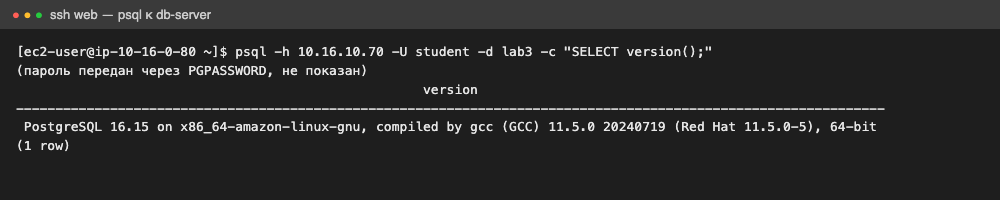
_С `web-server`: `psql -h 10.16.10.70 -U student -d lab3 -c "SELECT version();"` → PostgreSQL 16.15._

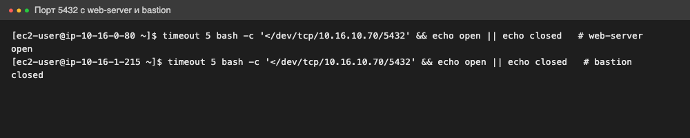
_Порт 5432: с `web-server` - `open`, с `bastion` - `closed`._

> **Почему с `web-server` порт открыт, а с `bastion` нет, хотя оба сервера в одной VPC и маршрут между ними есть?**
> Маршрут только доставляет пакет, а решение принимает Security Group `db-sg`: порт 5432 разрешён только от экземпляров с группой `web-sg`. У bastion группа `bastion-sg`, ей разрешён только порт 22, поэтому SYN к 5432 молча отбрасывается и соединение истекает по таймауту.

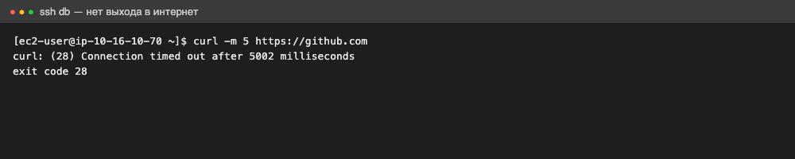
_`curl -m 5 https://github.com` с `db-server` - `Connection timed out`._

> **Почему запрос не проходит? Можно ли из интернета подключиться к порту 5432 `db-server`? Объясните по цепочке: маршрут, адрес, фильтры.**
> Маршрут: в `private-rt` нет `0.0.0.0/0` (NAT удалён), пакет к GitHub некуда отправить. Адрес: у `db-server` нет публичного IP, Internet Gateway нечем заменить приватный адрес, а снаружи до `10.16.10.70` не дойти, потому что приватные адреса в интернете не маршрутизируются. Фильтры: даже если бы путь был, `db-sg` пускает 5432 только от `web-sg`, а `pg_hba.conf` - только из `10.16.0.0/24`. Поэтому подключиться из интернета нельзя.

**Network ACL.** В Network ACL по умолчанию `acl-02fca3b9b1d590ae6` (связан со всеми 4 подсетями) добавлено входящее правило `90 DENY All traffic 94.243.69.x/32`.

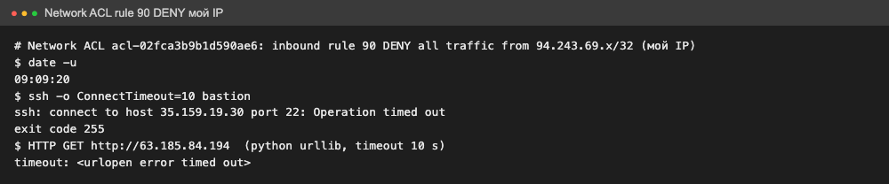
_С моего IP: `ssh bastion` - `Operation timed out`, сайт `http://63.185.84.194` - таймаут._

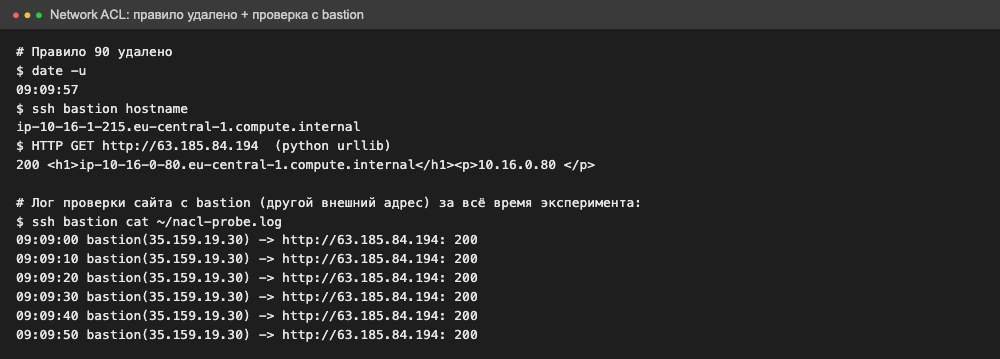
_После удаления правила 90 SSH и сайт снова работают. Лог проверки сайта с другого внешнего адреса (публичный IP bastion `35.159.19.30`, каждые 10 с): всё время эксперимента `200`._

> Проверку «с телефона через мобильный интернет» заменил проверкой с другого внешнего адреса: на bastion заранее запустил цикл `curl` к публичному IP `web-server`. Трафик bastion выходит через Internet Gateway и возвращается в `public-a` с публичным адресом bastion, который правилом не запрещён.

> **Почему заблокировано и SSH, и сайт, хотя вы не меняли ни одной Security Group? Почему с телефона сайт открывается? Почему правило должно иметь номер меньше 100?**
> Network ACL работает на границе подсети, до Security Group, и правило 90 запрещает весь трафик с моего адреса во все подсети, связанные с этим ACL, на любой порт. Поэтому блокируются и SSH на bastion, и HTTP на веб-сервер. Запрос с другого адреса (телефон, в моём случае bastion) правилу 90 не соответствует и пропускается правилом 100 `allow 0.0.0.0/0`. Правила ACL проверяются по возрастанию номера до первого совпадения, поэтому запрещающее правило должно стоять раньше разрешающего 100, иначе до него дело не дойдёт.

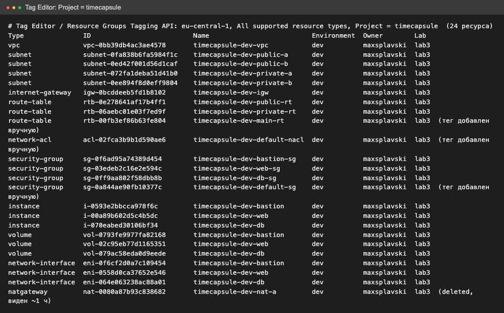
_Tag Editor (`Project = timecapsule`, `eu-central-1`): VPC, 4 подсети, IGW, 3 таблицы маршрутов, Network ACL, 4 Security Group, экземпляры, их диски и сетевые интерфейсы. Основной таблице маршрутов, ACL и SG по умолчанию теги добавлены вручную._

> **Как по тегам найти все ресурсы, которые нужно удалить после окончания проекта? Зачем нужен тег `Owner`, если аккаунт личный?**
> В Tag Editor или через `aws resourcegroupstaggingapi get-resources --tag-filters Key=Project,Values=timecapsule` можно получить список всех ресурсов проекта (а с `Environment=dev` или `Lab=lab3` - только нужной части) и удалить их по этому списку; по тем же тегам Cost Explorer показывает расходы проекта. `Owner` отвечает, кого спросить о ресурсе. В личном аккаунте это кажется лишним, но это привычка рабочего соглашения: аккаунт могут открыть преподаватель или коллеги, ресурсы потом переедут в общий аккаунт команды, а автоматизация (уведомления, очистка) использует `Owner`, чтобы найти ответственного.

Все три экземпляра остановлены (задание 7.6).

---

## Часть 2. Продвинутый уровень

### Задание 8. Перенос сервера ЛР2 в новую сеть

Из `webserver` ЛР2 создан образ `timecapsule-dev-app-lab2` (`ami-07d81360380bbda17`, теги на образ и снимок), из него запущен `timecapsule-dev-app` в `public-a` с `web-sg`. `web-server` из Части 1 завершён.

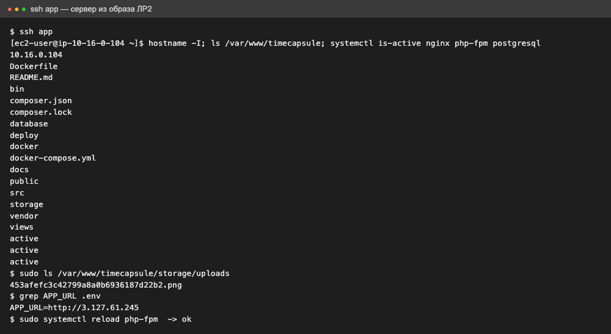
_`ssh app` (через bastion): код в `/var/www/timecapsule` с `vendor/`, работающие nginx, PHP-FPM и локальный PostgreSQL, файл капсулы в `storage/uploads`._

> **Что содержит образ? Какие данные из ЛР2 оказались на `app-server` без всякой установки? Где сейчас хранится база данных приложения?**
> Образ - снимок корневого тома EBS `webserver` с описанием (архитектура, тип загрузки). На `app-server` сразу оказались ОС с установленными nginx, PHP 8.4, PostgreSQL 16, Composer и git; их настройки; код с `vendor/` и `.env`; `~/deploy.sh`; загруженные файлы в `storage/uploads` и сама локальная база ЛР2 в `/var/lib/pgsql`. Сразу после запуска база всё ещё хранилась локально на диске `app-server` (`localhost`), а не на `db-server`.

### Задание 9. Elastic IP

Elastic IP `timecapsule-dev-app-eip` = `3.127.61.245`, привязан к `timecapsule-dev-app`; в `.env` `APP_URL=http://3.127.61.245`.

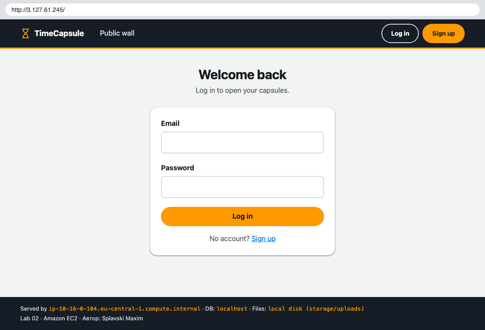
_Приложение по Elastic IP `http://3.127.61.245`._

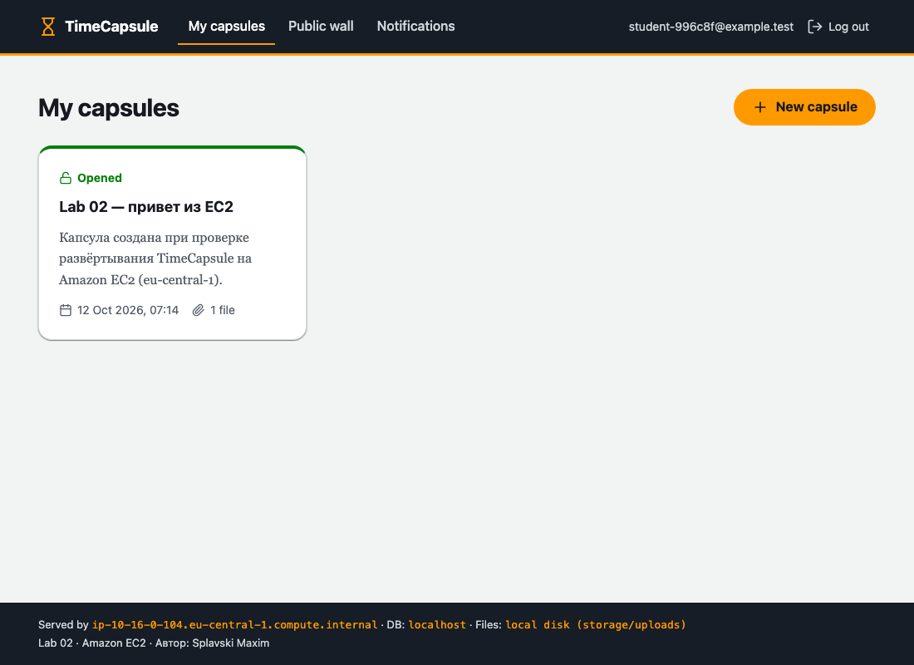
_Вход под пользователем, созданным в ЛР2._

> Замечание: после правки `.env` через `sed -i` файл пересоздаётся, и группа `apache` сбрасывается на `ec2-user`. PHP-FPM перестаёт читать `.env`, и `/health` отвечает `db: error`. Исправил командой `sudo chgrp apache .env`, дальнейшие правки делал с сохранением владельца.

> **Почему Elastic IP нужен `app-server`, но не нужен bastion? Сколько стоит Elastic IP, пока сервер остановлен, и почему? Понадобится ли Elastic IP, когда перед сервером появится балансировщик?**
> Адрес `app-server` знают пользователи и `APP_URL`, поэтому он должен быть постоянным. Адрес bastion нужен только администратору: после запуска достаточно поправить `HostName` в `~/.ssh/config`. Elastic IP стоит $0,005 в час (~$3,6 в месяц) всегда, в том числе у остановленного сервера: AWS берёт плату за каждый закреплённый публичный IPv4, потому что адрес зарезервирован за вами и недоступен другим. С балансировщиком нагрузки Elastic IP не понадобится: пользователи будут ходить на DNS-имя балансировщика, а `app-server` можно будет перенести в приватную подсеть.

### Задание 10. База данных приложения на `db-server`

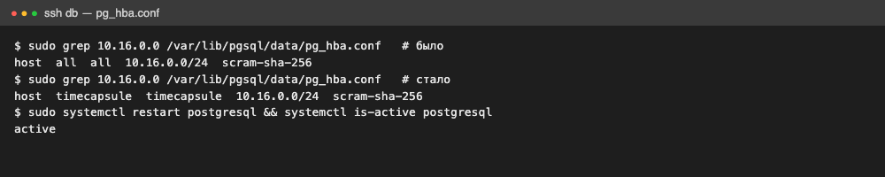
_Пользователь `timecapsule` с новым паролем и база `timecapsule`; строка `pg_hba.conf` ужесточена до `host timecapsule timecapsule 10.16.0.0/24 scram-sha-256`, PostgreSQL перезапущен._

> **Зачем для базы в отдельной сети нужен новый сильный пароль, если порт 5432 и так закрыт Security Group?**
> Security Group - лишь один слой: её могут изменить по ошибке, а к базе разрешено подключаться всему `web-sg`, то есть любому взломанному веб-серверу. Пароль ЛР2 лежал в `.env` и на старом диске (а значит, и в образе), так что его нужно считать скомпрометированным. Новый длинный случайный пароль с `scram-sha-256` - последний рубеж, если все сетевые фильтры пройдены.

### Задание 11. Приватная зона Route 53

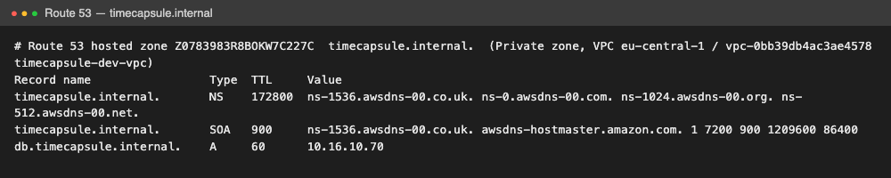
_Приватная зона `timecapsule.internal`, связанная с `timecapsule-dev-vpc`, запись `db A 10.16.10.70 TTL 60`._

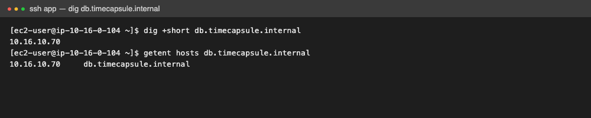
_С `app-server`: `dig +short db.timecapsule.internal` → `10.16.10.70`._

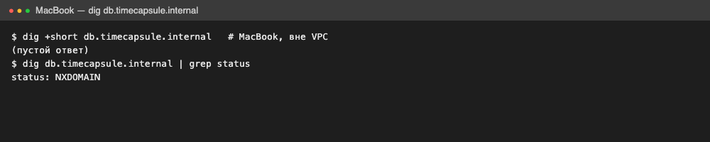
_С моего компьютера: пустой ответ, `NXDOMAIN`._

> **Почему с `app-server` имя находится, а с вашего компьютера нет? Что придётся изменить, если `db-server` пересоздадут с другим адресом?**
> Приватная зона отвечает только DNS-резолверу Route 53 внутри связанной VPC (адрес `10.16.0.2`), который используют серверы VPC. Мой компьютер спрашивает публичный DNS, где зоны `timecapsule.internal` нет. Если `db-server` пересоздадут, нужно изменить одну A-запись `db` в зоне; `.env` и код приложения менять не придётся (новый адрес подхватится в течение TTL 60 секунд).

### Задание 12. Перенос данных и переключение приложения

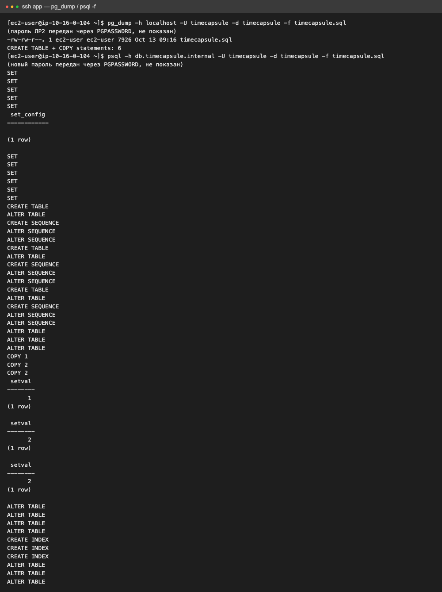
_`pg_dump` локальной базы ЛР2 и `psql -h db.timecapsule.internal ... -f timecapsule.sql`: таблицы созданы, `COPY 1/2/2`._

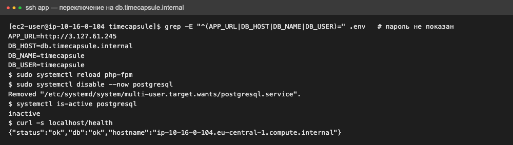
_`DB_HOST=db.timecapsule.internal` и новый пароль в `.env`, локальный PostgreSQL выключен (`inactive`), `/health` → `ok`._

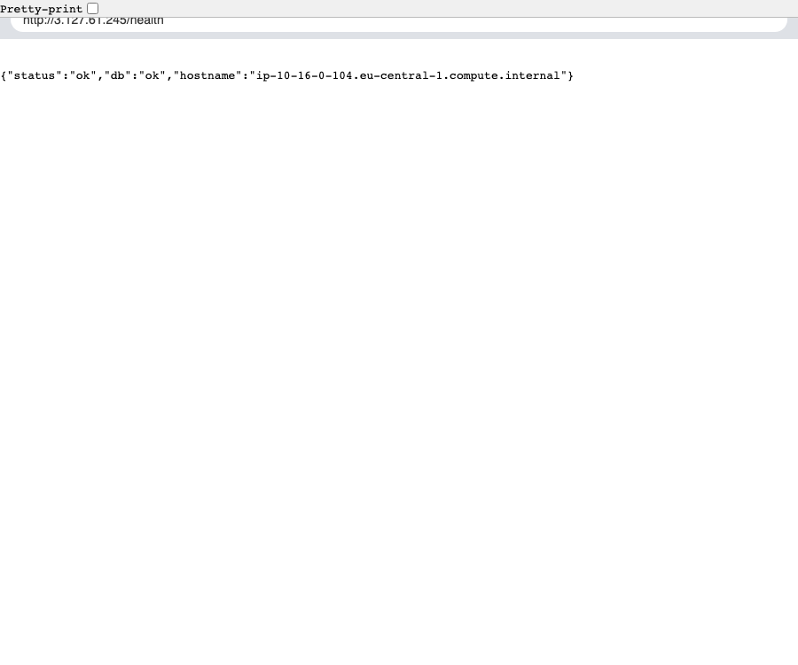
_`http://3.127.61.245/health` → `{"status":"ok","db":"ok"}`._

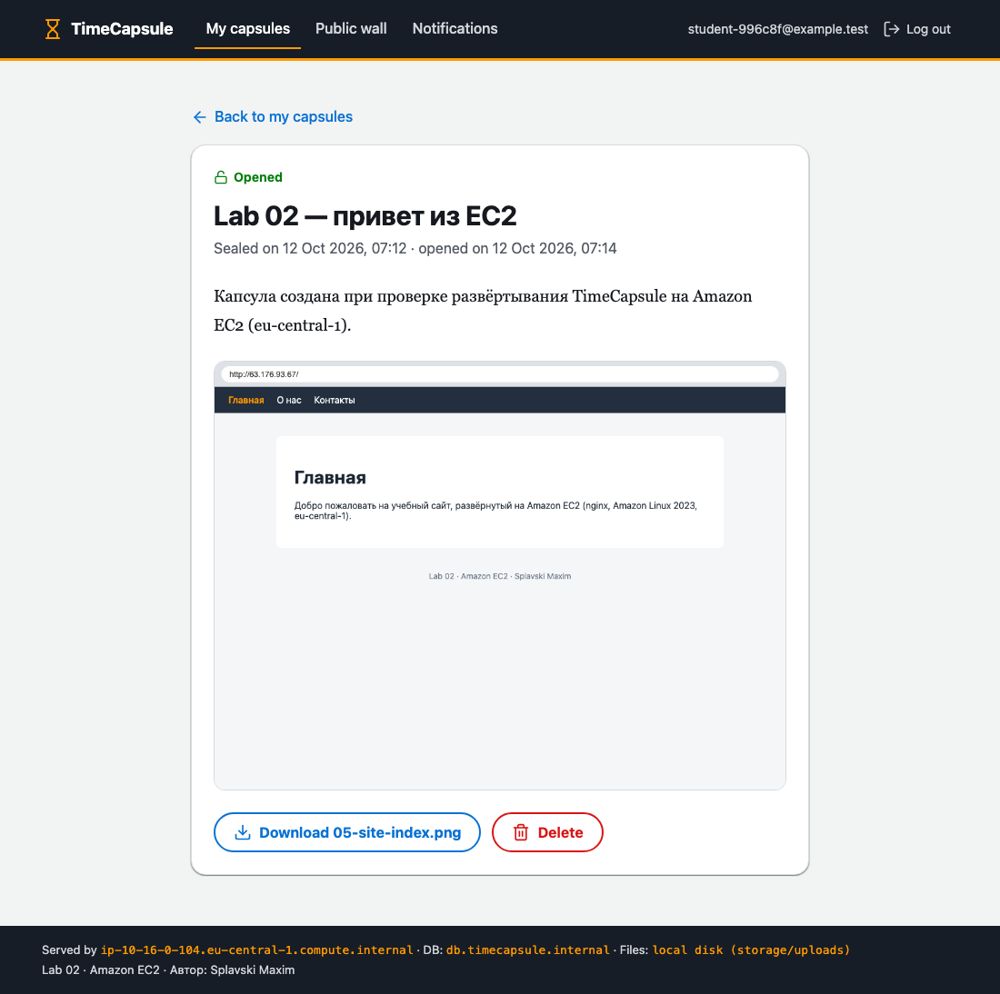
_Капсула из ЛР2 с вложением на месте; в подвале `Served by ip-10-16-0-104 · DB: db.timecapsule.internal`._

Образ `timecapsule-dev-app-lab2` отменён (`Deregister`), снимок `snap-045418d3235f5e8c5` удалён.

> **Файлы, которые пользователи прикрепили к капсулам, переехали вместе с образом, а не вместе с базой. Где они лежат? Что с ними будет, если `app-server` удалить?**
> Они лежат на корневом томе EBS `app-server` в `/var/www/timecapsule/storage/uploads`, а в базе хранятся только ссылки на них. При `Terminate` корневой том по умолчанию удаляется, и файлы пропадут, хотя записи капсул в базе на `db-server` останутся с битыми ссылками. Поэтому файлы надо выносить в общее хранилище (S3) или хотя бы делать снапшоты тома.

### Задание 13. Деплой и обслуживание

**1. Новая версия.** Коммит `74f876f Show LR3 in footer`, деплой одной командой `ssh app ./deploy.sh`.

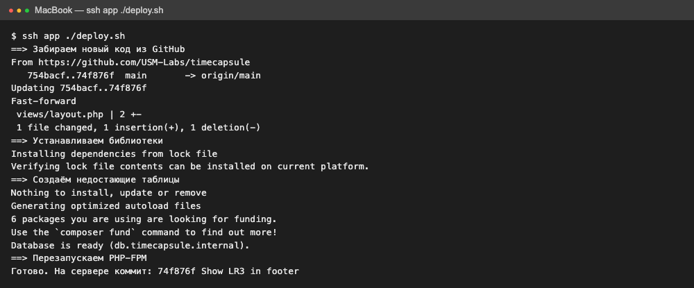
_`ssh app ./deploy.sh` через bastion: на сервере коммит `74f876f`._

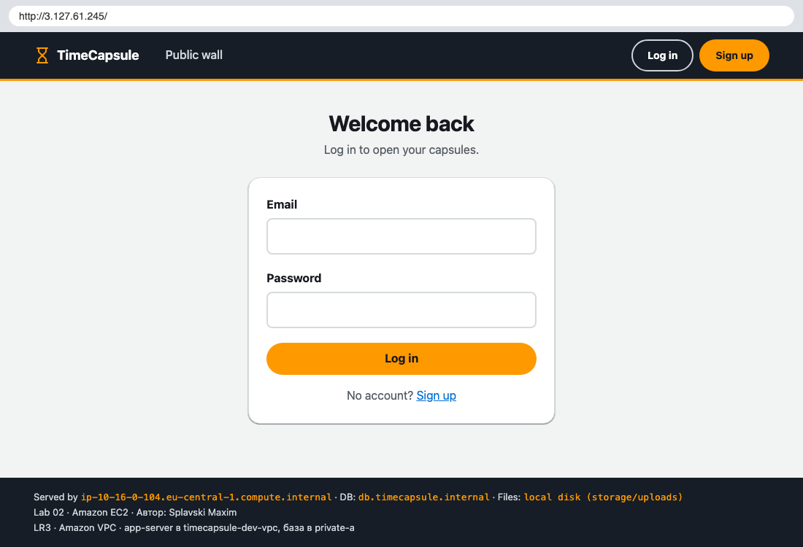
_Строка «LR3 · Amazon VPC ...» в подвале по Elastic IP._

> **Почему в самом `deploy.sh` ничего менять не пришлось?**
> Скрипт работает на самом сервере и использует только локальные пути (`/var/www/timecapsule`), `git pull` по HTTPS через Internet Gateway и `.env`, где уже прописана новая база. Как добраться до сервера (через bastion), решает `~/.ssh/config` на моём компьютере, а не скрипт, поэтому команда `ssh app ./deploy.sh` выглядит так же, как в ЛР2.

**2. Отказ базы.**

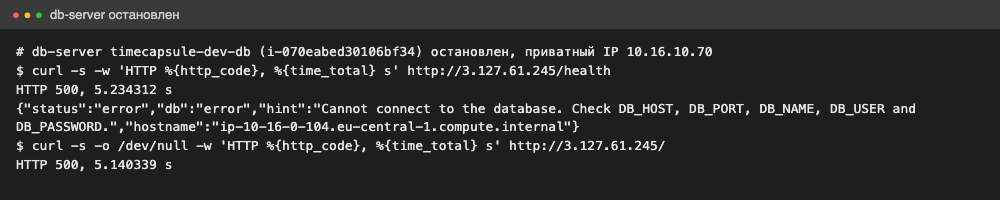
_`db-server` остановлен: `/health` → `500 {"db":"error"}` через ~5 с, главная страница → 500._

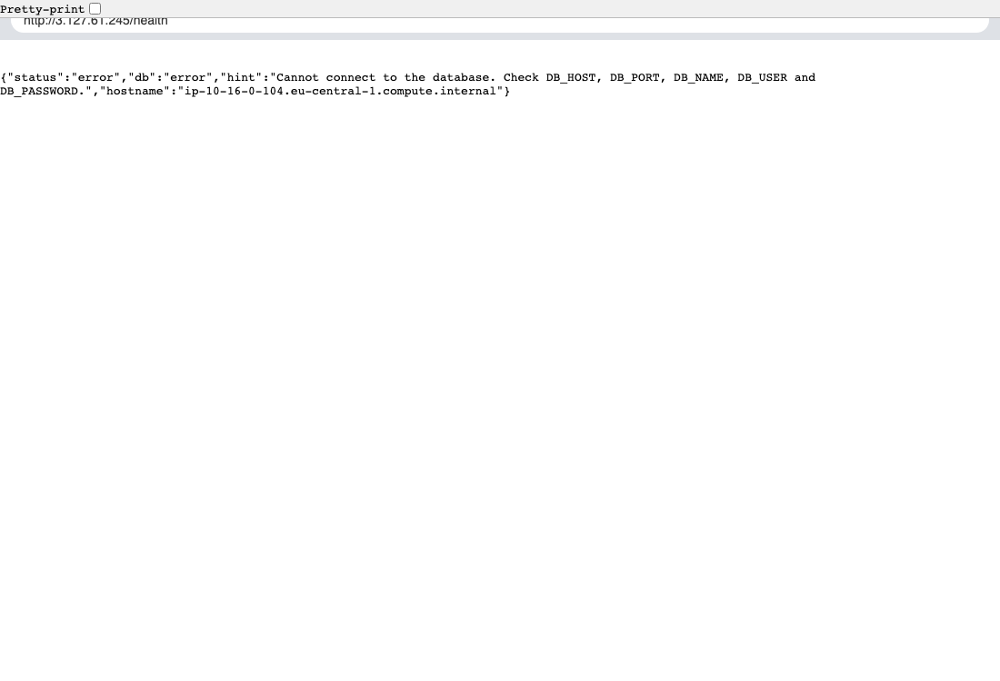
_Ответ `/health` в браузере при остановленной базе._

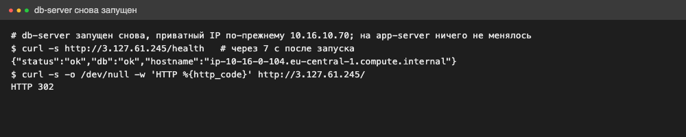
_После запуска `db-server` приложение восстановилось само через ~7 с; приватный IP тот же `10.16.10.70`._

> **Что показал `/health` и почему? Изменился ли приватный адрес `db-server` после остановки и запуска?**
> `/health` вернул HTTP 500 и `"db":"error"`, потому что он выполняет запрос `SELECT COUNT(*) FROM users`, а подключиться к `db.timecapsule.internal:5432` не удалось (сервер выключен, приложение ждёт таймаут подключения ~5 с). Приватный адрес не изменился: он закреплён за сетевым интерфейсом в подсети и сохраняется при Stop/Start, меняется только публичный. Поэтому A-запись и `.env` трогать не пришлось.

**3. Обновление пакетов на `db-server` (вариант B).**

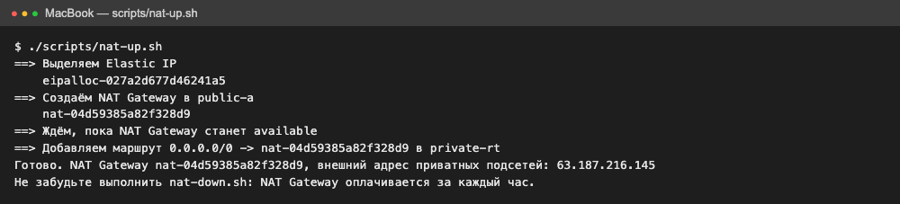
_`scripts/nat-up.sh`: Elastic IP, NAT Gateway в `public-a`, ожидание `available`, маршрут в `private-rt`._

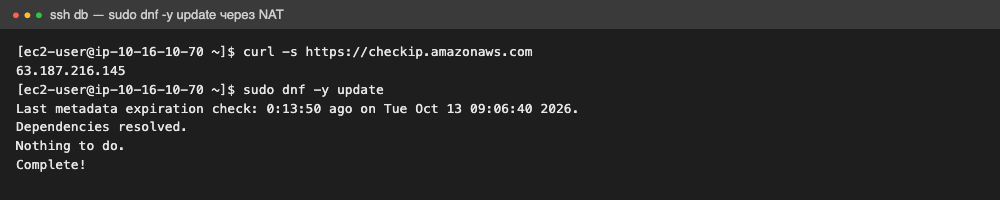
_На `db-server` внешний адрес = Elastic IP NAT; `sudo dnf -y update` проходит (`Nothing to do`: пакеты уже обновлялись в задании 6)._

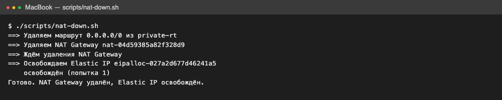
_`scripts/nat-down.sh`: маршрут удалён, NAT удалён и дождались `deleted`, Elastic IP освобождён._

Идентификаторы шлюза и адреса скрипты хранят в `scripts/nat-state.env`, файл добавлен в [`.gitignore`](../../.gitignore).

> **Почему `nat-down.sh` должен освобождать Elastic IP только после того, как NAT Gateway удалён?**
> Пока NAT Gateway существует, Elastic IP привязан к его сетевому интерфейсу, и `release-address` завершится ошибкой (адрес используется). Даже после перехода шлюза в `deleted` AWS отпускает адрес не мгновенно, поэтому скрипт ждёт `nat-gateway-deleted` и повторяет попытку с паузой. Если сначала потерять ID адреса или прервать скрипт, Elastic IP останется выделенным и будет оплачиваться.

### Задание 14. Архитектура и решение

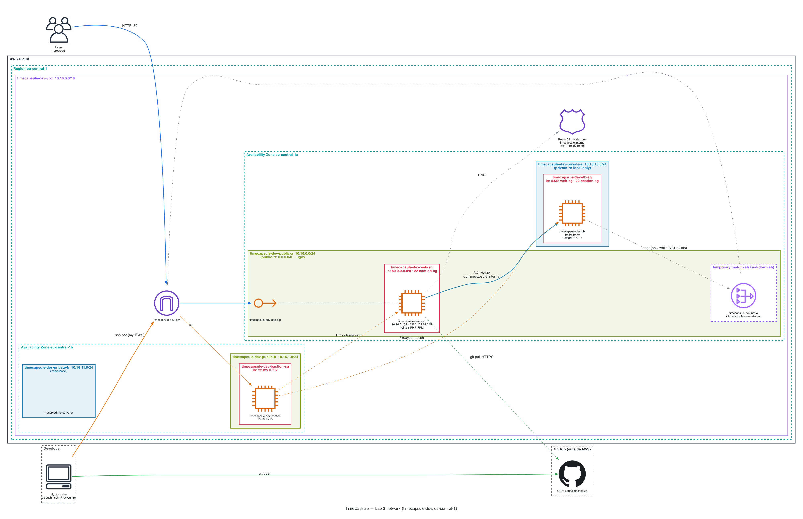
_Схема: пользователи, мой компьютер и GitHub вне AWS; `timecapsule-dev-vpc` в `eu-central-1`, две AZ и четыре подсети, `timecapsule-dev-igw`, `bastion`/`app`/`db` с их Security Group, Elastic IP, приватная зона Route 53 и временный NAT Gateway (пунктир)._

ADR: [docs/adr/0002-database-placement.md](../adr/0002-database-placement.md) - сравнение базы на сервере приложения, в публичной и в приватной подсети (и RDS как следующий шаг); обновления через временный NAT и его стоимость; зачем Elastic IP и что изменит балансировщик.

---

## Итог

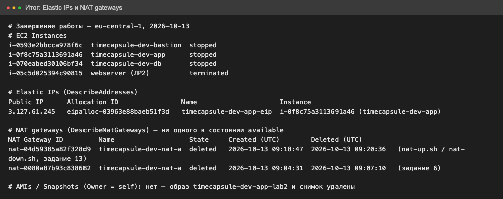
_После завершения: `webserver` ЛР2 завершён, `bastion`, `app-server`, `db-server` остановлены; в `Elastic IPs` только `timecapsule-dev-app-eip`; оба NAT Gateway в состоянии `deleted`; образов и снимков нет._

VPC, подсети, таблицы маршрутов и Security Group оставлены для следующих работ.

## Контрольные вопросы

**1. Как проходит запрос пользователя от браузера до базы данных? Какие маршруты и правила фильтрации он проходит?**
Браузер обращается к Elastic IP `3.127.61.245:80`. Internet Gateway переводит его в приватный адрес `app-server` `10.16.0.104`; на входе в `public-a` пакет проверяет Network ACL (правило 100 allow), затем `web-sg` (80 от `0.0.0.0/0`). nginx передаёт запрос в PHP-FPM, приложение резолвит `db.timecapsule.internal` через DNS VPC в `10.16.10.70` и открывает соединение на 5432: оно идёт по маршруту `local`, через Network ACL `private-a` и `db-sg` (5432 от `web-sg`), а PostgreSQL проверяет `pg_hba.conf` (пользователь, база, подсеть `10.16.0.0/24`) и пароль. Ответы возвращаются тем же путём; Security Group stateful и ответ пропускают автоматически.

**2. Злоумышленник знает приватный IP `db-server`. Что ему нужно получить, чтобы подключиться к базе?**
Сам по себе приватный адрес из интернета бесполезен: до него нет маршрута. Нужно оказаться внутри VPC на машине с группой `web-sg` в подсети `10.16.0.0/24`, то есть взломать `app-server` (или получить доступ к AWS-аккаунту и поменять сеть). Кроме того, нужно знать логин и пароль пользователя `timecapsule` (они в `.env` на `app-server`). Поэтому самое ценное - сам `app-server`, его `.env` и SSH-ключ.

**3. Чем временный NAT Gateway лучше постоянного и какие неудобства он создаёт?**
Он дешевле (центы за сеанс обновления вместо ~$38 в месяц) и безопаснее: большую часть времени у `db-server` вообще нет пути в интернет, вредоносный код не сможет выгрузить данные или скачать что-то. Неудобства: обновления нужно запускать вручную (скриптами), во время работы шлюза нужно следить, чтобы его не забыли удалить, а пакеты нельзя поставить в любой момент, например при срочной уязвимости ночью; при каждом подъёме меняется внешний IP.

**4. Как изменится схема, если приложение должно пережить отказ зоны `eu-central-1a`? Каких ресурсов не хватает?**
Сейчас и `app-server`, и `db-server`, и NAT находятся в `eu-central-1a`, поэтому отказ зоны остановит всё. Нужны: второй сервер приложения в `public-b` (а лучше Auto Scaling Group в двух зонах), Application Load Balancer в `public-a` и `public-b` вместо Elastic IP, реплика базы в `private-b` с автоматическим переключением (проще всего RDS Multi-AZ), общее хранилище файлов вместо локального диска (S3), а при постоянном NAT - по шлюзу в каждой зоне. Подсети `public-b` и `private-b` для этого уже заложены в план адресов.

## Источники

1. Задание: [MSU-Courses/cloud-computing, Lab 03](https://github.com/MSU-Courses/cloud-computing/tree/main/Lab/03_Cloud_Networking).
2. Лекция 5 «Виртуальные сети в облаке. Amazon VPC», Hands-on 5.1.
3. [Amazon VPC User Guide](https://docs.aws.amazon.com/vpc/latest/userguide/): subnet sizing (reserved addresses), route tables, NAT gateways, network ACLs, security groups.
4. [Amazon Route 53 Developer Guide: private hosted zones](https://docs.aws.amazon.com/Route53/latest/DeveloperGuide/hosted-zones-private.html).
5. [Amazon EC2: Elastic IP addresses, AMIs](https://docs.aws.amazon.com/AWSEC2/latest/UserGuide/), [AWS public IPv4 pricing](https://aws.amazon.com/vpc/pricing/).
6. [PostgreSQL 16: pg_hba.conf](https://www.postgresql.org/docs/16/auth-pg-hba-conf.html), [pg_dump](https://www.postgresql.org/docs/16/app-pgdump.html).
