# Лабораторная работа №4. Облачные хранилища. Amazon S3

- **Студент:** Splavski Maxim
- **Группа:** I2402
- **Специальность:** Informatică
- **Уровень:** продвинутый (Часть 1 + Часть 2, задания 1-14)
- **Репозиторий:** https://github.com/USM-Labs/timecapsule
- **Изменения модуля хранения:** коммит [`c647b87`](https://github.com/USM-Labs/timecapsule/commit/c647b87) - [`src/storage.php`](../../src/storage.php), `composer.json`/`composer.lock`, `.env.example`, подвал `views/layout.php`
- **ADR:** [docs/adr/0003-attachment-storage.md](../adr/0003-attachment-storage.md)
- **Предыдущие отчёты:** [ЛР2](../../README.md), [ЛР3](../lab3/README.md)

Все ресурсы в `eu-central-1`, теги `Name`, `Project=timecapsule`, `Environment=dev`, `Owner=maxsplavski`, `Lab=lab4`.

| Ресурс                   | Имя                                   | Где используется                                      |
| ------------------------ | ------------------------------------- | ----------------------------------------------------- |
| Бакет S3                 | `timecapsule-dev-uploads-maxsplavski` | вложения капсул, префикс `uploads/`                   |
| Правило жизненного цикла | `timecapsule-dev-noncurrent`          | только `uploads/`                                     |
| Политика IAM             | `timecapsule-dev-app-s3`              | v1 (с `ListBucket`), v2 по умолчанию (без него)       |
| Тестовая роль            | `timecapsule-dev-s3-tester`           | доверие: этот аккаунт; права: `timecapsule-dev-app-s3` |
| Роль сервера             | `timecapsule-dev-app-role`            | доверие: `ec2.amazonaws.com`, привязана к `timecapsule-dev-app` |

> **Как сделаны скриншоты.** Всё в Части 1 и IAM в Части 2 сделано **в консоли AWS** в Chrome под
> IAM-пользователем `maxsplavski_student`; команды CLI - в **AWS CloudShell** (скриншоты из Chrome).
> Команды на `app-server` выполнялись с моего компьютера через bastion (`ssh app`) - это реальный вывод,
> отрисованный в нейтральное окно терминала. Сверху страниц приложения и S3 добавлена строка адреса.
> В подписанных URL на скриншотах `X-Amz-Signature`, `X-Amz-Credential` и `X-Amz-Security-Token`
> заменены на `...`, а сами ссылки давно истекли. Ключей доступа IAM в работе нет.

---

## Часть 1. Базовый уровень

### Задание 1. Бакет и объекты в консоли

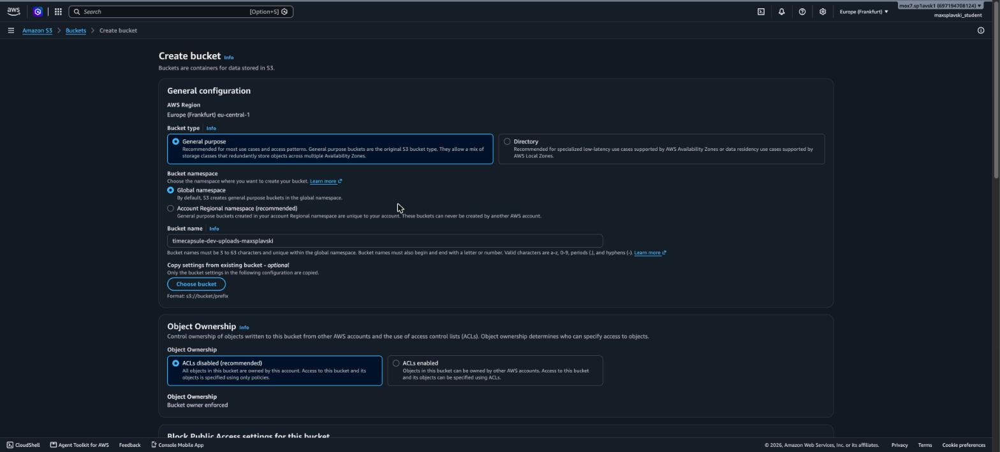
_`Create bucket`: `General purpose`, глобальное пространство имён, имя `timecapsule-dev-uploads-maxsplavski`, `ACLs disabled (Bucket owner enforced)`._

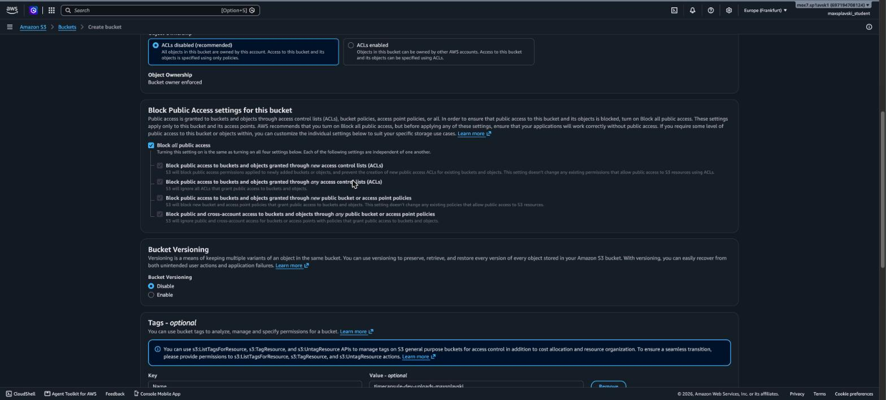
_`Block all public access` включён (все четыре настройки), `Bucket Versioning: Disable`._

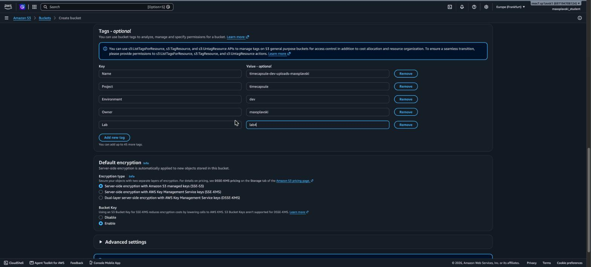
_Пять обязательных тегов, шифрование `SSE-S3`._

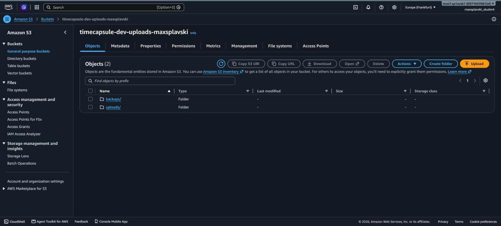
_Корень бакета: «папки» `backups/` и `uploads/`._

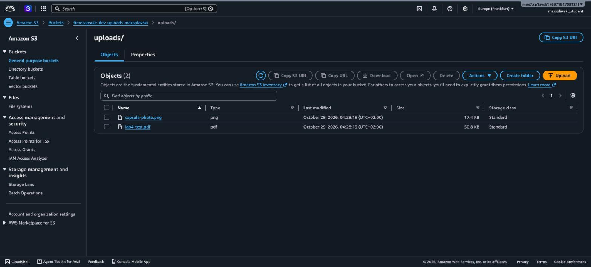
_`uploads/`: картинка `capsule-photo.png` и PDF `lab4-test.pdf` (в `backups/` - `backup-note.txt`)._

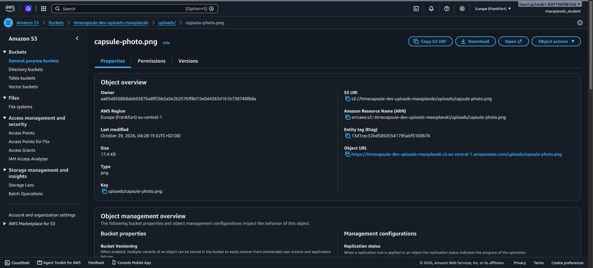
_Свойства картинки: ключ `uploads/capsule-photo.png`, ETag `13d1cec32bd58925541795abf5169b76`, Object URL._

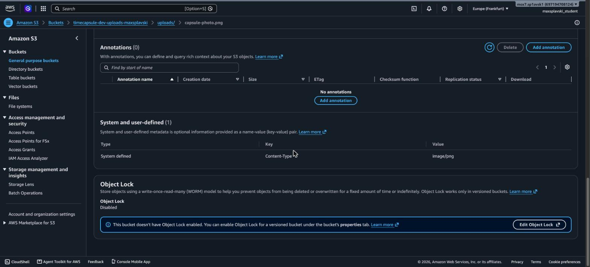
_Системные метаданные: `Content-Type: image/png`._

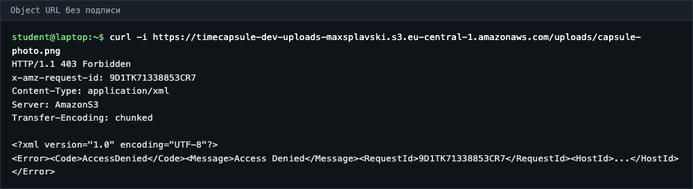
_Object URL без подписи: `403 Forbidden`, `AccessDenied` (Chrome не даёт снять свой просмотр XML, поэтому тот же запрос снят через `curl`)._

> **Какой ключ у картинки? Почему `Object URL` не открывается, хотя вы владелец бакета? Что на самом деле создала кнопка `Create folder`?**
> Ключ - `uploads/capsule-photo.png`: в S3 нет каталогов, путь это просто часть имени объекта. Object URL открывается как анонимный запрос: браузер не знает, что я владелец, и не подписывает запрос моими учётными данными (вход в консоль - это сессия консоли, а не подпись запросов к S3). Анонимного доступа нет: ACL отключены, политики с `Allow` для всех нет, и Block Public Access её всё равно не дал бы добавить. Кнопка `Create folder` создала пустой объект с ключом `uploads/` (0 байт, его видно в `ls` ниже), чтобы консоль показывала «папку» до загрузки файлов.

### Задание 2. Объекты из командной строки

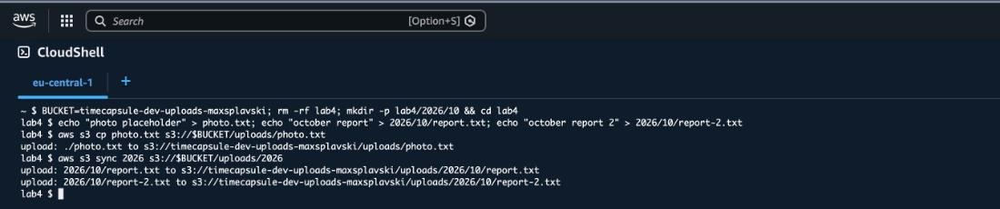
_CloudShell: `cp` одного файла и `sync` папки `2026`._

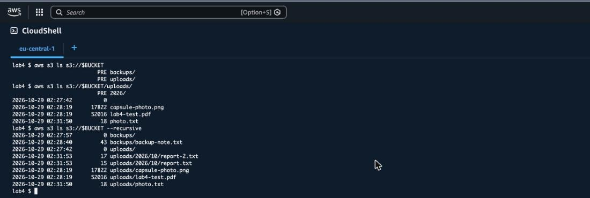
_Три варианта `aws s3 ls`._

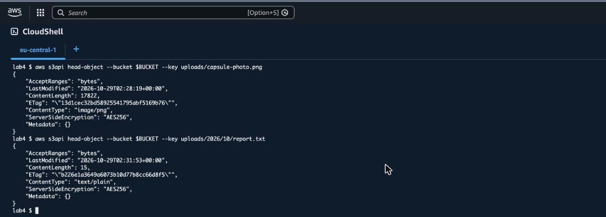
_`head-object` для картинки (`image/png`) и `uploads/2026/10/report.txt` (`text/plain`)._

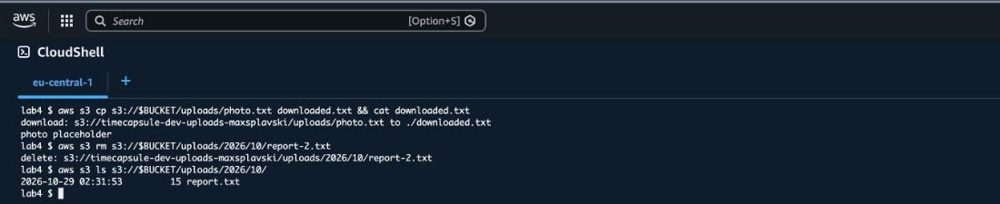
_Скачивание `photo.txt` и удаление `report-2.txt`._

> **Почему первая команда `ls` показывает `PRE uploads/` и `PRE backups/`, а третья показывает полные ключи? Какой `Content-Type` получил `report.txt`, хотя вы его не указывали?**
> `aws s3 ls s3://bucket` запрашивает список с разделителем `/`, и S3 сворачивает ключи с общим началом до первого `/` в `CommonPrefixes` - CLI выводит их как `PRE`. С `--recursive` разделителя нет, и S3 возвращает все ключи целиком, в том числе пустые объекты-«папки» `uploads/` и `backups/`. `report.txt` получил `Content-Type: text/plain`: AWS CLI сам угадывает тип по расширению файла (модуль `mimetypes`) и передаёт его в `PutObject`.

### Задание 3. Политика бакета: только HTTPS

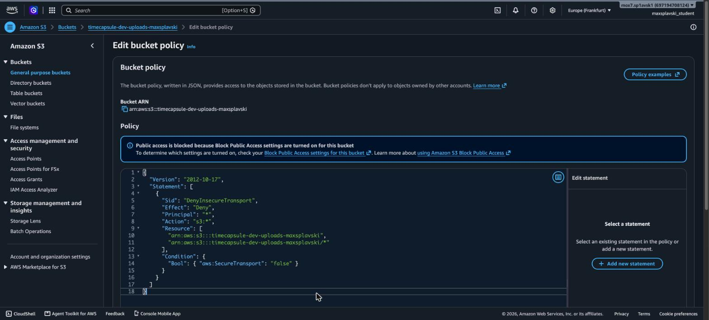
_`Permissions` → `Bucket policy`: `Deny` для `"Principal": "*"`, `s3:*` на бакет и `/*`, если `aws:SecureTransport` = `false`. Файл: [bucket-policy.json](bucket-policy.json)._

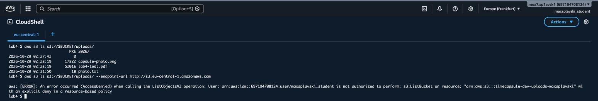
_По HTTPS список виден, по `http://` - `AccessDenied ... with an explicit deny in a resource-based policy`._

> **Почему вторая команда получает `AccessDenied`, хотя у вас права администратора? Почему Block Public Access не помешал сохранить политику с `"Principal": "*"`?**
> В IAM явный `Deny` всегда сильнее любого `Allow`. `AdministratorAccess` даёт `Allow` в политике пользователя, но политика бакета с `Deny` для всех участников при `aws:SecureTransport = false` срабатывает раньше, и запрос по `http://` отклоняется для всех, включая root аккаунта. Block Public Access блокирует только политики, которые **дают** публичный доступ (`Allow` для `*`). Политика из одного `Deny` никому ничего не открывает, поэтому она не считается публичной и сохраняется.

### Задание 4. Версионирование и защита от удаления

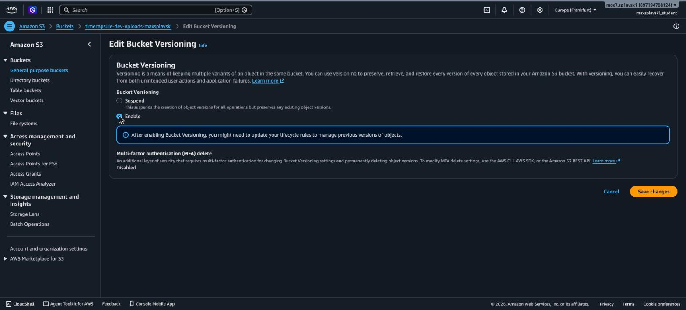
_`Properties` → `Bucket Versioning` → `Enable`._

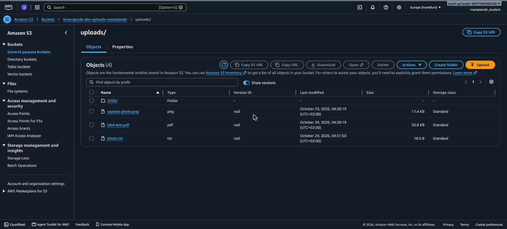
_`Show versions`: у файлов, загруженных до включения версионирования, `Version ID = null`._


_`notes.txt` загружен дважды (`v1`, потом `v2`): две версии с идентификаторами._

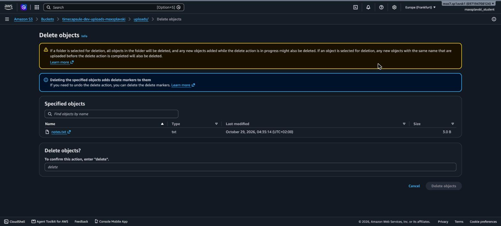
_Удаление при выключенном `Show versions`: консоль предупреждает, что добавит маркер удаления, подтверждение словом `delete`._

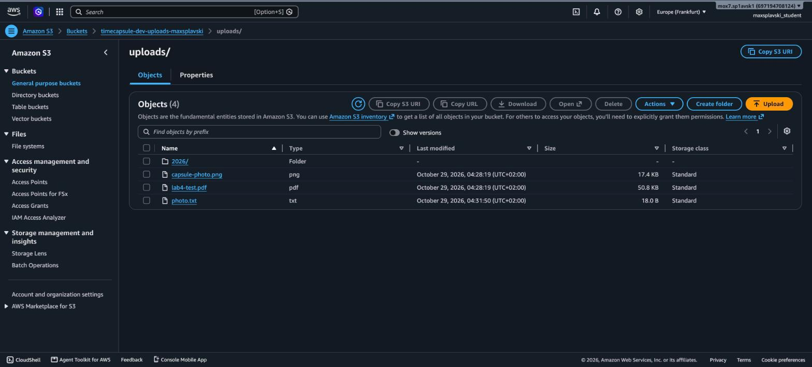
_`notes.txt` пропал из обычного списка._

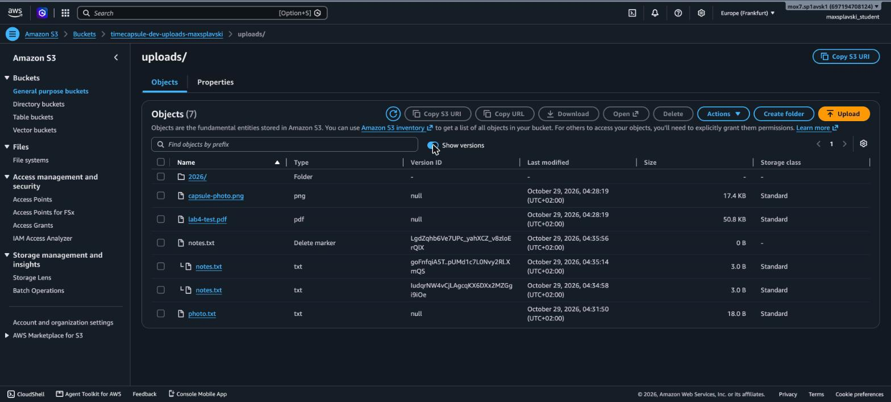
_С `Show versions`: сверху `Delete marker`, под ним обе версии на месте._

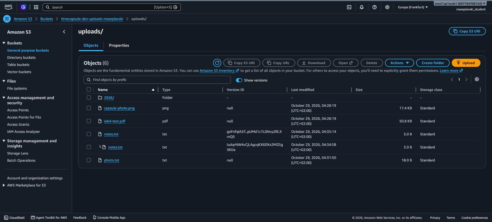
_Маркер удалён - `notes.txt` вернулся, текущая версия `v2` (`aws s3 cp ... -` вернул `v2`)._

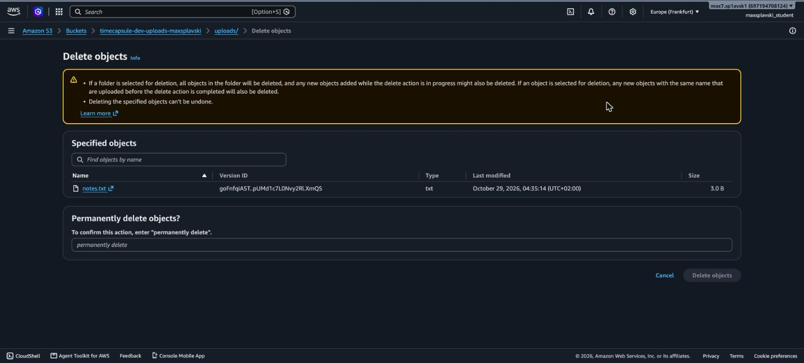
_Удаление конкретной версии `v2`: `Permanently delete objects?`, «can't be undone», подтверждение `permanently delete`._

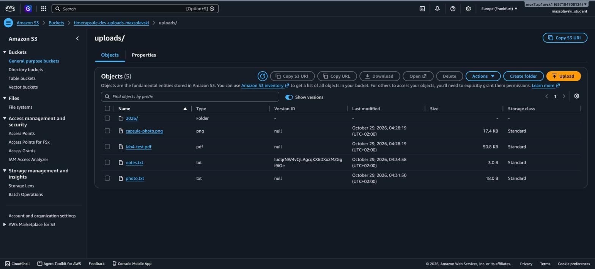
_Осталась одна версия, текущей стала `v1` (содержимое проверено: `v1`)._

> **Чем удаление в шаге 3 отличается от удаления в шаге 5? Какое из них можно отменить? Какой из двух способов защищает от случайного удаления, а какой нужно запрещать приложению?**
> В шаге 3 был `DeleteObject` без `VersionId`: S3 ничего не удалил, а добавил маркер удаления как новую текущую версию, и объект просто скрылся. Это отменяется удалением маркера (шаг 4). В шаге 5 был `DeleteObject` с `VersionId` (`s3:DeleteObjectVersion`): конкретная версия удалена навсегда, вернуть её нельзя. Первый способ и есть защита от случайного удаления; второй нужно запрещать приложению - что и сделано в политике задания 7.

### Задание 5. Правило жизненного цикла

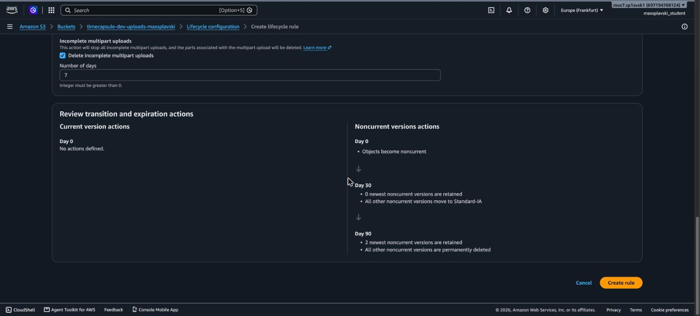
_`Review transition and expiration actions`: день 30 - неактуальные версии в Standard-IA, день 90 - удаление всех, кроме 2 самых новых неактуальных._

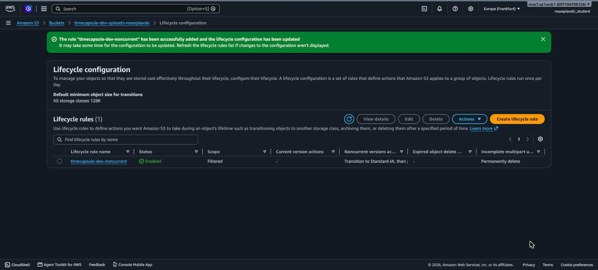
_Правило `timecapsule-dev-noncurrent` `Enabled`, `Scope: Filtered` (префикс `uploads/`), незавершённые multipart-загрузки удаляются (7 дней)._

> **Как поведёт себя правило для файла, который перезаписывали 10 раз за неделю? Какие версии и когда окажутся в Standard-IA, какие будут удалены? Почему наши маленькие тестовые файлы в Standard-IA не попадут? Что такое незавершённая загрузка частями и почему за неё приходится платить?**
> Будет 1 текущая версия и 9 неактуальных; каждая неактуальна с момента, когда её перезаписали. Через 30 дней после этого момента каждая из 9 переходит в Standard-IA (у перехода я не задавал `newer versions to retain`). Через 90 дней удаляются те неактуальные, у которых есть больше двух более новых неактуальных: удалятся 7 самых старых, а 2 последние прежние версии плюс текущая останутся навсегда (пока их не перезапишут). Объекты меньше 128 КБ по умолчанию не переходят в другие классы (`TransitionDefaultMinimumObjectSize = all_storage_classes_128K`): для Standard-IA плата считается минимум за 128 КБ и за каждый переход, мелкие файлы стали бы дороже. Незавершённая multipart-загрузка - это `CreateMultipartUpload`, после которого уже загружены части, но не было `Complete` или `Abort` (обрыв сети, упавший клиент). Части хранятся и оплачиваются как обычные данные, но в списке объектов не видны; правило через 7 дней их удаляет.

### Задание 6. Подписанные URL

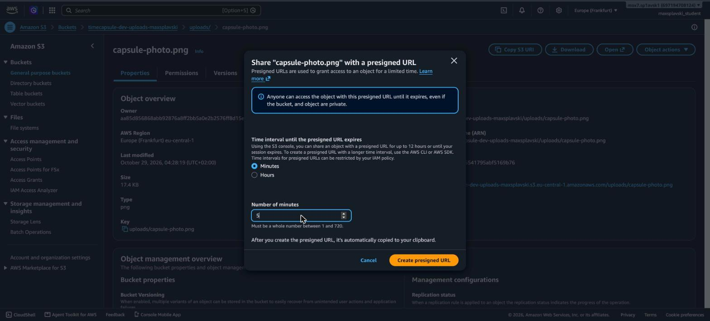
_`Object actions` → `Share with a presigned URL`, 5 минут._

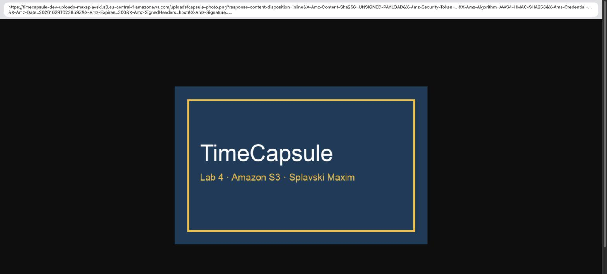
_Ссылка открыта в браузере вне консоли: картинка отдаётся (`X-Amz-Expires=300`)._

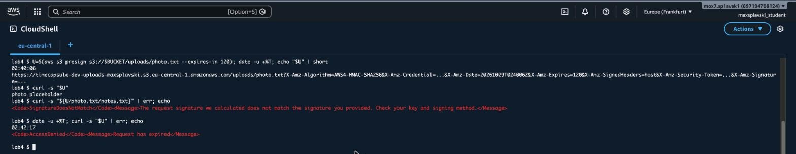
_CloudShell: ссылка на `uploads/photo.txt` на 120 с (02:40:06 UTC) - файл скачивается; та же ссылка с `notes.txt` вместо `photo.txt` - `SignatureDoesNotMatch`; через 2 минуты (02:42:17) - `AccessDenied: Request has expired`._

> **Какие ошибки вернул S3 в шагах 3 и 4? Почему нельзя получить другой файл, просто поменяв ключ в ссылке? Обращалась ли команда `aws s3 presign` к S3, когда создавала ссылку?**
> Шаг 3 - `403 SignatureDoesNotMatch`, шаг 4 - `403 AccessDenied` с сообщением `Request has expired`. Подпись (`X-Amz-Signature`) - это HMAC-SHA256 от строки запроса, в которую входят метод, бакет, ключ, время, срок и параметры. S3 пересчитывает её с секретным ключом владельца учётных данных; при другом ключе объекта подпись не совпадёт, а подобрать новую без секретного ключа невозможно. `aws s3 presign` к S3 не обращался: ссылка вычисляется локально из учётных данных CLI. Поэтому он даже не проверяет, существует ли объект и есть ли права - это проверит S3 при открытии ссылки.

После Части 1 папка `lab4` в CloudShell удалена (`cd ~ && rm -rf lab4`), бакет оставлен.

---

## Часть 2. Продвинутый уровень

### Задание 7. Политика приложения

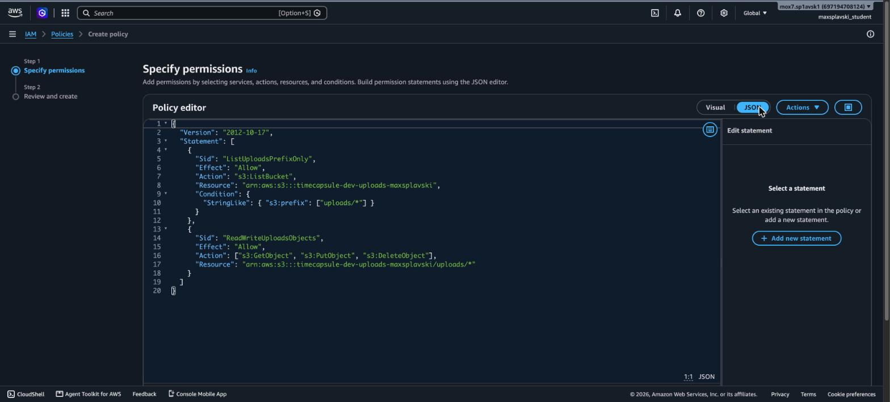
_`IAM` → `Policies` → `Create policy` → `JSON`. Файл: [app-policy.json](app-policy.json)._

```json
{
  "Version": "2012-10-17",
  "Statement": [
    {
      "Sid": "ListUploadsPrefixOnly",
      "Effect": "Allow",
      "Action": "s3:ListBucket",
      "Resource": "arn:aws:s3:::timecapsule-dev-uploads-maxsplavski",
      "Condition": { "StringLike": { "s3:prefix": ["uploads/*"] } }
    },
    {
      "Sid": "ReadWriteUploadsObjects",
      "Effect": "Allow",
      "Action": ["s3:GetObject", "s3:PutObject", "s3:DeleteObject"],
      "Resource": "arn:aws:s3:::timecapsule-dev-uploads-maxsplavski/uploads/*"
    }
  ]
}
```

Политика создана с именем `timecapsule-dev-app-s3` и пятью тегами (`Lab=lab4`).

> **Почему `s3:ListBucket` относится к ресурсу "бакет", а `s3:GetObject` к ресурсу "объект"? Что произойдёт, если перепутать ARN в этих двух правилах?**
> Список объектов - операция над самим бакетом (`GET /?list-type=2` по адресу бакета), а чтение, запись и удаление - над конкретным объектом (`/uploads/<key>`). IAM сравнивает действие с типом ресурса: `ListBucket` применяется только к `arn:aws:s3:::bucket`, а `GetObject` - только к `arn:aws:s3:::bucket/key`. Если перепутать, правила станут бессмысленными: `ListBucket` на `.../uploads/*` и `GetObject` на ARN бакета не совпадут ни с одним запросом, и всё будет отклоняться неявным запретом (консоль IAM при этом предупреждает о несовместимом ресурсе).

### Задание 8. Проверка прав через тестовую роль

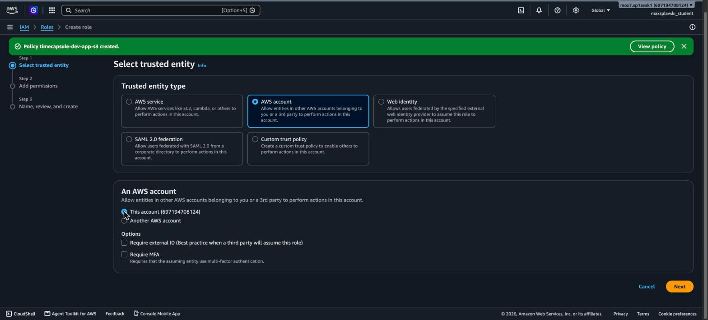
_Роль `timecapsule-dev-s3-tester`: `AWS account` → `This account (697194708124)`; права - только `timecapsule-dev-app-s3`, пять тегов._

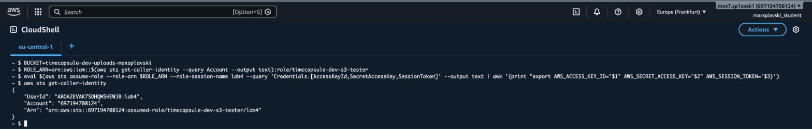
_CloudShell после `assume-role`: `arn:aws:sts::697194708124:assumed-role/timecapsule-dev-s3-tester/lab4`._

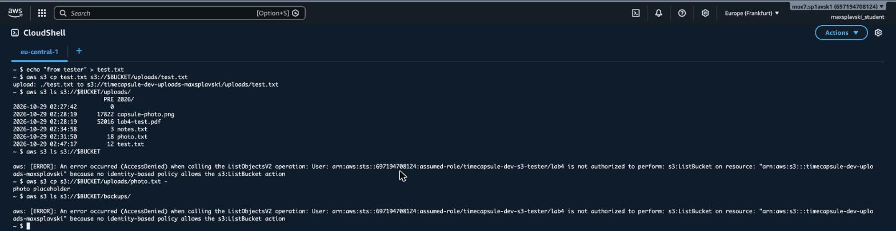
_Команды 1-5._

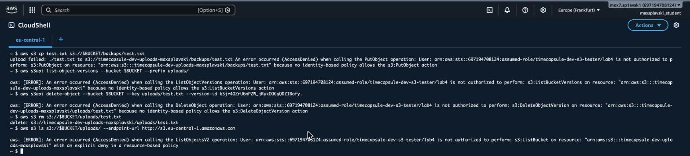
_Команды 6-10. `VersionId` для команды 8 (`kSjr4O2rU6nPZW_jRykOOGqQOZIBofy.`) взят из списка версий `uploads/test.txt`._

Колонку «Ожидаю» заполнил до запуска команд.

| №   | Команда                                                                                   | Ожидаю         | Получил                                                  | Какое правило сработало                          |
| --- | ----------------------------------------------------------------------------------------- | -------------- | -------------------------------------------------------- | ------------------------------------------------ |
| 1   | `aws s3 cp test.txt s3://$BUCKET/uploads/test.txt`                                        | разрешено      | разрешено (`upload: ./test.txt`)                         | разрешение в политике приложения (`PutObject`)   |
| 2   | `aws s3 ls s3://$BUCKET/uploads/`                                                         | разрешено      | разрешено (список `uploads/`)                            | разрешение в политике приложения (`ListBucket`, `prefix=uploads/`) |
| 3   | `aws s3 ls s3://$BUCKET`                                                                  | `AccessDenied` | `AccessDenied` (`s3:ListBucket`, no identity-based policy allows) | неявный запрет (пустой префикс не подходит под `uploads/*`) |
| 4   | `aws s3 cp s3://$BUCKET/uploads/photo.txt -`                                              | разрешено      | разрешено (`photo placeholder`)                          | разрешение в политике приложения (`GetObject`)   |
| 5   | `aws s3 ls s3://$BUCKET/backups/`                                                         | `AccessDenied` | `AccessDenied` (`s3:ListBucket`)                         | неявный запрет (префикс `backups/`)              |
| 6   | `aws s3 cp test.txt s3://$BUCKET/backups/test.txt`                                        | `AccessDenied` | `AccessDenied` (`s3:PutObject` на `backups/test.txt`)    | неявный запрет (ресурс вне `uploads/*`)          |
| 7   | `aws s3api list-object-versions --bucket $BUCKET --prefix uploads/`                       | `AccessDenied` | `AccessDenied` (`s3:ListBucketVersions`)                 | неявный запрет (другое действие)                 |
| 8   | `aws s3api delete-object --bucket $BUCKET --key uploads/test.txt --version-id <VersionId>` | `AccessDenied` | `AccessDenied` (`s3:DeleteObjectVersion`)                | неявный запрет (с `VersionId` нужно другое действие) |
| 9   | `aws s3 rm s3://$BUCKET/uploads/test.txt`                                                 | разрешено      | разрешено (`delete: s3://.../uploads/test.txt`)          | разрешение в политике приложения (`DeleteObject`) |
| 10  | `aws s3 ls s3://$BUCKET/uploads/ --endpoint-url http://s3.eu-central-1.amazonaws.com`     | `AccessDenied` | `AccessDenied` (`with an explicit deny in a resource-based policy`) | явный запрет в политике бакета (не HTTPS) |

Все результаты совпали с ожиданиями. После проверки - `unset AWS_ACCESS_KEY_ID AWS_SECRET_ACCESS_KEY AWS_SESSION_TOKEN`, `get-caller-identity` снова показывает `user/maxsplavski_student`.

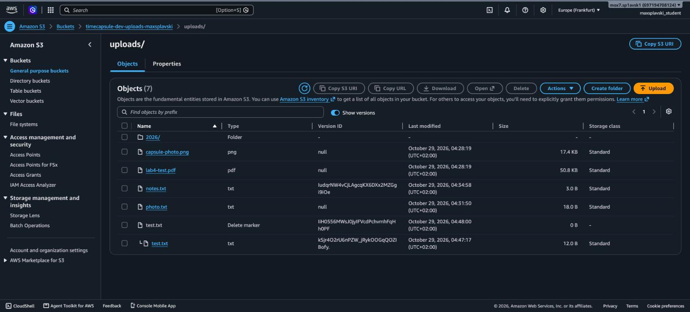
_Что стало с `test.txt` после команды 9: маркер удаления, версия `kSjr4O2r...` на месте._

> **Чем политика доверия роли отличается от политики прав? Что на самом деле произошло с `test.txt` после команды 9, и можно ли его восстановить? Сможет ли злоумышленник, получивший учётные данные приложения, уничтожить файлы пользователей без возможности восстановления? А если бы в политике было `"s3:*"`?**
> Политика доверия (trust policy) отвечает на вопрос «**кто** может взять роль» (`sts:AssumeRole` для `"AWS": "697194708124"` - любой участник моего аккаунта, у которого самого есть право на `AssumeRole`). Политика прав отвечает «**что** можно делать с ролью» (действия и ресурсы). После команды 9 объект не удалён: появился маркер удаления, версия с текстом `from tester` осталась, и её можно вернуть, удалив маркер (как в задании 4). Злоумышленник с правами приложения может перезаписывать и «удалять» файлы, но только маркерами и новыми версиями: `DeleteObjectVersion`, `PutBucketVersioning`, `PutLifecycleConfiguration` ему запрещены, и прежние версии остаются (до 90 дней по правилу жизненного цикла, две последние - навсегда). С `"s3:*"` он смог бы удалить все версии, отключить версионирование, поменять или удалить политику бакета, правило жизненного цикла и сам бакет - восстановить было бы нечего.

### Задание 9. Роль сервера

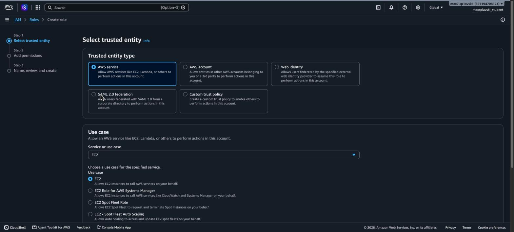
_Роль `timecapsule-dev-app-role`: `AWS service`, use case `EC2`; права - `timecapsule-dev-app-s3`, пять тегов._

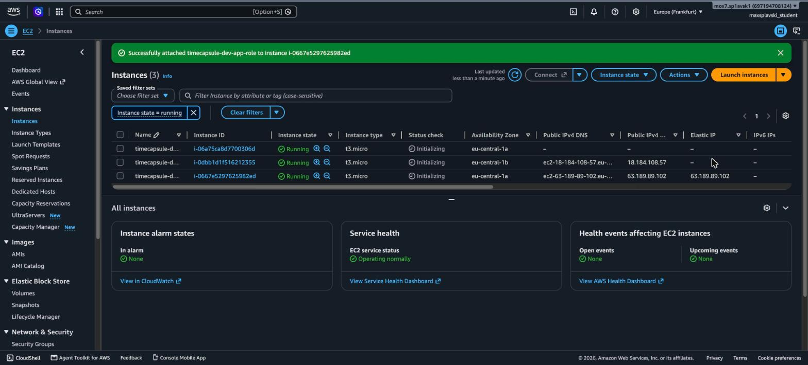
_`Actions` → `Security` → `Modify IAM role`: `Successfully attached timecapsule-dev-app-role to instance i-0667e5297625982ed`, без перезапуска (серверы запущены `start-lab.sh`)._

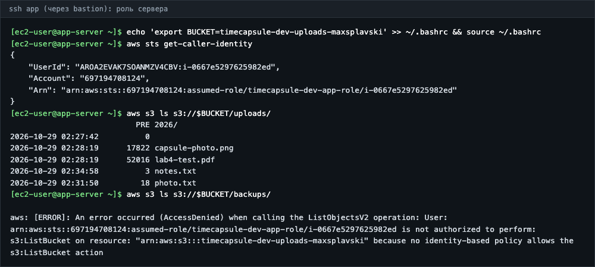
_На `app-server`: `assumed-role/timecapsule-dev-app-role/i-0667e5297625982ed`, `uploads/` виден, `backups/` - `AccessDenied`._

> **Где AWS CLI на сервере взял учётные данные, если вы не выполняли `aws configure` и не вызывали `assume-role`? Чем политика доверия этой роли отличается от тестовой? Почему такие учётные данные безопаснее ключа доступа в файле `.env`?**
> CLI (и SDK) проходит цепочку источников учётных данных: переменные окружения, `~/.aws`, а затем сервис метаданных экземпляра IMDS (`http://169.254.169.254`, IMDSv2). Через instance profile EC2 сама берёт роль и выдаёт экземпляру временные ключи с токеном, CLI их читает из `.../iam/security-credentials/timecapsule-dev-app-role`. Политика доверия этой роли разрешает `sts:AssumeRole` только сервису `"Service": "ec2.amazonaws.com"`, а у тестовой - участникам моего аккаунта; человек не может взять роль сервера, а EC2 - тестовую. Такие ключи живут несколько часов и обновляются автоматически, их не нужно хранить, копировать и ротировать вручную, они не попадут в git, в образ AMI или в бэкап `.env`. Утёкший ключ из `.env` работал бы, пока его не отзовут вручную.

### Задание 10. Перенос существующих файлов

На сервере проект лежит в `/var/www/timecapsule` (без `current/`). Файлы принадлежат `apache`, поэтому `sync` под `sudo`; служебный `.gitkeep` исключён.

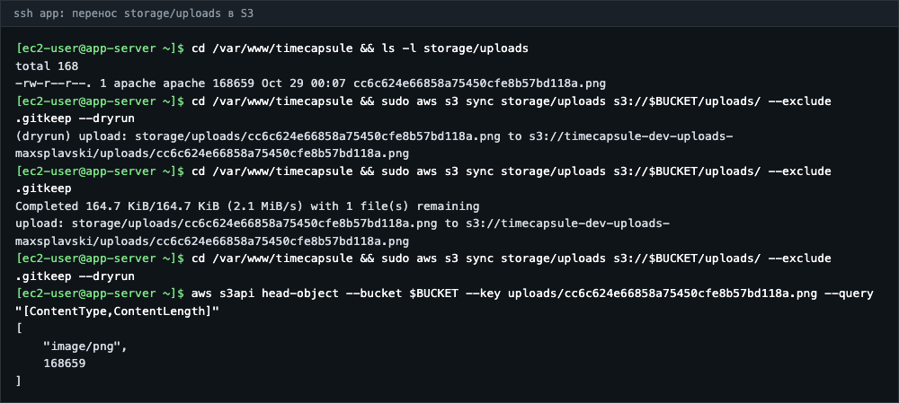
_`--dryrun` показывает один файл (картинка капсулы из ЛР2), затем настоящий `sync`, повторный `--dryrun` пуст, у объекта `ContentType: image/png`._

> **Хватило ли для `aws s3 sync` прав политики приложения? Какие из разрешённых действий использовала команда?**
> Хватило. `sync` сначала получает список объектов под `uploads/` (`s3:ListBucket` с `prefix=uploads/` - разрешено условием), сравнивает размеры и время, а затем загружает недостающие файлы (`s3:PutObject` на `uploads/*`). `GetObject` и `DeleteObject` не понадобились (без `--delete` sync ничего не удаляет).

### Задание 11. Модуль хранения на S3

Composer есть только на сервере: `composer require aws/aws-sdk-php` (`^3.402`) выполнен во временной копии репозитория на `app-server`, изменённые `composer.json` и `composer.lock` скопированы и закоммичены. В `.env.example` и `/var/www/timecapsule/.env` вместо `UPLOAD_DIR` теперь:

```text
S3_BUCKET=timecapsule-dev-uploads-maxsplavski
AWS_REGION=eu-central-1
```

Ключей `AWS_ACCESS_KEY_ID` / `AWS_SECRET_ACCESS_KEY` нигде нет. После правки `.env` - `sudo chgrp apache .env` (иначе PHP-FPM не прочитает файл).

Изменения: коммит [`c647b87`](https://github.com/USM-Labs/timecapsule/commit/c647b87), модуль [`src/storage.php`](../../src/storage.php):

| Функция            | Что делает                                                                                                                    |
| ------------------ | ----------------------------------------------------------------------------------------------------------------------------- |
| `s3_client()`      | один `Aws\S3\S3Client(['region' => AWS_REGION])` на запрос, учётные данные - из роли сервера                                 |
| `storage_save()`   | случайное имя, `putObject` с `SourceFile` и `ContentType = mime_content_type(tmp)` под ключом `uploads/<имя>`, возвращает имя |
| `storage_delete()` | `deleteObject` для `uploads/<имя>` (при версионировании - маркер удаления)                                                    |
| `storage_stream()` | `getCommand('GetObject', ...)` с `ResponseContentType` и `ResponseContentDisposition` (`inline`/`attachment`, исходное имя в `filename` и `filename*=UTF-8''...`), `createPresignedRequest(..., '+5 minutes')`, `302` на ссылку и `Cache-Control: no-store` |

Проверка прав на капсулу осталась в контроллере до вызова `storage_stream()`. Кроме модуля изменён только подвал: `Files: s3://timecapsule-dev-uploads-maxsplavski/uploads/`. Перед коммитом модуль проверен на сервере (загрузка, `headObject` → `text/plain`, удаление, генерация ссылки).

### Задание 12. Деплой и проверка

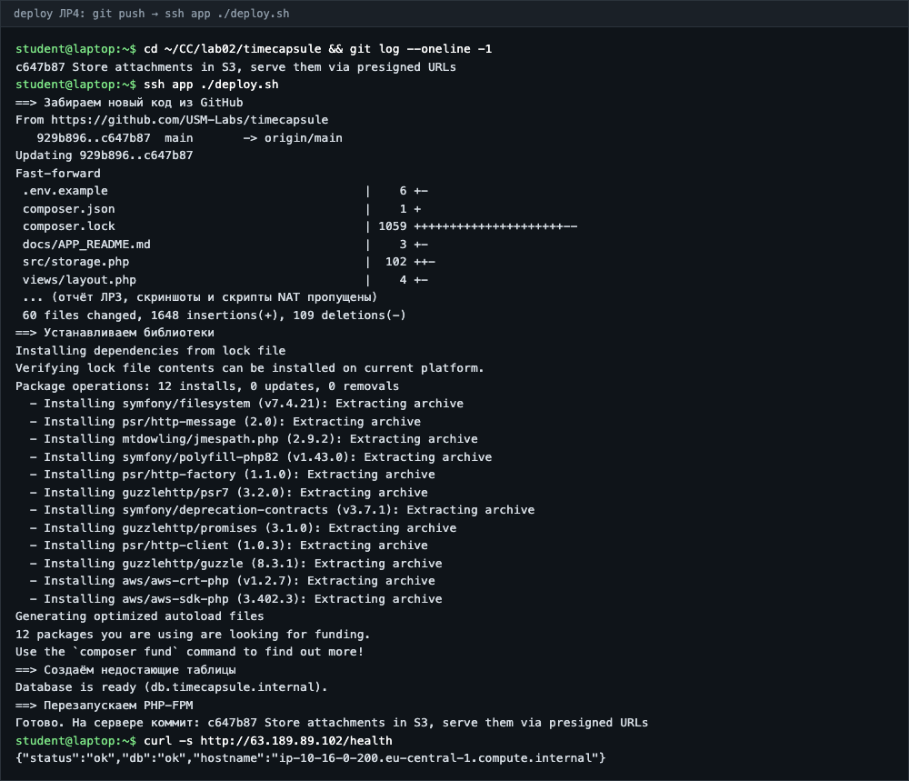
_`git push` → `ssh app ./deploy.sh`: `git pull`, `composer install` поставил `aws/aws-sdk-php 3.402.3` и зависимости, перезапуск PHP-FPM, `/health` - `ok`._

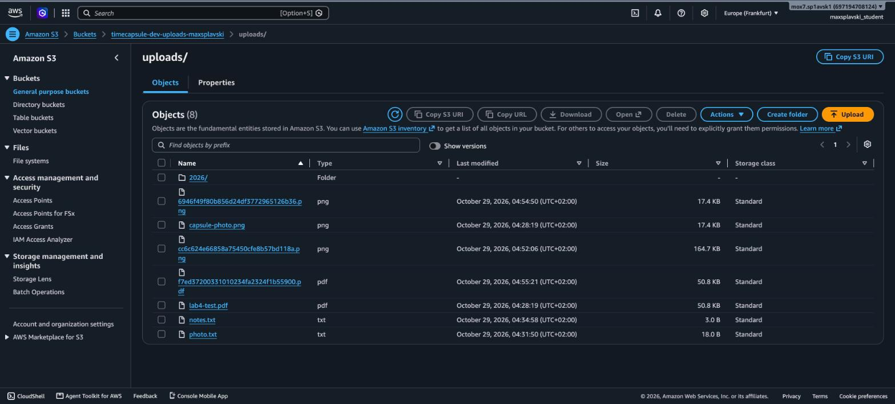
_После создания капсул с картинкой и PDF в `uploads/` появились `6946f49f....png` (04:54:50) и `f7ed3720....pdf` (04:55:21); рядом `cc6c624e....png` из `sync`._

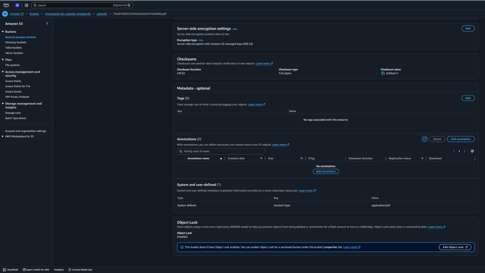
_У PDF `Content-Type: application/pdf` (у картинки `image/png`), шифрование SSE-S3._

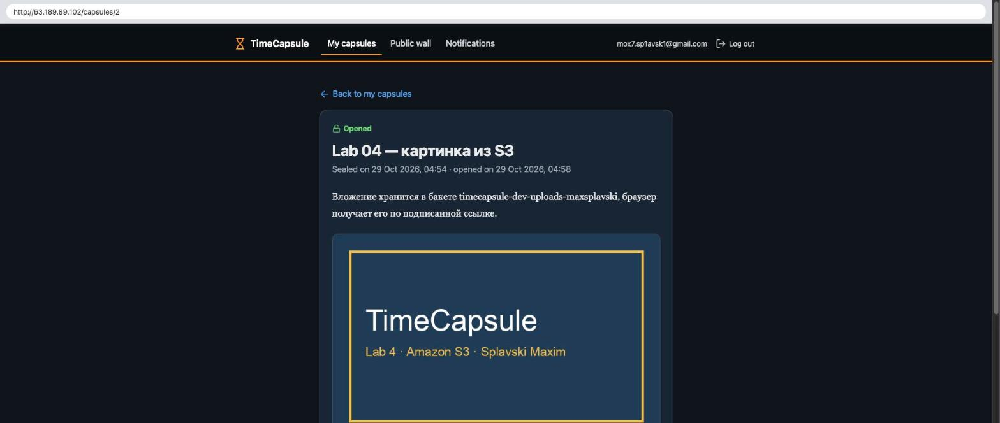
_Капсула «Lab 04 — картинка из S3» открылась в 04:58, картинка в странице._

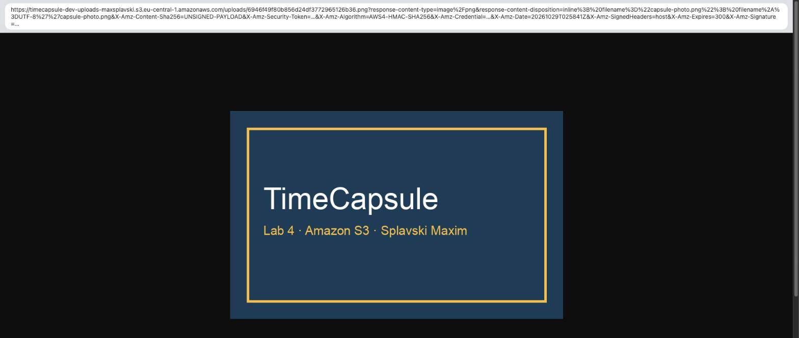
_Картинка в отдельной вкладке: адрес `timecapsule-dev-uploads-maxsplavski.s3.eu-central-1.amazonaws.com/uploads/6946f49f...png` с `response-content-type`, `response-content-disposition=inline; filename="capsule-photo.png"` и параметрами `X-Amz-*` (`X-Amz-Expires=300`, `X-Amz-Date=20261029T025841Z`)._

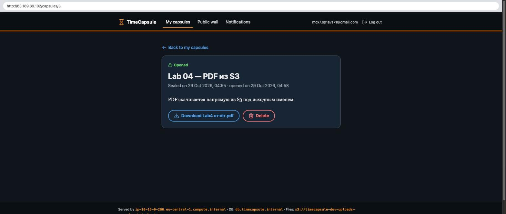
_Капсула с PDF: кнопка `Download Lab4 отчёт.pdf`._

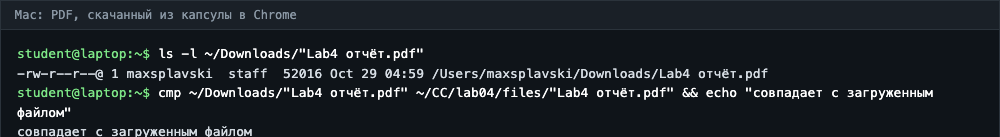
_Chrome сохранил файл как `Lab4 отчёт.pdf`, он совпадает с загруженным._

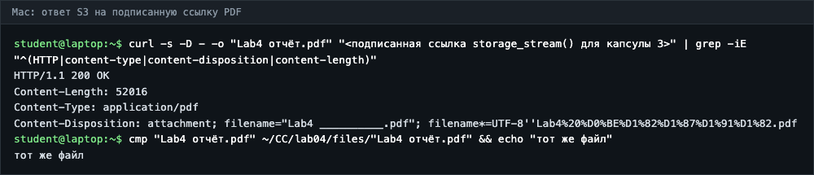
_Заголовки, которые S3 отдаёт по такой ссылке: `Content-Type: application/pdf`, `Content-Disposition: attachment; ... filename*=UTF-8''Lab4%20%D0%BE%D1%82%D1%87%D1%91%D1%82.pdf`._

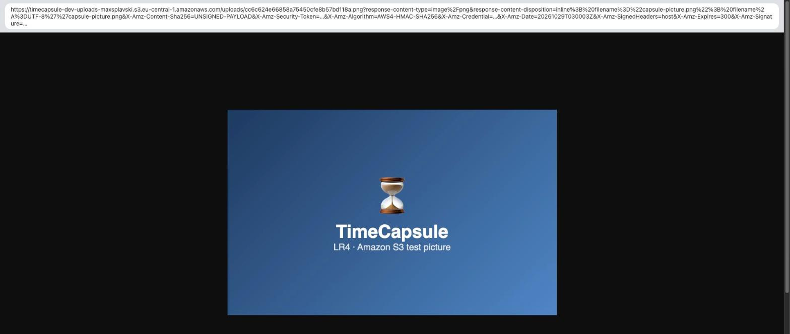
_Капсула из ЛР2: вложение `cc6c624e....png` (перенесено в задании 10) тоже открывается по подписанной ссылке из S3._

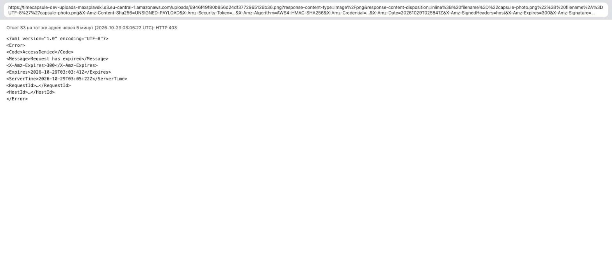
_Тот же адрес картинки через 5 минут: `403 AccessDenied`, `Request has expired`, `Expires 03:03:41Z`, `ServerTime 03:05:22Z`. Ответ выведен на страницу: Chrome не даёт снять свой просмотрщик XML._

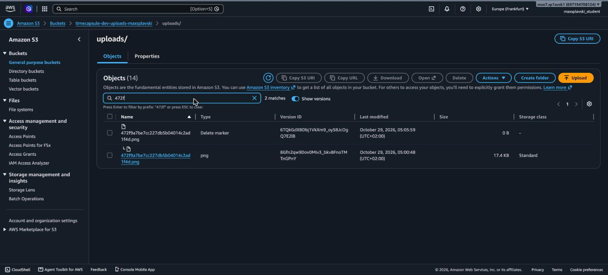
_Капсула с вложением (`472f9a7b....png`, задание 13) удалена в приложении: в бакете маркер удаления (05:05:59), версия файла на месте._

> **Почему ссылку, которую пользователь переслал другу, не нужно специально отзывать? Что осталось в бакете после удаления капсулы и когда это исчезнет окончательно?**
> Ссылка живёт 5 минут (`X-Amz-Expires=300`) и подписана временными ключами роли; после срока S3 сам отвечает `Request has expired`, а новую ссылку друг без входа в приложение не получит. После удаления капсулы в бакете остались маркер удаления (текущая версия) и прежняя версия файла. Она стала неактуальной: правило `timecapsule-dev-noncurrent` переведёт её в Standard-IA через 30 дней (для 17 КБ перехода не будет, меньше 128 КБ) и удалит через 90 дней, если у ключа будет больше двух более новых неактуальных версий. Так как имя случайное и больше не перезаписывается, эта версия - единственная неактуальная и по правилу останется; окончательно её можно удалить вручную, а для автоматики добавить в правило `Delete expired object delete markers` и срок без `NewerNoncurrentVersions`.

### Задание 13. Сервер без состояния

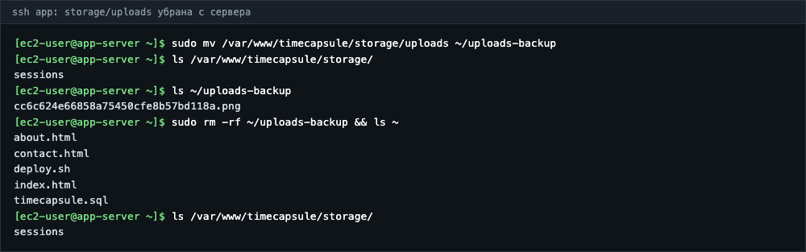
_`storage/uploads` перенесена в `~/uploads-backup`, в `storage/` осталась только `sessions`; после проверки копия удалена._

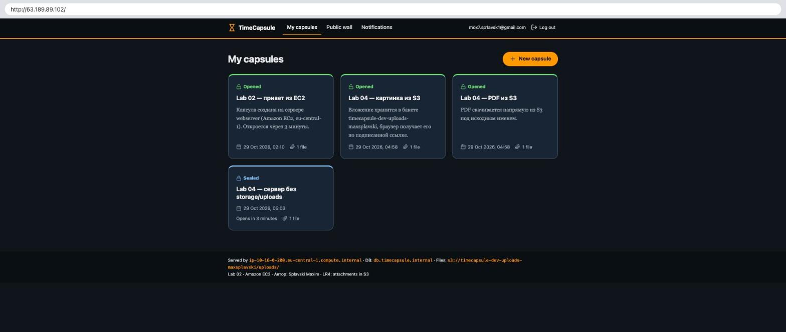
_Без локальной папки: старые и новые капсулы открываются, создана ещё одна капсула с вложением._


_Новая капсула «Lab 04 — сервер без storage/uploads» открылась с картинкой; её объект `472f9a7b....png` появился в бакете, в логе PHP-FPM новых ошибок нет._


_Новая версия политики `timecapsule-dev-app-s3`: только `Get/Put/DeleteObject` на `uploads/*`._


_`Policy versions`: `Version 2` - `Default`, `Version 1` сохранена._


_На сервере: `aws s3 ls .../uploads/` - `AccessDenied`, `no-such-file.txt` - `403 Forbidden`, приложение работает (`/health` 200)._


_Тот же запрос в CloudShell под `maxsplavski_student`: `404 Not Found`._

> **Почему S3 ответил вам и серверу по-разному, хотя объекта нет в обоих случаях? Зачем S3 так поступает? Что теперь нужно сделать, чтобы заменить `app-server` новым сервером без потери данных?**
> Если объекта нет, S3 отвечает `404` только тому, у кого есть `s3:ListBucket` на этот бакет; без этого права - `403`. У меня (администратор) право есть, у роли сервера после задания 13 - нет. Так S3 не раскрывает, какие ключи существуют: без права на список нельзя перебором выяснить, есть ли файл с данным именем. Чтобы заменить `app-server`: запустить новый экземпляр (из того же AMI или чистый + `deploy.sh`) в `public-a` с `web-sg`, привязать роль `timecapsule-dev-app-role`, положить `.env` (пароль базы, `S3_BUCKET`, `AWS_REGION`) с группой `apache`, перенести Elastic IP и завершить старый. Файлы в S3, база на `db-server` - на старом сервере ничего не теряется (кроме PHP-сессий: пользователям придётся войти заново).

### Задание 14. Архитектура и решение


_Схема ЛР3, дополненная: бакет `timecapsule-dev-uploads-maxsplavski` (префикс `uploads/`) в регионе вне VPC, роль `timecapsule-dev-app-role` с политикой `timecapsule-dev-app-s3` у `app-server`, стрелки `PutObject/DeleteObject` от приложения (по HTTPS через Internet Gateway публичной подсети) и скачивание браузером по подписанному URL._

ADR: [docs/adr/0003-attachment-storage.md](../adr/0003-attachment-storage.md) - сравнение диска EBS, Amazon EFS и Amazon S3; как пользователь получает файл и что ограничивает срок ссылки; версионирование и жизненный цикл; что изменится с несколькими серверами и балансировщиком.

---

## Итог

- Бакет, политика `timecapsule-dev-app-s3` (v2), роли `timecapsule-dev-s3-tester` и `timecapsule-dev-app-role` оставлены для следующих работ.
- `bastion`, `app-server`, `db-server` остановлены (`stop-lab.sh`), NAT Gateway нет, Elastic IP один.
- В CloudShell удалены `lab4/` и `~/test.txt`. Ключей доступа IAM не создавалось.

## Контрольные вопросы

**1. Как проходит запрос на скачивание вложения: от нажатия ссылки в браузере до получения файла? Где на этом пути проверяются права пользователя приложения, а где права роли?**
Браузер запрашивает `http://63.189.89.102/capsules/{id}/file` с cookie сессии. nginx передаёт его в PHP-FPM; приложение по сессии определяет пользователя, загружает капсулу из базы и проверяет, что он владелец (или капсула публичная) и что капсула уже открыта - это **права приложения**, S3 о пользователях ничего не знает. Затем `storage_stream()` локально подписывает `GetObject` временными ключами роли и отвечает `302 Location: https://...s3...amazonaws.com/uploads/...?X-Amz-...`. Браузер идёт прямо в S3 по HTTPS; S3 проверяет подпись и срок, а затем **права роли** (`s3:GetObject` на `uploads/*` в `timecapsule-dev-app-s3`) и политику бакета (HTTPS), и отдаёт файл с заголовками из ссылки.

**2. Какие настройки бакета и какие свойства подписанного URL не дают постороннему открыть вложение по прямому адресу объекта?**
Бакет: `Block all public access` (нельзя сделать объект или бакет публичным ни ACL, ни политикой), `ACLs disabled` (у объектов нет своих ACL), в политике бакета нет `Allow` для `*`, только `Deny` без HTTPS. Поэтому анонимный запрос к Object URL получает `403`. Имя объекта случайное (128 бит), его не угадать. Ссылка: подпись привязана к бакету, ключу, методу и параметрам (изменить нельзя - `SignatureDoesNotMatch`), срок 5 минут, подписана ключами роли с правами только на `uploads/*`.

**3. Почему приложение отдаёт файлы через подписанный URL, а не открывает бакет для чтения всем?**
Публичный бакет отдал бы любой файл любому, кто знает или подсмотрел адрес, навсегда и без проверки, кому принадлежит капсула и открыта ли она - запечатанные капсулы перестали бы быть запечатанными. Подписанный URL выдаётся только после проверки прав в приложении и сам истекает, а бакет остаётся закрытым. При этом сохраняется главный плюс S3: файл идёт из S3 напрямую, не нагружая PHP и сервер.

**4. Как изменится схема, если вложения должны пережить отказ всего региона `eu-central-1`?**
S3 Standard уже хранит данные в нескольких AZ региона, но не в другом регионе. Нужен второй бакет в другом регионе (например, `eu-west-1`) с версионированием и правилом **Cross-Region Replication**, а для роли - политика на оба бакета (или Multi-Region Access Point с одним адресом). Приложение и база тоже должны работать во втором регионе (копия VPC, серверы, реплика базы), иначе файлы переживут отказ, а сервис - нет. Переключение - через Route 53 failover. Репликация не копирует удаления версий и не защищает от ошибок приложения - для этого остаются версионирование и бэкапы.

## Источники

1. Задание: [MSU-Courses/cloud-computing, Lab 04](https://github.com/MSU-Courses/cloud-computing/tree/main/Lab/04_Cloud_Storage).
2. [Amazon S3 User Guide](https://docs.aws.amazon.com/AmazonS3/latest/userguide/): Block Public Access, versioning, lifecycle (noncurrent versions, minimum object size for transitions), presigned URLs, bucket policies (`aws:SecureTransport`), ListBucket и 403/404.
3. [IAM User Guide](https://docs.aws.amazon.com/IAM/latest/UserGuide/): policy evaluation logic, roles for EC2 (instance profiles), trust policies.
4. [AWS SDK for PHP v3: Amazon S3 pre-signed URLs](https://docs.aws.amazon.com/sdk-for-php/v3/developer-guide/s3-presigned-url.html).
5. [Amazon S3 pricing](https://aws.amazon.com/s3/pricing/), [Amazon EFS pricing](https://aws.amazon.com/efs/pricing/).
