# Лабораторная работа №5. Облачные базы данных. Amazon RDS

- **Студент:** Splavski Maxim
- **Группа:** I2402
- **Специальность:** Informatică
- **Уровень:** продвинутый (Часть 1 + Часть 2, задания 1-12)
- **Репозиторий:** https://github.com/USM-Labs/timecapsule
- **Изменения в коде:** код приложения не менялся (DB_HOST тот же), только подвал `views/layout.php` (коммит [`2934d8b`](https://github.com/USM-Labs/timecapsule/commit/2934d8b))
- **ADR:** [docs/adr/0004-database-hosting.md](../adr/0004-database-hosting.md)
- **Предыдущие отчёты:** [ЛР2](../../README.md), [ЛР3](../lab3/README.md), [ЛР4](../lab4/README.md)

Все ресурсы в `eu-central-1`, теги `Name`, `Project=timecapsule`, `Environment=dev`, `Owner=maxsplavski`, `Lab=lab5`.

> **Как сделаны скриншоты.** Всё в консоли AWS снято в Chrome под IAM-пользователем `maxsplavski_student`; номер
> аккаунта на страницах скрыт (`••••••••••••`), временные ключи STS в CloudTrail закрыты плашкой. Команды `psql`,
> `dig`, `curl` выполнялись с моего компьютера через bastion (`ssh lab5web`, `ssh app` с `ProxyJump`) - это реальный
> вывод, отрисованный в нейтральное окно терминала. Пароли `dbadmin` сгенерировал RDS (`Auto generate password`),
> они хранятся у меня локально и в `~/.pgpass` на серверах, в отчёт и репозиторий не попадают.
>
> **Ограничения бесплатного плана AWS** (аккаунт создан после июля 2025 г.): доступен только шаблон `Free tier`
> (это и есть `Sandbox` из задания), срок хранения автоматических копий максимум 1 день, не больше двух
> экземпляров RDS одновременно. Где это повлияло на работу, сказано в тексте.

---

## Часть 1. Базовый уровень

Все учебные ресурсы называются с префиксом `lab5-` и имеют теги `Name`, `Project=timecapsule`, `Environment=dev`, `Owner=maxsplavski`, `Lab=lab5`.

| Ресурс | Имя | Что это |
| --- | --- | --- |
| Группа подсетей | `lab5-db-subnets` | `timecapsule-dev-private-a` (10.16.10.0/24, 1a) и `timecapsule-dev-private-b` (10.16.11.0/24, 1b) |
| SG веб-сервера | `lab5-web-sg` | входящий SSH только от `timecapsule-dev-bastion-sg` |
| SG базы | `lab5-rds-sg` | входящий TCP 5432 только от `lab5-web-sg` |
| Веб-сервер | `lab5-web-server` | t3.micro, Amazon Linux 2023, `public-a`, `lab5-web-sg`, клиент `psql` 16 |
| База | `lab5-db` | PostgreSQL 18.3, db.t4g.micro, gp3 20 ГиБ, `eu-central-1a` |
| Реплика | `lab5-db-replica` | db.t4g.micro, `eu-central-1b` |
| Восстановленная копия | `lab5-db-restore` | db.t4g.micro, `eu-central-1a` |

### Задание 1. Размещение и доступ к базе

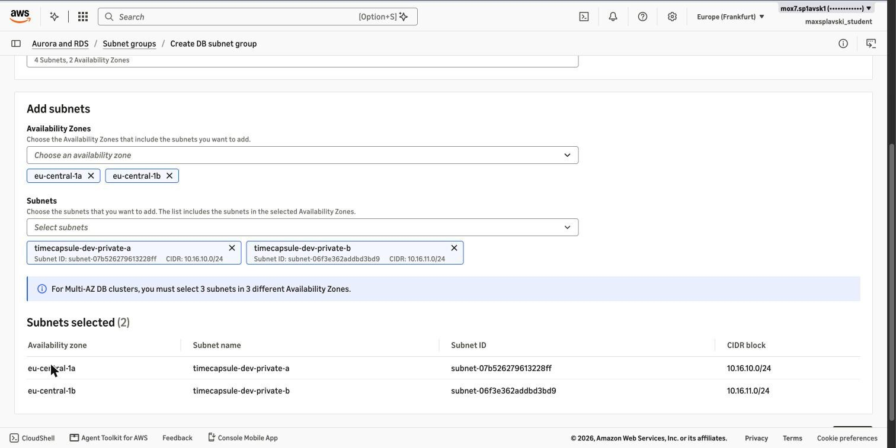
_Группа подсетей `lab5-db-subnets`: VPC `timecapsule-dev-vpc`, две приватные подсети в зонах `1a` и `1b`._

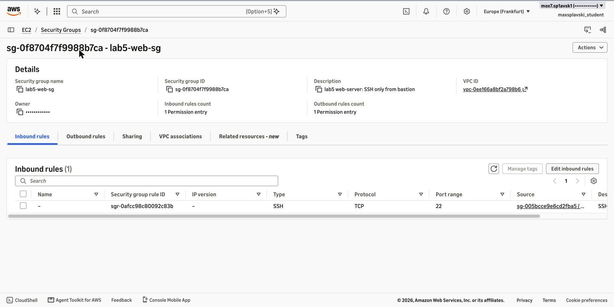
_`lab5-web-sg`: на веб-сервер можно зайти по SSH только с bastion (источник `sg-005bcce9e6cd2fba5`, это `timecapsule-dev-bastion-sg`). HTTP ему в этой работе не нужен._

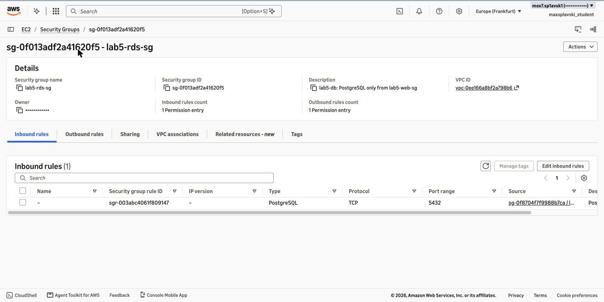
_`lab5-rds-sg`: одно входящее правило, PostgreSQL TCP 5432, источник `sg-0f8704f7f9988b7ca` (`lab5-web-sg`). Ни одного CIDR._

> **Почему для ограничения доступа удобнее использовать Security Group источника, а не его IP-адрес? Зачем указывать две подсети, если учебная база будет работать в одной зоне?**
> Правило с SG источника пускает любой интерфейс, к которому эта SG привязана, и не зависит от адресов. Сервер можно пересоздать, получить другой приватный IP, добавить второй и третий сервер (в ЛР6 их запускает группа Auto Scaling), а правило базы менять не придётся. По IP пришлось бы править правило при каждом изменении, и любой другой ресурс, получивший этот адрес, получил бы доступ. Две подсети в разных зонах RDS требует для любой группы подсетей: без них нельзя включить Multi-AZ, создать реплику в другой зоне (задание 4) и восстановить базу в другой зоне при отказе `eu-central-1a`.

### Задание 2. База RDS

Бесплатный план аккаунта (`Free plan`) оставляет только шаблон `Free tier`: это и есть «песочница» из задания, `Production` и `Dev/Test` недоступны, Multi-AZ тоже.

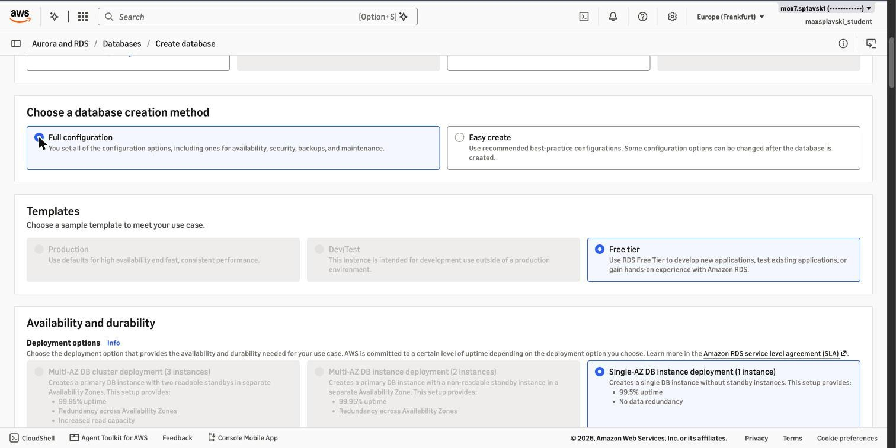
_`Full configuration`, шаблон `Free tier`, единственный доступный вариант `Single-AZ DB instance deployment (1 instance)`._

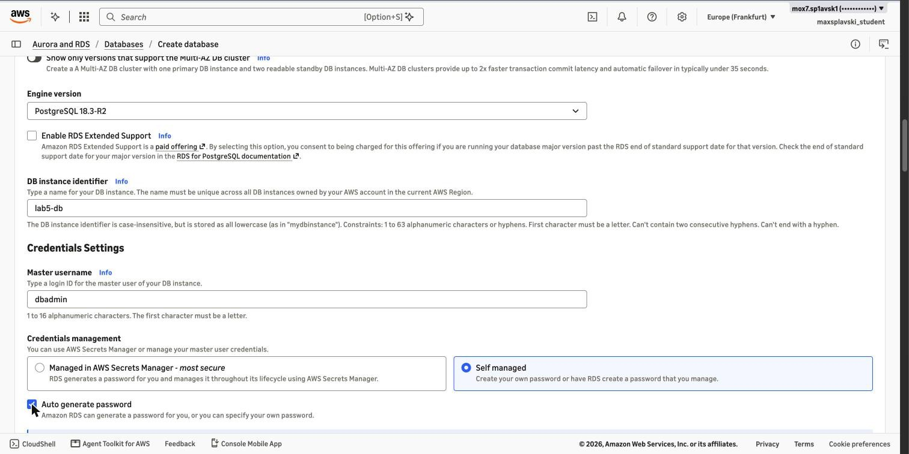
_PostgreSQL 18.3-R2 (последняя версия), идентификатор `lab5-db`, пользователь `dbadmin`, `Self managed` + `Auto generate password`._

Пароль RDS показал один раз в окне `View connection details` после создания. Я скопировал его в локальный файл с правами `600`, в репозиторий и в отчёт он не попадает. На веб-сервере пароль лежит в `~/.pgpass` (права `600`), поэтому `psql` не спрашивает его и он не виден в истории.

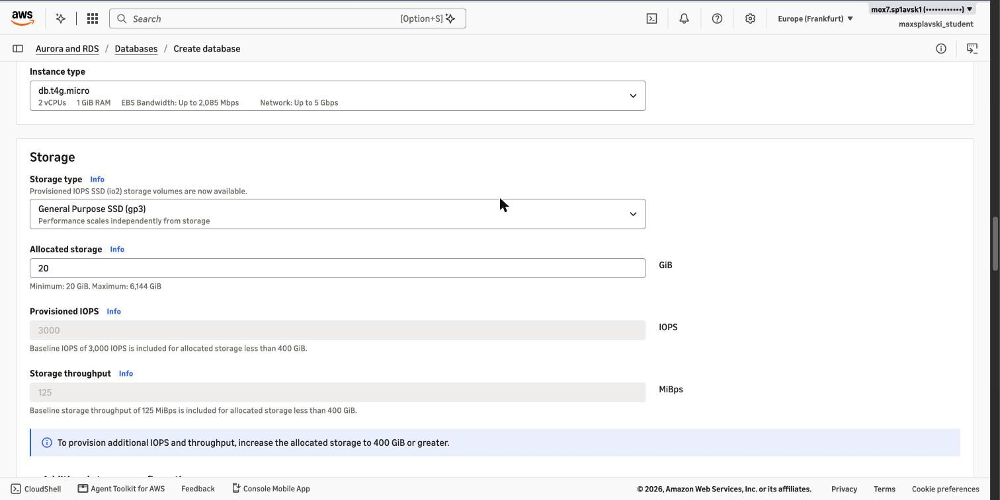
_Класс `db.t4g.micro`, `General Purpose SSD (gp3)`, 20 ГиБ (3000 IOPS и 125 МиБ/с входят в цену)._

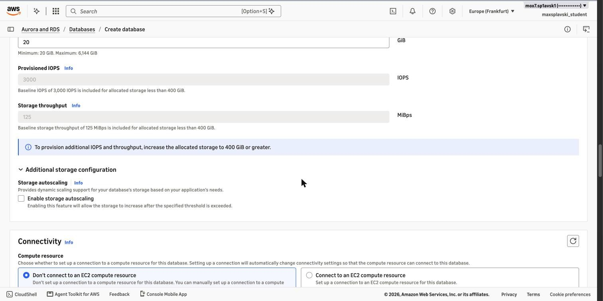
_`Enable storage autoscaling` выключено: диск не вырастет сам и не начнёт стоить больше._

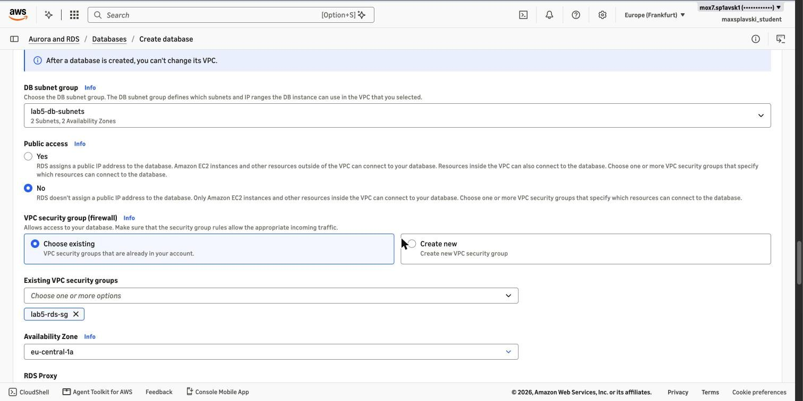
_`timecapsule-dev-vpc`, группа подсетей `lab5-db-subnets`, `Public access: No`, SG только `lab5-rds-sg` (группа `default` убрана), зона `eu-central-1a`._

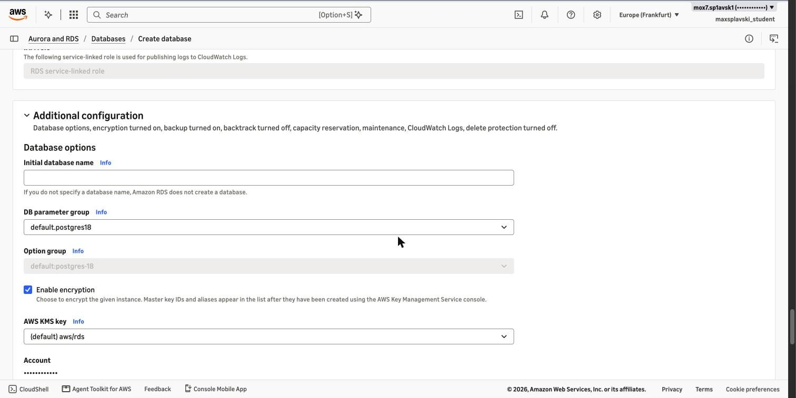
_`Initial database name: lab5`, шифрование включено ключом `aws/rds`._

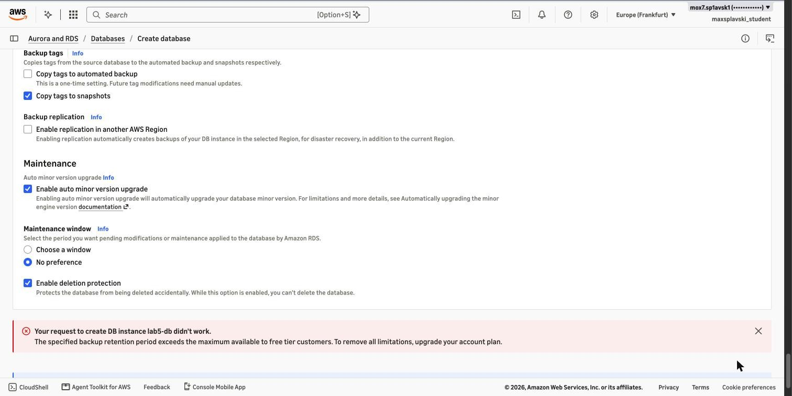
_Первая попытка с хранением копий 7 дней: `The specified backup retention period exceeds the maximum available to free tier customers`._

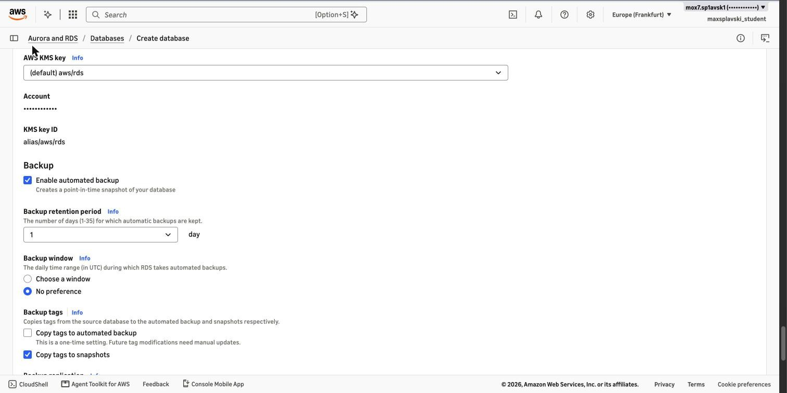
_Поэтому срок хранения 1 день (максимум бесплатного плана). Восстановление на любой момент работает так же, только окно не 7 дней, а сутки._

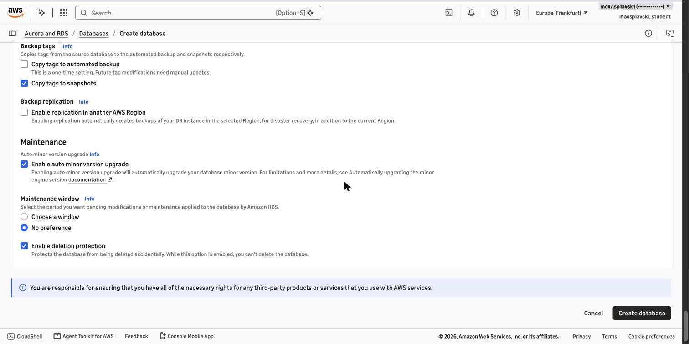
_`Enable deletion protection` включено._

> **Как убедиться, что база принимает подключения только с нужного сервера? Почему для неё выбрана зона `eu-central-1a`? От чего защищает `deletion protection`, а от чего нет?**
> Проверить с трёх мест: с `lab5-web-server` подключение проходит, с `app-server` (он в другой SG, `timecapsule-dev-web-sg`) `psql` висит до таймаута, с ноутбука тоже таймаут: имя разрешается в приватный адрес 10.16.10.146, публичного адреса у базы нет (скриншоты ниже). На вкладке `Connectivity & security` в `Security group rules` одно входящее правило с источником `lab5-web-sg`. Зона `eu-central-1a` та же, что у веб-сервера и `app-server` (`public-a`): запросы не ходят между зонами, задержка меньше и нет платы за межзональный трафик. `Deletion protection` запрещает удалить экземпляр (кнопкой или API, в том числе случайно скриптом), пока её не выключат через `Modify`. От потери данных внутри базы она не защищает: `DELETE`, `DROP TABLE`, ошибка приложения или утёкший пароль работают как обычно. Для этого нужны резервные копии (задание 5).

### Задание 3. Подключение к базе

Веб-сервер `lab5-web-server` создан в `public-a` с SG `lab5-web-sg`, в `User data` ставится `postgresql16` и `bind-utils`. Подключаюсь к нему с ноутбука через bastion (`ProxyJump`).

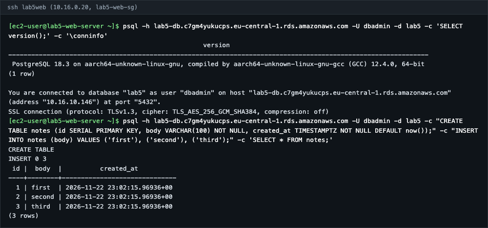
_`SELECT version()` - PostgreSQL 18.3 на aarch64 (Graviton, `t4g`). `\conninfo`: база `lab5`, пользователь `dbadmin`, адрес 10.16.10.146, соединение зашифровано TLSv1.3. Таблица `notes` с тремя строками._

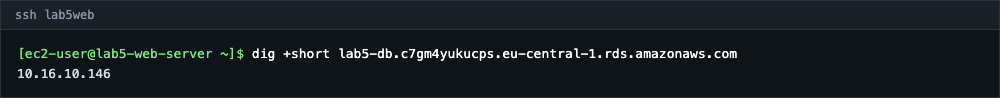
_Endpoint с веб-сервера разрешается в 10.16.10.146 (подсеть `private-a`)._

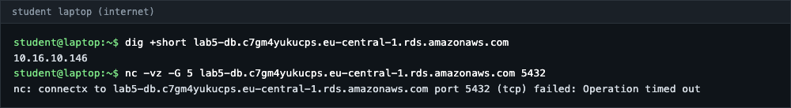
_С ноутбука имя разрешается в тот же приватный адрес (публичный DNS RDS отдаёт приватный IP, раз `Public access: No`), но подключиться нельзя: `nc` - `Operation timed out`._

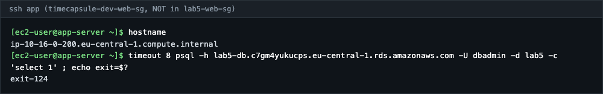
_С `app-server` (SG `timecapsule-dev-web-sg`, не `lab5-web-sg`) `psql` за 8 секунд не получил ответа (`timeout` вернул 124): SG базы отбрасывает пакеты молча._

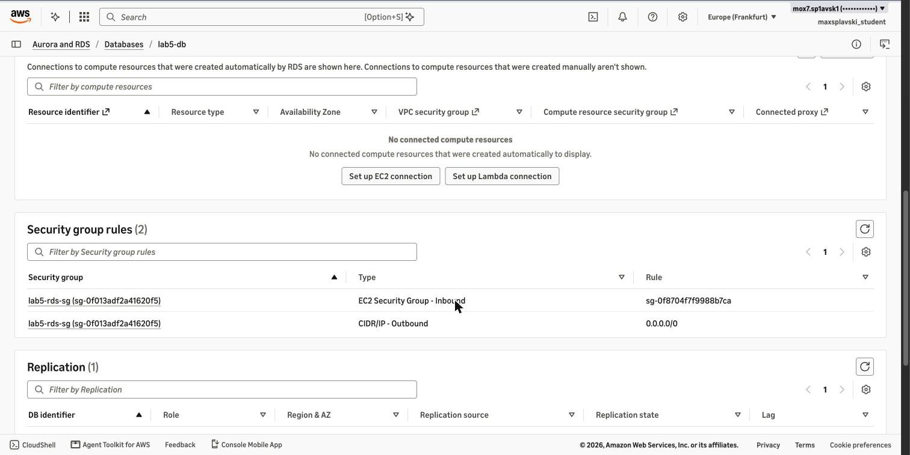
_Вкладка `Connectivity & security` базы: входящее правило `lab5-rds-sg` только от `sg-0f8704f7f9988b7ca`._

### Задание 4. Реплика для чтения

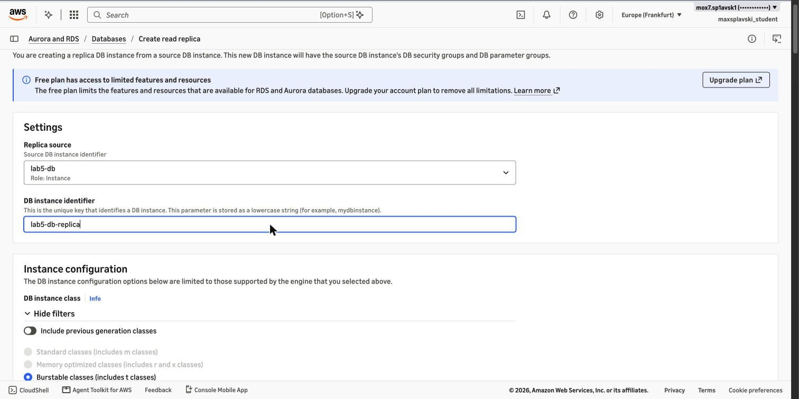
_`Create read replica`: источник `lab5-db`, имя `lab5-db-replica`._

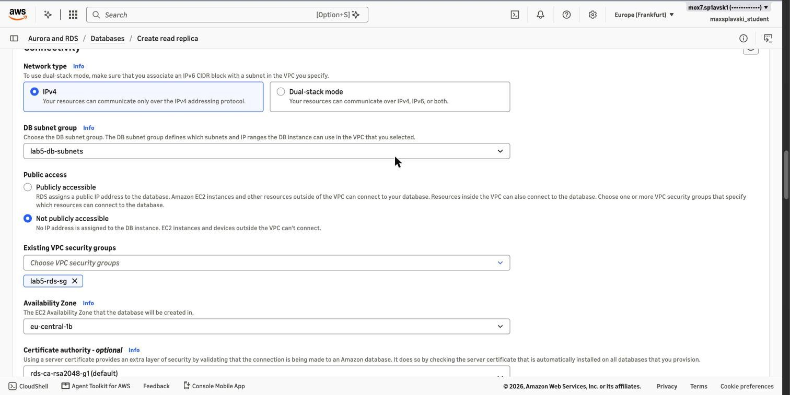
_Та же группа подсетей и SG, без публичного доступа, зона `eu-central-1b`. Автоувеличение хранилища и Enhanced Monitoring выключены, защиты от удаления нет._

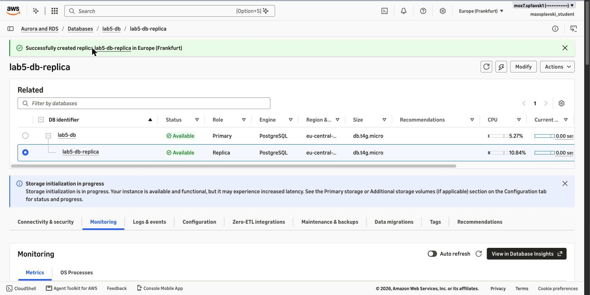
_`lab5-db` (Primary) и `lab5-db-replica` (Replica) в состоянии `Available`. Бесплатный план разрешает не больше двух экземпляров, поэтому базу приложения из Части 2 я создавал после удаления учебных._

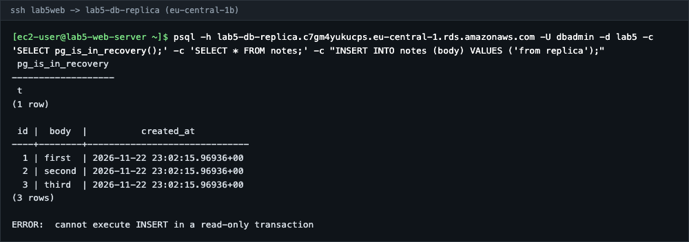
_На реплике `pg_is_in_recovery() = t`, видны три строки, `INSERT` - `ERROR: cannot execute INSERT in a read-only transaction`._

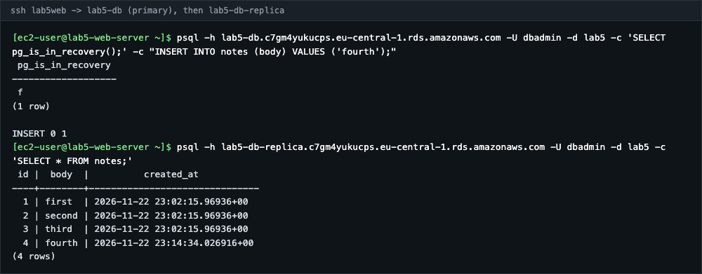
_На основной базе `pg_is_in_recovery() = f`, `INSERT 'fourth'` прошёл. Через несколько секунд строка `fourth` уже читается на реплике._

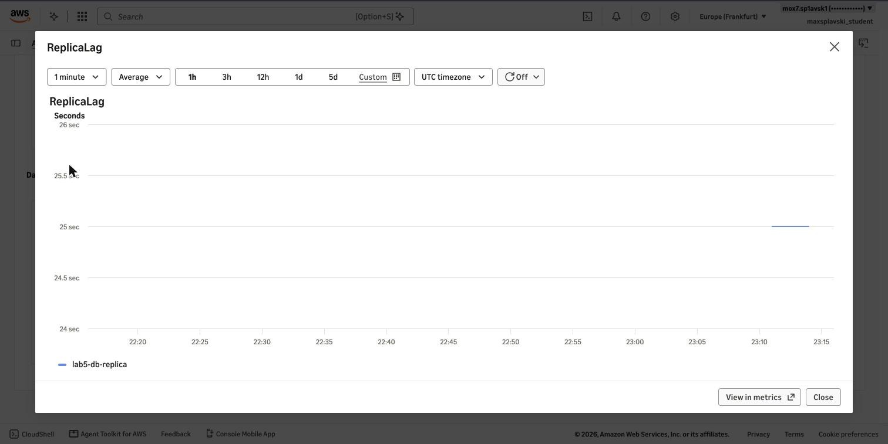
_`ReplicaLag` с периодом 1 минута: около 25 секунд. В RDS for PostgreSQL метрика считает время с последней воспроизведённой транзакции, поэтому на учебной базе, куда почти ничего не пишут, она растёт между записями, хотя реально изменения приходят за секунды (строка `fourth` появилась сразу)._

> **Почему `INSERT` на реплике не выполнился? Чем реплика для чтения отличается от резервного экземпляра Multi-AZ?**
> Реплика - это PostgreSQL в режиме восстановления (`pg_is_in_recovery() = t`): он только применяет журнал WAL, который присылает основная база, и принимает лишь читающие транзакции. Если бы на ней можно было писать, её данные разошлись бы с основной. Реплика асинхронная: у неё свой endpoint, её можно читать (разгрузить отчёты и чтение), она может быть в другой зоне или регионе и немного отставать. Резервный экземпляр Multi-AZ получает изменения синхронно (коммит подтверждается, только когда запись есть в обеих зонах), своего endpoint у него нет, читать с него нельзя. Он нужен только для автоматического переключения при отказе основного экземпляра или зоны: endpoint базы остаётся тем же, DNS переводится на резервный экземпляр за 1-2 минуты. Реплику при отказе нужно повышать (`Promote`) вручную, и у неё будет другой endpoint.

### Задание 5. Восстановление после ошибки

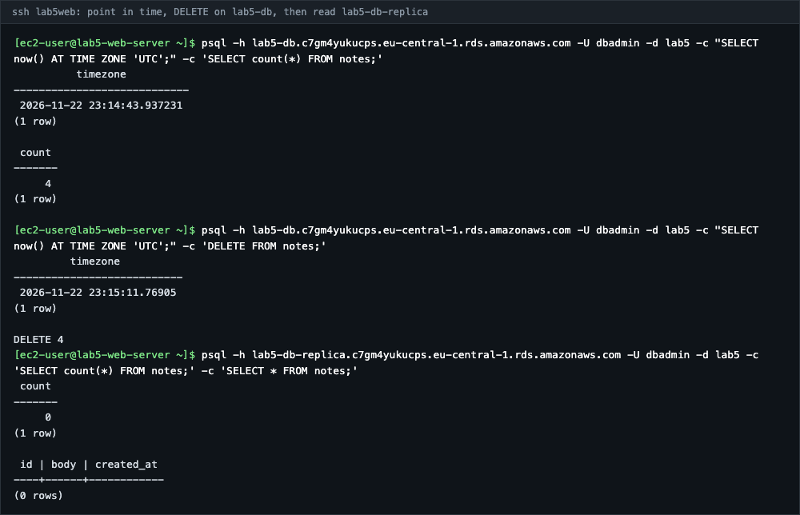
_Момент до ошибки: `2026-11-22 23:14:43 UTC`, в таблице 4 строки. В 23:15:11 `DELETE FROM notes` удалил все 4 строки, и реплика тут же показывает 0 строк._

Реплику после этого удалил (без снимка и без сохранения копий).

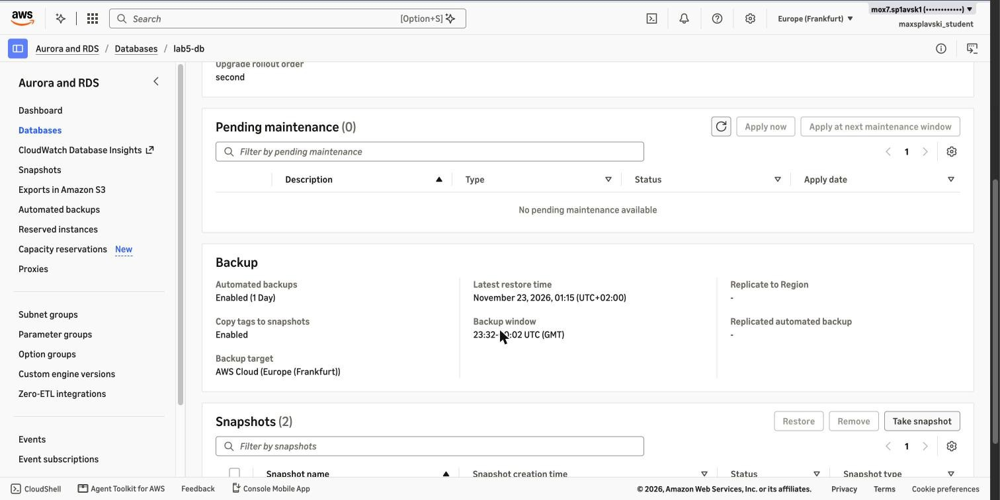
_`Latest restore time` дошёл до `01:15` по времени браузера (UTC+2), то есть 23:15 UTC - позже момента из шага 1, можно восстанавливать. Срок хранения копий `1 Day` из-за бесплатного плана._

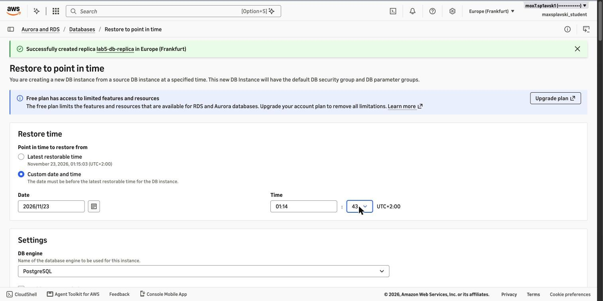
_`Restore to point in time` - `Custom date and time`: `2026/11/23 01:14:43 UTC+2:00` = `2026-11-22 23:14:43 UTC`. Консоль показывает время в часовом поясе браузера, поэтому к UTC из `psql` прибавлено 2 часа._

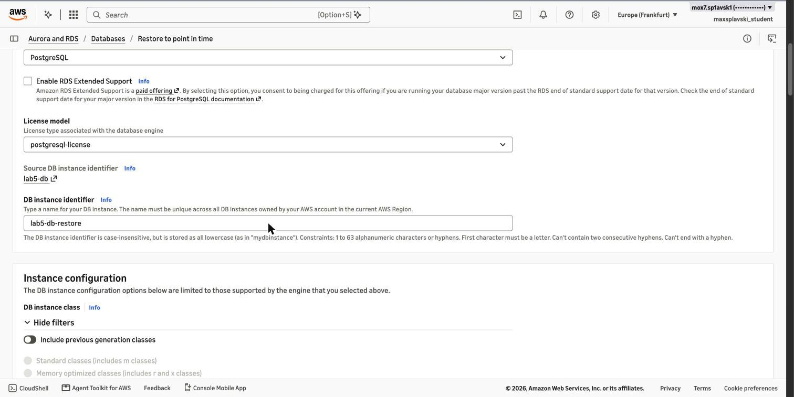
_Имя новой базы `lab5-db-restore`._

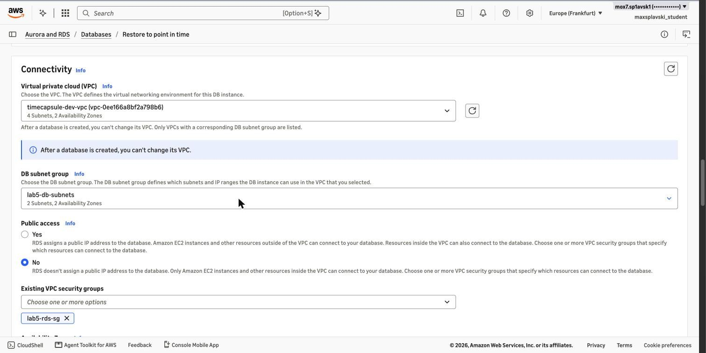
_Одна зона, `db.t4g.micro`, `lab5-db-subnets`, без публичного доступа, SG `lab5-rds-sg` (как у основной), защита от удаления выключена._

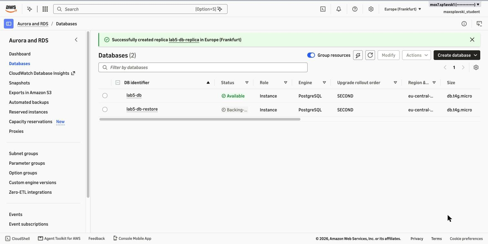
_`lab5-db-restore` создан рядом с `lab5-db` как отдельный экземпляр._

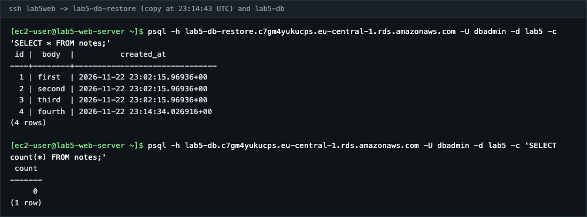
_В копии все 4 строки (`first`...`fourth`), в исходной `lab5-db` по-прежнему 0. Данные можно перенести обратно (`pg_dump -t notes` из копии и загрузка в основную) или переключить приложение на копию._

Копию удалил без финального снимка и без сохранения резервных копий.

> **Почему реплика не спасла данные? Почему восстановление создаёт новую базу, а не откатывает старую?**
> Реплика повторяет всё, что происходит на основной базе, в том числе ошибки: `DELETE` - обычная транзакция, она попала в WAL и через секунду была воспроизведена на реплике (там тоже стало 0 строк). Реплика защищает от отказа сервера или зоны, но не от ошибочных команд. Восстановление на момент времени берёт ближайший суточный снимок и проигрывает поверх него журналы транзакций до нужной секунды. Это можно сделать только на новом томе, поэтому получается новый экземпляр с новым endpoint. Старая база остаётся как есть: после ошибки в неё могли записать и нужные данные, их нельзя молча потерять. Можно сравнить обе базы, перенести недостающие строки и только потом решить, какую оставить.

### Завершение Части 1

`lab5-db-restore` удалена, у `lab5-db` выключена защита от удаления (`Modify` → `Apply immediately`), затем база удалена без снимка и без копий. После этого удалены группа подсетей `lab5-db-subnets`, SG `lab5-rds-sg`, сервер `lab5-web-server` и его SG `lab5-web-sg`.
## Часть 2. Продвинутый уровень

| Ресурс | Имя | Значение |
| --- | --- | --- |
| Security Group базы | `timecapsule-dev-rds-sg` (`sg-0557ba2e54bf8d596`) | TCP 5432 только от `timecapsule-dev-web-sg` (SG `app-server`) |
| Группа подсетей | `timecapsule-dev-db-subnets` | `private-a` (1a) + `private-b` (1b) |
| База | `timecapsule-dev-rds` | PostgreSQL **16.15** (как на `db-server`, иначе `pg_dump` 16 не снимет выгрузку), db.t4g.micro, gp3 20 ГиБ, `eu-central-1a`, шифрование, deletion protection, копии 1 день |
| Политика расписания | `timecapsule-dev-rds-stop` | только `rds:StopDBInstance` на ARN `...:db:timecapsule-dev-rds` |
| Роль расписания | `timecapsule-dev-scheduler-role` | доверие: `scheduler.amazonaws.com` с условием `aws:SourceAccount` |
| Расписание | `timecapsule-dev-rds-nightly-stop` | `cron(0 23 * * ? *)`, `Europe/Chisinau`, без гибкого окна |
| Запись DNS | `db.timecapsule.internal` | `CNAME` → endpoint базы, TTL 60 |

### Задание 6. База приложения

Группа доступа и группа подсетей созданы как в Части 1. База создана той же формой `Full configuration` → `Free tier`, но с версией 16.15 и без `Initial database name`.

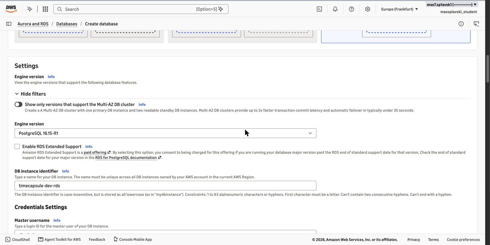
_Версия `PostgreSQL 16.15-R1`, идентификатор `timecapsule-dev-rds`._

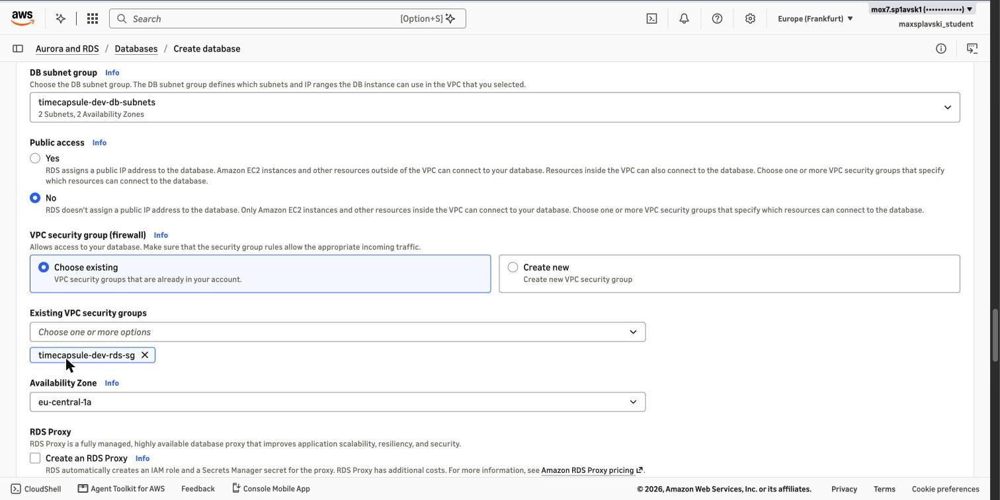
_Группа подсетей `timecapsule-dev-db-subnets`, `Public access: No`, SG `timecapsule-dev-rds-sg`, зона `eu-central-1a`._

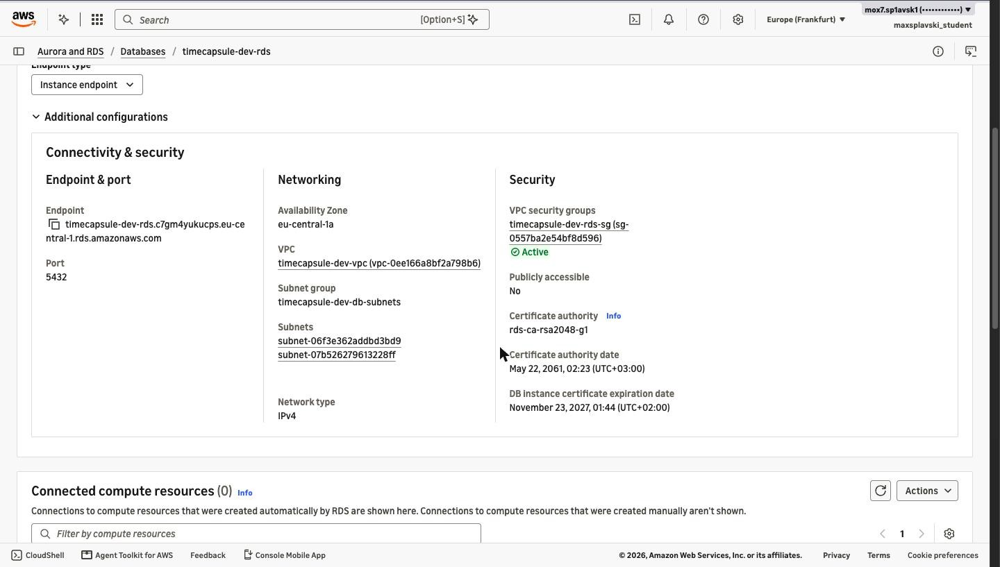
_Вкладка `Connectivity & security` созданной базы: endpoint `timecapsule-dev-rds.c7gm4yukucps.eu-central-1.rds.amazonaws.com:5432`, зона `eu-central-1a`, группа подсетей `timecapsule-dev-db-subnets` (две подсети), SG `timecapsule-dev-rds-sg`, `Publicly accessible: No`._

Первая попытка создать базу, пока учебные `lab5-db` и `lab5-db-replica` ещё существовали, закончилась ошибкой `You reached the maximum number of instances available with free plan accounts`: бесплатный план разрешает не больше двух экземпляров RDS. Поэтому базу приложения я создал сразу после завершения Части 1.

> **Какие параметры базы приложения вы выбрали бы иначе для рабочей системы с реальными пользователями? Почему?**
> Multi-AZ (резервный экземпляр в `eu-central-1b` с автоматическим переключением), срок хранения копий 7-35 дней вместо 1 дня и ручные снимки перед миграциями, более крупный класс без кредитов CPU (`db.m7g.large` или хотя бы `db.t4g.small` с unlimited), автоувеличение хранилища с разумным потолком, включённые Enhanced Monitoring, Performance Insights и экспорт журналов PostgreSQL в CloudWatch, тревоги на CPU, свободную память, место и число подключений. Пароль `dbadmin` хранил бы в Secrets Manager с ротацией, а не локально. Ночную остановку для рабочей системы не включал бы.

### Задание 7. Ночная остановка базы

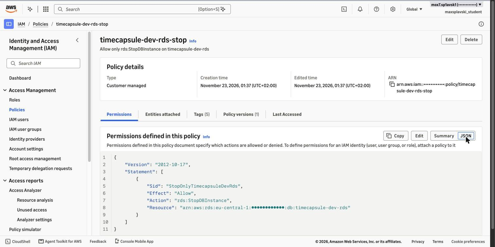
_Политика `timecapsule-dev-rds-stop`: одно действие `rds:StopDBInstance`, один ресурс - ARN базы `timecapsule-dev-rds`._

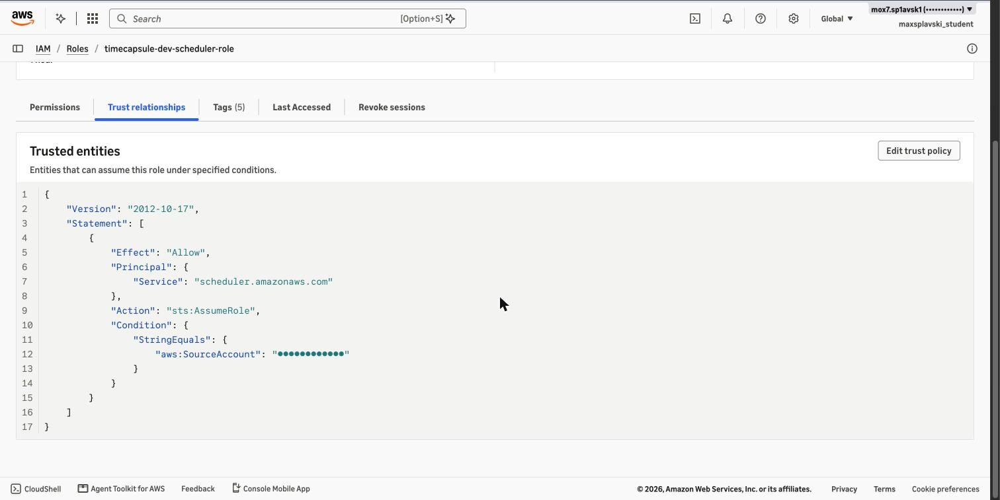
_Роль `timecapsule-dev-scheduler-role`: брать её на себя может только `scheduler.amazonaws.com` и только для расписаний этого аккаунта (`aws:SourceAccount`, защита от confused deputy)._

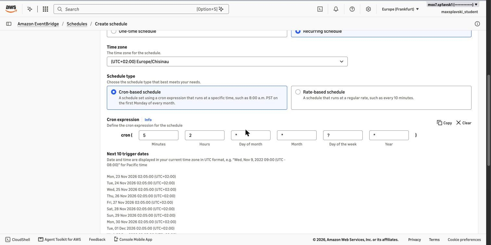
_Расписание: `Recurring schedule`, часовой пояс `Europe/Chisinau`, для проверки `cron(5 2 * * ? *)` - 02:05, примерно через 20 минут (база ещё создавалась). Ниже консоль показывает ближайшие запуски. `Flexible time window: Off`._

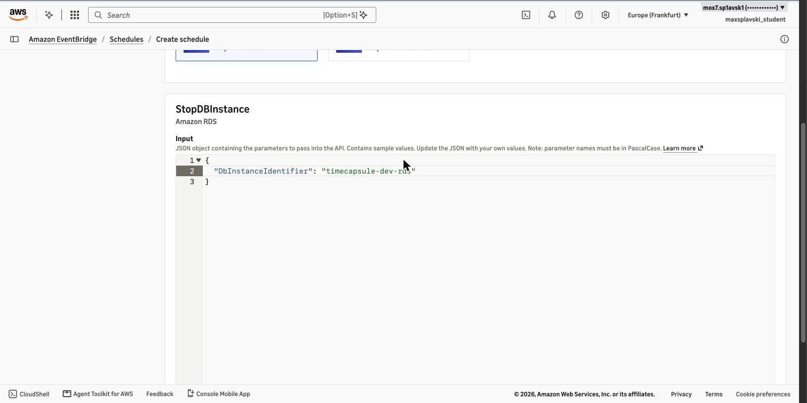
_Цель: `All APIs` → `Amazon RDS` → `StopDBInstance`, вход `{"DbInstanceIdentifier": "timecapsule-dev-rds"}`._

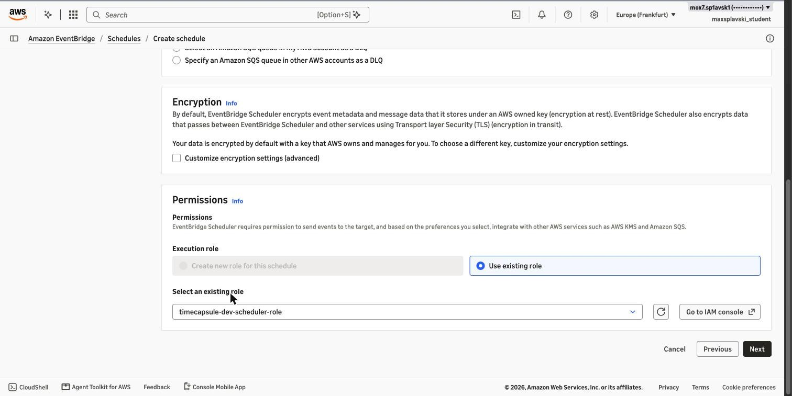
_`Use existing role` → `timecapsule-dev-scheduler-role`._

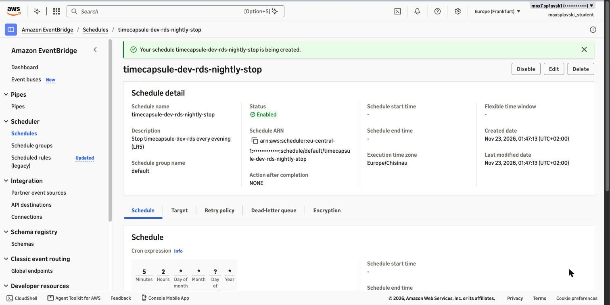
_Расписание `Enabled`._

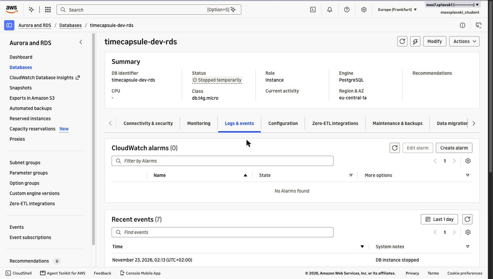
_После 02:05 база перешла в `Stopping`, затем в `Stopped temporarily`._

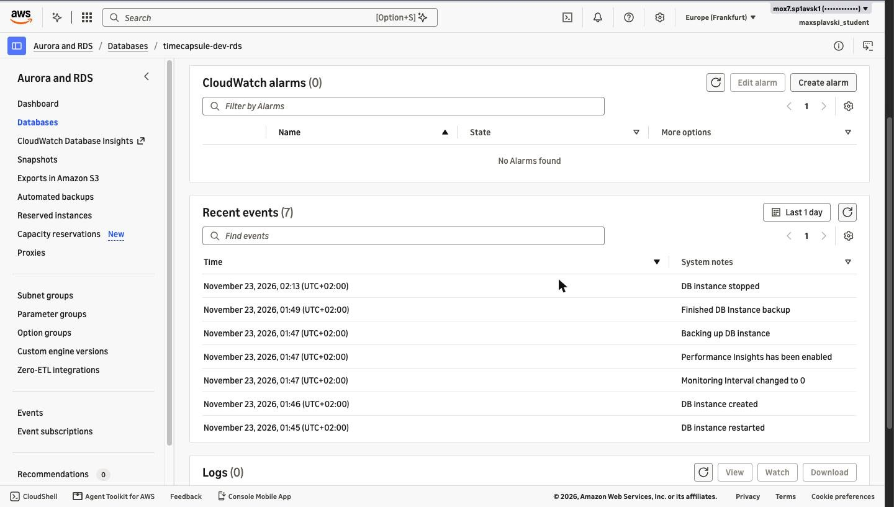
_`Logs & events`: `DB instance stopped` в 02:13 (остановка заняла около 8 минут: RDS перед остановкой делает снимок)._

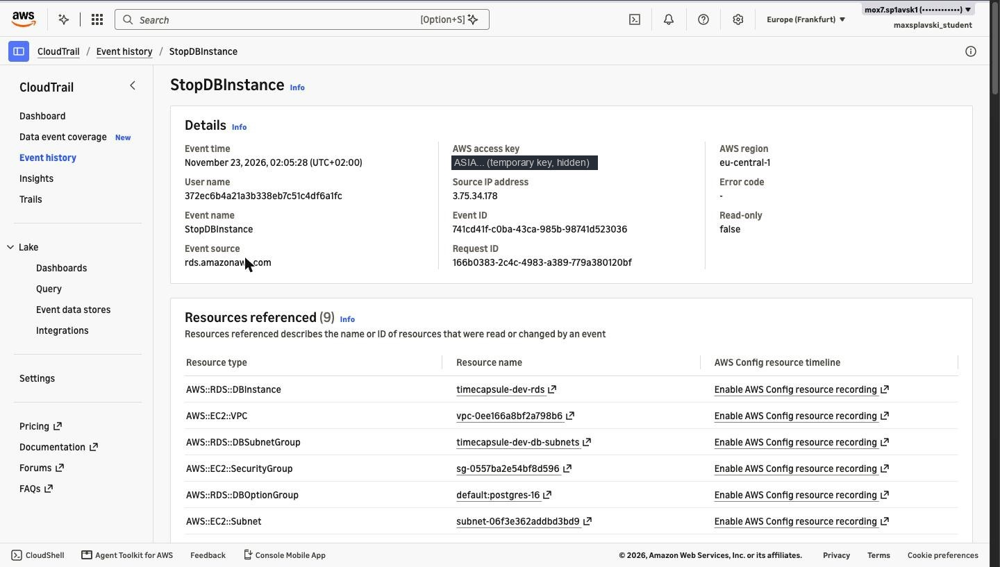
_CloudTrail: `StopDBInstance` в 02:05:28, ресурс `timecapsule-dev-rds`._

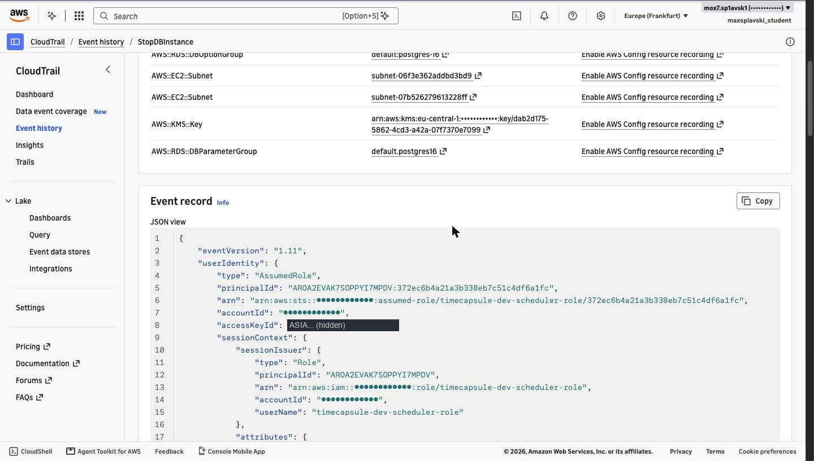
_Кто вызвал: `AssumedRole` - `assumed-role/timecapsule-dev-scheduler-role/<сессия>`. Это не мой пользователь, а роль расписания._

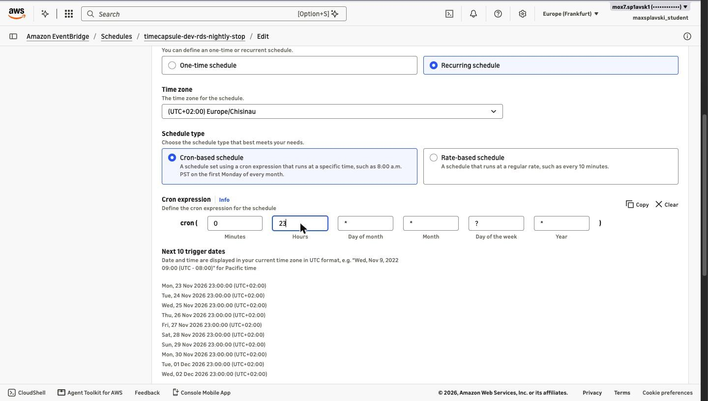
_Выражение заменено на `cron(0 23 * * ? *)`: ближайшие запуски каждый день в 23:00 по Кишинёву. После этого база снова запущена (`Actions` → `Start`)._

> **Зачем расписанию своя роль, если вы и сами можете остановить базу? Почему роль может остановить только одну базу?**
> Расписание срабатывает, когда меня нет в консоли, и у него нет моих учётных данных: EventBridge Scheduler должен от чьего-то имени подписать вызов API, и это делает роль, которую он берёт на себя. Мой пользователь в группе `Admins` может всё, а расписанию нужно одно действие. По принципу наименьших привилегий роль получила только `rds:StopDBInstance` и только на ARN `timecapsule-dev-rds`: если кто-то изменит цель расписания (другая база, `DeleteDBInstance`), вызов получит `AccessDenied`. В журнале CloudTrail видно, что остановку сделала именно эта роль.

### Задание 8. Пользователь и база данных

Подключаюсь к базе с `app-server` под `dbadmin` (пароль в `~/.pgpass`, права 600). Пароль пользователя `timecapsule` беру из `DB_PASSWORD` в `.env` тем же скриптом на сервере: он не попадает ни в историю, ни в вывод, ни в отчёт. Вместо интерактивного `\password` (через ssh без терминала он не работает) скрипт передаёт пароль в `psql` переменной: `ALTER USER timecapsule PASSWORD :'pw'`.

```sql
CREATE USER timecapsule;
ALTER USER timecapsule PASSWORD :'pw';   -- pw = DB_PASSWORD из .env
GRANT timecapsule TO dbadmin;
CREATE DATABASE timecapsule OWNER timecapsule;
```

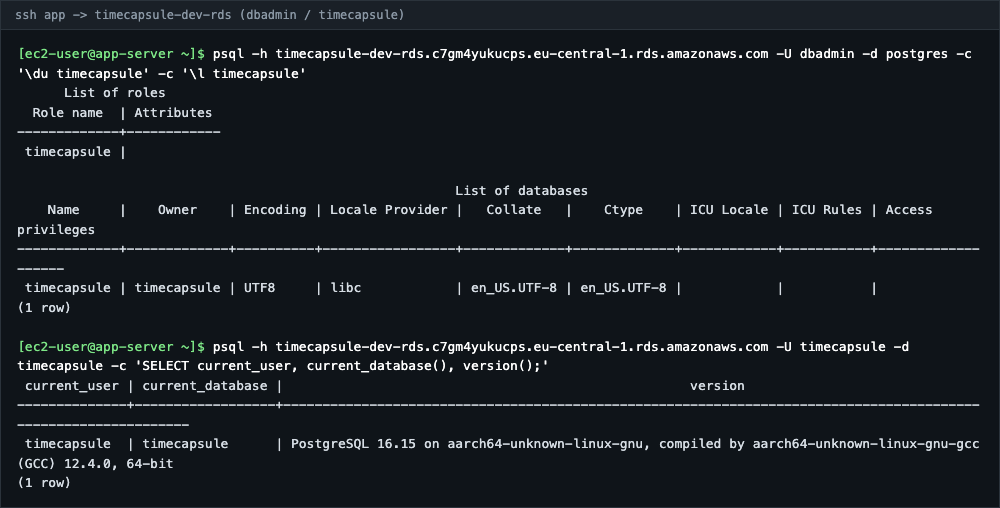
_Пользователь `timecapsule` без особых атрибутов (не суперпользователь, не может создавать базы и роли), база `timecapsule` принадлежит ему. Подключение под `timecapsule` работает, сервер - PostgreSQL 16.15._

> **Почему приложению нужен отдельный пользователь, а не `dbadmin`?**
> `dbadmin` в RDS почти администратор: может создавать и удалять базы и роли, менять параметры, читать все базы экземпляра. Если пароль из `.env` утечёт или в приложении найдётся SQL-инъекция, с `dbadmin` пострадает весь экземпляр, а с `timecapsule` - только своя база и только то, что разрешено её владельцу. Кроме того, пароль `dbadmin` можно хранить отдельно и менять, не трогая приложение, а в журналах базы видно, какие запросы пришли от приложения, а какие от администратора.

### Задание 9. Перенос данных

Приложение я не открывал от `pg_dump` до переключения DNS.

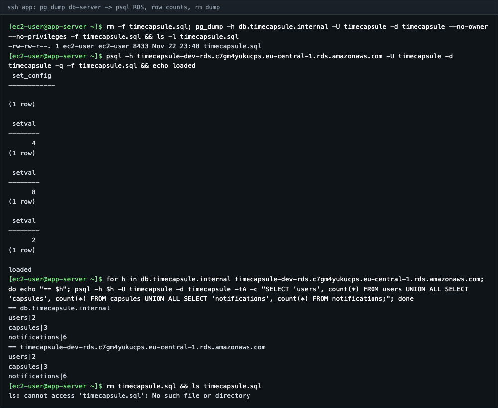
_На `app-server`: `pg_dump` со старой базы (8,4 КБ), загрузка в RDS под `timecapsule`, одинаковые числа строк в обеих базах: `users` 2, `capsules` 3, `notifications` 6. Файл выгрузки удалён (в нём хеши паролей)._

### Задание 10. Переключение приложения

Запись A `db` удалена и CNAME создана **одним** запросом `ChangeResourceRecordSets` (`DELETE` + `CREATE` в одной пачке изменений). Route 53 применяет пачку атомарно, поэтому промежутка, в котором имени `db` нет и ответ NXDOMAIN мог бы закэшироваться, не было вообще.

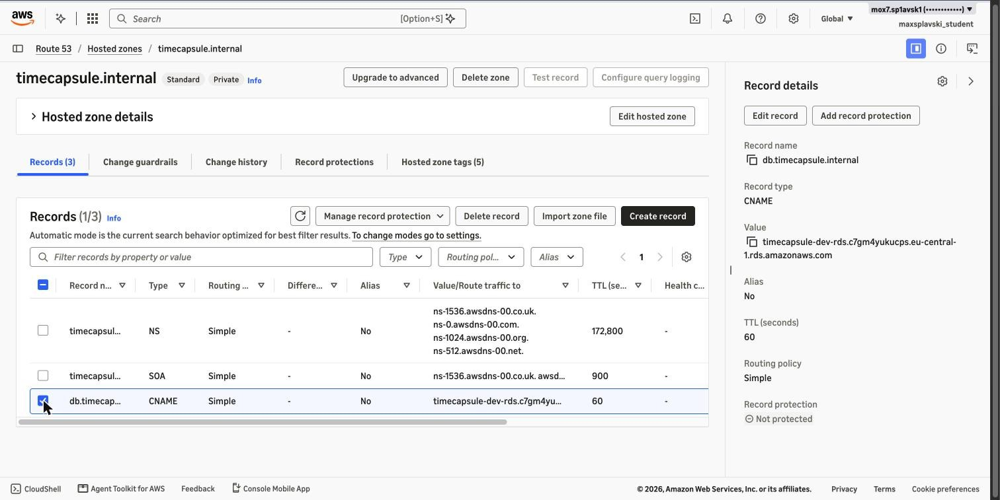
_Зона `timecapsule.internal`: `db.timecapsule.internal` - `CNAME` на `timecapsule-dev-rds.c7gm4yukucps.eu-central-1.rds.amazonaws.com`, TTL 60._

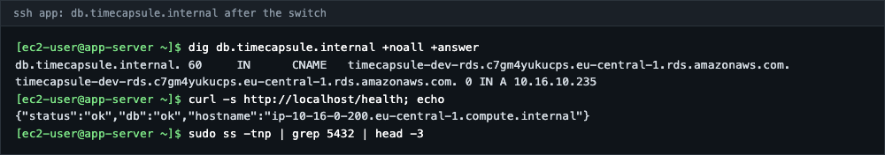
_С `app-server`: через минуту (TTL старой записи A) `dig` отдаёт CNAME и адрес базы 10.16.10.235, `/health` - `ok`._

Шифрование: приложение PHP, а `pdo_pgsql` (libpq) по умолчанию использует `sslmode=prefer`, то есть сам предлагает TLS. Менять `.env` не пришлось.

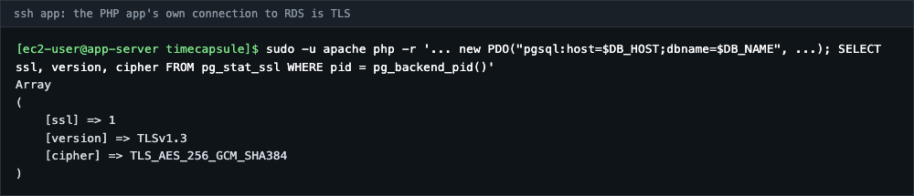
_Подключение самого приложения (под пользователем `apache`, с параметрами из `.env`): `pg_stat_ssl.ssl = true`, TLSv1.3._

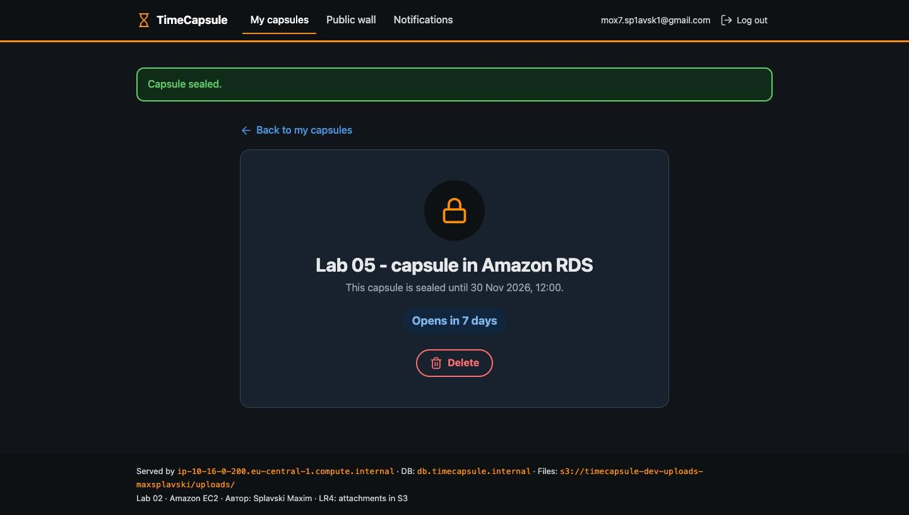
_Новая капсула `Lab 05 - capsule in Amazon RDS`, создана через приложение после переключения._


_Капсула 5 в таблице `capsules` RDS и уведомление о запечатывании в `notifications`. `db-server` остановлен (порт 5432 на 10.16.10.184 не отвечает), а `/health` - `ok`._

После проверки `timecapsule-dev-db` удалён (`Terminate`):


_Серверы: `timecapsule-dev-db` - `Terminated`, работают только `bastion` и `app`. (`lab5-web-server` из Части 1 тоже удалён.)_

> **Почему не пришлось менять `DB_HOST`? Какие обязанности из ЛР3 перешли к AWS, а какие остались за вами?**
> В `.env` с ЛР3 записано не адрес сервера, а имя `db.timecapsule.internal` из своей приватной зоны. Это уровень косвенности: поменялась только DNS-запись (A → CNAME на endpoint RDS), приложение при следующем подключении получило новый адрес. К AWS перешли установка и обновление PostgreSQL и ОС (в окно обслуживания, без моего NAT Gateway), ежедневные снимки и журналы для восстановления на момент времени, контроль и перезапуск экземпляра при сбое хоста, шифрование диска, журнал событий. За мной остались: сеть и доступ (подсети, SG, отсутствие публичного адреса), пользователи и права внутри PostgreSQL, пароли, схема и данные, выбор версии и параметров, расписание остановки и расходы, проверка восстановления и переключение приложения на восстановленную копию.

### Задание 11. Обслуживание базы


_`Reboot`: `/health` опрашивается каждые 2 секунды. С 00:37:08 до 00:37:18 UTC (около 12 секунд) ответ `500` с `"db":"error"` (`Cannot connect to the database`), потом снова `200`. Пользователь увидел бы страницу 500 на эти секунды._


_`Logs & events` по времени Кишинёва: 02:13 `DB instance stopped` (это расписание из задания 7), 02:16-02:18 запуск (`Recovery of the DB instance has started/complete`, `DB instance restarted`), 02:19 `DB instance started`, 02:37 `DB instance shutdown` и `DB instance restarted` - перезагрузка._


_Остановленная база: `/health` отвечает `{"status":"error","db":"error",...}` (HTTP 500)._


_Страница приложения при остановленной базе: `500 Something went wrong`, `Cannot connect to the database`. Вход тоже не работает: пользователь хранится в базе._


_После запуска базы приложение работает без изменений, все четыре капсулы на месте._

Ошибку расписания для уже остановленной базы проверил тем же вызовом API (вывод в конце работы, раздел «Завершение»).

> **Что показывал `/health` во время перезагрузки? Изменился ли endpoint после остановки и запуска? Какую ошибку получает расписание, если база уже остановлена?**
> Во время перезагрузки около 12 секунд `/health` возвращал HTTP 500 и `"db":"error"`, приложение не могло подключиться. Остальное время - `200 ok`. Endpoint не изменился: и после остановки расписанием и запуска, и после перезагрузки это тот же `timecapsule-dev-rds.c7gm4yukucps.eu-central-1.rds.amazonaws.com` (поменяться может только приватный IP за ним, поэтому TTL у CNAME маленький и само имя RDS отдаёт TTL 0-5 с). Если база уже остановлена, `StopDBInstance` возвращает `InvalidDBInstanceState` (`Instance timecapsule-dev-rds is not in available state`). Истории запусков у расписания нет, ошибка видна только в метрике CloudWatch `InvocationAttemptCount`/`TargetErrorCount` для Scheduler и в CloudTrail; базе это не вредит.

### Задание 12. Архитектура и решение


_Схема ЛР5: `db-server` заменён на `timecapsule-dev-rds` в `private-a` с отдельной `timecapsule-dev-rds-sg`; `db.timecapsule.internal` - CNAME на endpoint; EventBridge Scheduler с ролью останавливает базу в 23:00, вызов виден в CloudTrail. Подсеть `private-b` входит в группу подсетей базы (восстановление или Multi-AZ во второй зоне)._

Решение записано в [docs/adr/0004-database-hosting.md](../adr/0004-database-hosting.md): сравнение PostgreSQL на EC2, RDS Single-AZ, RDS Multi-AZ и Aurora; последствия - резервные копии и RPO, стоимость и 7 дней остановки, поиск базы и отказ `eu-central-1a`.

## Завершение работы

- Базовый уровень: `lab5-db`, `lab5-db-replica`, `lab5-db-restore`, их автоматические копии и снимки, `lab5-db-subnets`, `lab5-rds-sg`, `lab5-web-sg` и сервер `lab5-web-server` удалены. В `Databases` остался только `timecapsule-dev-rds`, в `Snapshots` нет снимков `lab5-`.
- Продвинутый уровень: `timecapsule-dev-rds` остановлена (`Stopped temporarily`); группа доступа, группа подсетей, политика, роль и расписание оставлены для следующих работ. `db-server` удалён.
- Повторный вызов `StopDBInstance` для уже остановленной базы (как это сделает расписание в 23:00) вернул `InvalidDBInstanceState: Instance timecapsule-dev-rds is not in available state`. Базе это не вредит.
- Скрипты защиты `start-lab.sh` / `stop-lab.sh` переписаны: база RDS запускается первой и останавливается вместе с серверами, `db-server` из них убран.

## Ответы на устные вопросы

**1. Как проходит запрос от браузера до базы? Какие проверки проходит соединение на каждом шаге?**
Браузер → Internet Gateway → Elastic IP `app-server` (SG `timecapsule-dev-web-sg` пропускает 80 из интернета) → nginx → PHP-FPM. PHP разрешает `db.timecapsule.internal` через Route 53 Resolver VPC: приватная зона отдаёт CNAME на endpoint, тот - приватный IP в `private-a`. Пакет к 5432 идёт по маршруту `local` внутри VPC, NACL подсетей пропускает, SG `timecapsule-dev-rds-sg` пускает только трафик от интерфейсов с `timecapsule-dev-web-sg`. Затем PostgreSQL: соединение шифруется TLS, проверяется пользователь `timecapsule` и пароль, а внутри базы - права роли (она владелец только базы `timecapsule`).

**2. Чем репликация отличается от резервного копирования?**
Репликация непрерывно повторяет все изменения на другом экземпляре (асинхронно у реплики для чтения, синхронно у Multi-AZ): помогает при отказе сервера или зоны и для чтения, но ошибочный `DELETE` попадает в реплику через секунду. Резервная копия (снимок + журналы) хранит прошлые состояния: из неё можно вернуться на момент до ошибки, но это новая база и минуты на восстановление. Нужны обе вещи для разных аварий.

**3. Как пережить отказ зоны `eu-central-1a` и сколько это будет стоить?**
Сейчас - вручную: `Restore to point in time` в `eu-central-1b` (подсеть `private-b` уже в группе подсетей), сервер приложения в `public-b` и смена CNAME `db`; десятки минут простоя и до ~5 минут потерянных изменений, почти без доплаты. Автоматически - включить Multi-AZ (резерв в `1b`, переключение за 1-2 минуты без смены endpoint и без потери данных): экземпляр и хранилище стоят вдвое больше (≈ $0,038/ч и ≈ $5,2/мес за 20 ГиБ), плюс нужен второй сервер приложения в `1b` за балансировщиком (ЛР6). На бесплатном плане Multi-AZ недоступен.

**4. Как вы решили проблему автоматического запуска базы через 7 дней?**
Расписание EventBridge Scheduler `timecapsule-dev-rds-nightly-stop` каждый день в 23:00 по Кишинёву вызывает `StopDBInstance` от роли с правом только на эту базу. Если AWS запустит базу через 7 дней остановки, она проработает не дольше чем до ближайших 23:00. Если база уже остановлена, вызов просто получает `InvalidDBInstanceState`. Дополнительно `stop-lab.sh` останавливает базу после каждого занятия, а бюджет `ZeroSpend` из ЛР2 пришлёт письмо, если что-то начнёт стоить денег.
