# Лабораторная работа №6. Балансировка нагрузки и масштабирование. ALB, Auto Scaling, DynamoDB

- **Студент:** Splavski Maxim
- **Группа:** I2402
- **Специальность:** Informatică
- **Уровень:** продвинутый (Часть 1 + Часть 2, задания 1-7)
- **Репозиторий:** https://github.com/USM-Labs/timecapsule
- **Изменения в коде:** сессии PHP в DynamoDB (`src/bootstrap.php`, коммит [`fc1ce0f`](https://github.com/USM-Labs/timecapsule/commit/fc1ce0f)), подвал `views/layout.php`
- **ADR:** [docs/adr/0005-session-storage.md](../adr/0005-session-storage.md)
- **Предыдущие отчёты:** [ЛР2](../../README.md), [ЛР3](../lab3/README.md), [ЛР4](../lab4/README.md), [ЛР5](../lab5/README.md)

Все ресурсы в `eu-central-1`.

> **Как сделаны скриншоты.** Всё в консоли AWS снято в Chrome под IAM-пользователем `maxsplavski_student`; номер
> аккаунта на страницах скрыт (`••••••••••••`). Страницы приложения сняты в том же браузере, адресная строка
> дорисована сверху, чтобы было видно DNS-имя балансировщика. Значение cookie сессии и CSRF-токен закрыты плашками.
> Вывод скриптов нагрузки - реальный вывод с моего компьютера, отрисованный в нейтральное окно терминала.

---

## Часть 1. Базовый уровень

Ресурсы с префиксом `lab6-`, теги `Project=timecapsule`, `Environment=dev`, `Owner=maxsplavski`, `Lab=lab6`. Все удалены в конце части.

| Ресурс | Имя | Настройки |
| --- | --- | --- |
| SG балансировщика | `lab6-alb-sg` | входящий HTTP 80 из `0.0.0.0/0` |
| SG серверов | `lab6-web-sg` | HTTP 80 только от `lab6-alb-sg`, SSH 22 только от `timecapsule-dev-bastion-sg` |
| Целевая группа | `lab6-tg` | Instances, HTTP:80, проверка `GET /health` каждые 10 с, timeout 5 с, healthy/unhealthy threshold 2/2 |
| Балансировщик | `lab6-alb` | Application, Internet-facing, `public-a` + `public-b`, listener HTTP:80 → `lab6-tg` |
| Шаблон | `lab6-lt` | AL2023, t3.micro, `maxsplavski-keypair`, `lab6-web-sg`, IMDSv2, User data из задания, без подсети |
| Группа | `lab6-asg` | `public-a` + `public-b`, `lab6-tg`, ELB health checks, 2/2/4, политика `lab6-requests-per-target-50` |

### Задание 1. Балансировщик

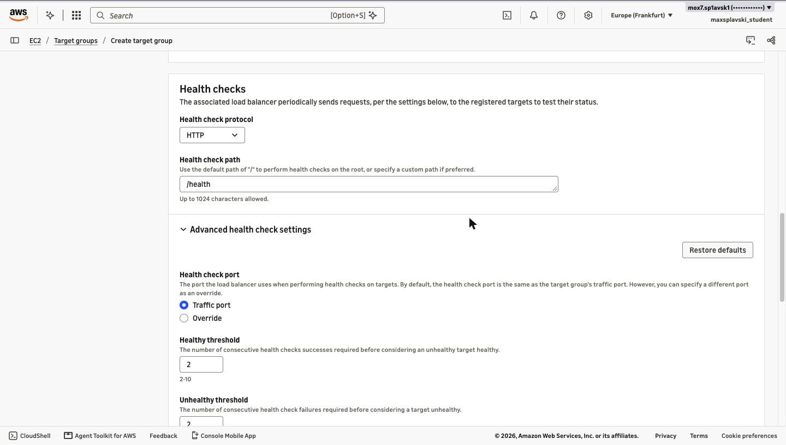
_Целевая группа `lab6-tg`: путь `/health`, интервал 10 с. Пороги 2/2, чтобы новый сервер считался исправным через ~20 секунд._

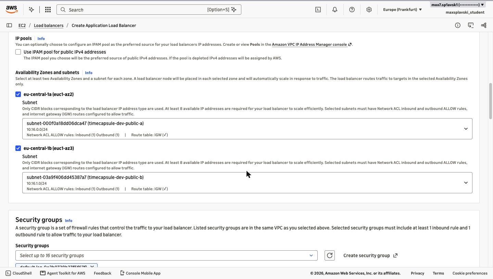
_`lab6-alb`: Internet-facing, VPC `timecapsule-dev-vpc`, по одной публичной подсети в зонах `1a` и `1b`._

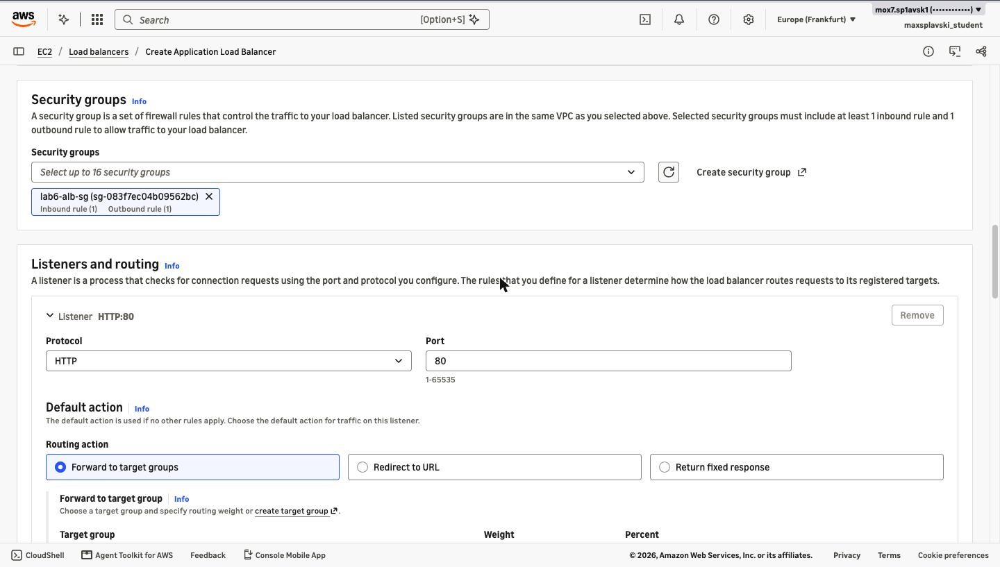
_SG `lab6-alb-sg` (HTTP из любого места), listener HTTP:80 → forward в `lab6-tg`._

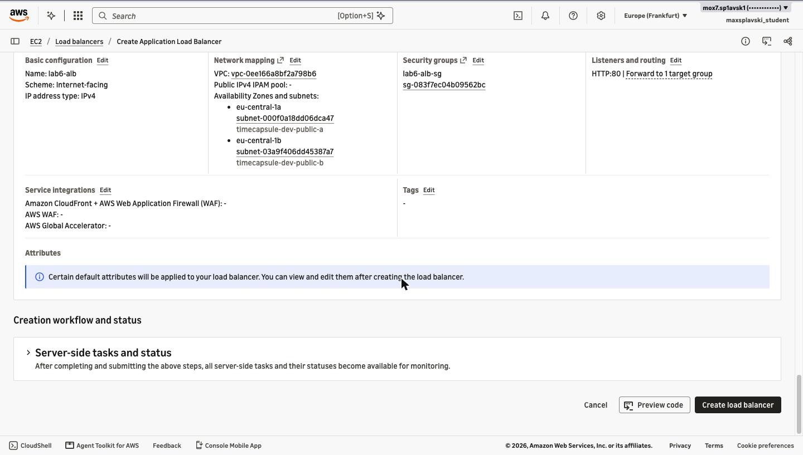
_Итог перед созданием._

Серверы для `lab6-alb` группа запустила почти сразу, поэтому ответ пустого балансировщика я снял на втором, точно так же настроенном балансировщике Части 2 (`timecapsule-dev-alb`) до создания его группы:

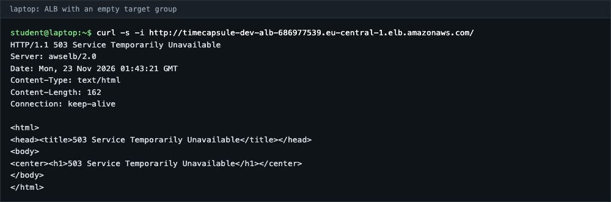
_ALB без исправных целей: `503 Service Temporarily Unavailable`, `Server: awselb/2.0` - ответ формирует сам балансировщик._

> **Какой ответ вернул балансировщик и почему? Зачем ему подсети в двух зонах?**
> `503 Service Temporarily Unavailable`: listener работает, но в `lab6-tg` нет ни одной исправной цели, отправить запрос некому (серверов ещё нет). Балансировщик ставит узел в каждую выбранную зону, и DNS-имя отдаёт адреса всех узлов. При отказе одной зоны работает узел в другой. Кроме того, ALB вообще нельзя создать меньше чем в двух зонах: это требование AWS для отказоустойчивости. Цели в зоне без узла балансировщика трафик не получили бы.

### Задание 2. Группа Auto Scaling

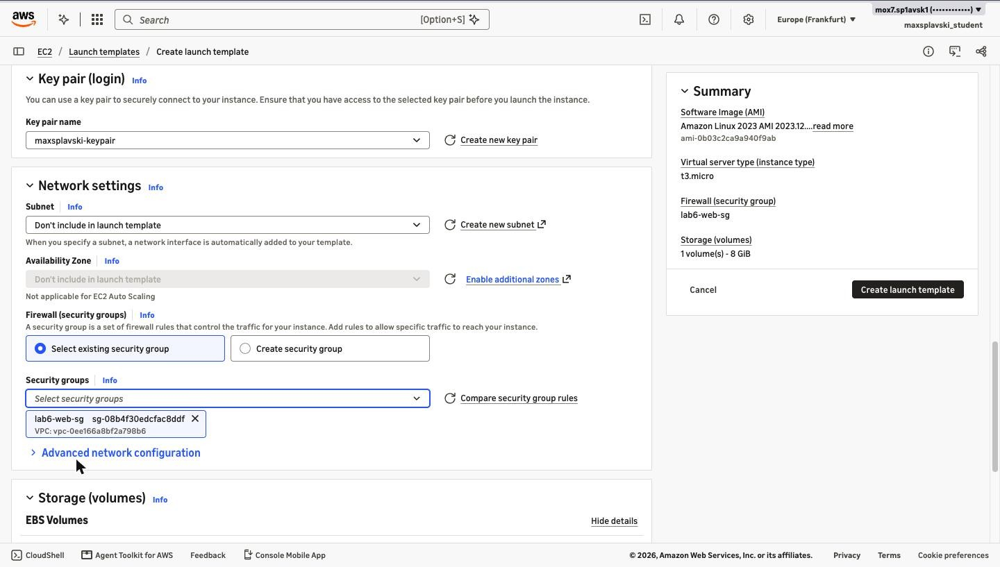
_Шаблон `lab6-lt`: AL2023, t3.micro, ключ, SG `lab6-web-sg`, подсеть `Don't include in launch template`._

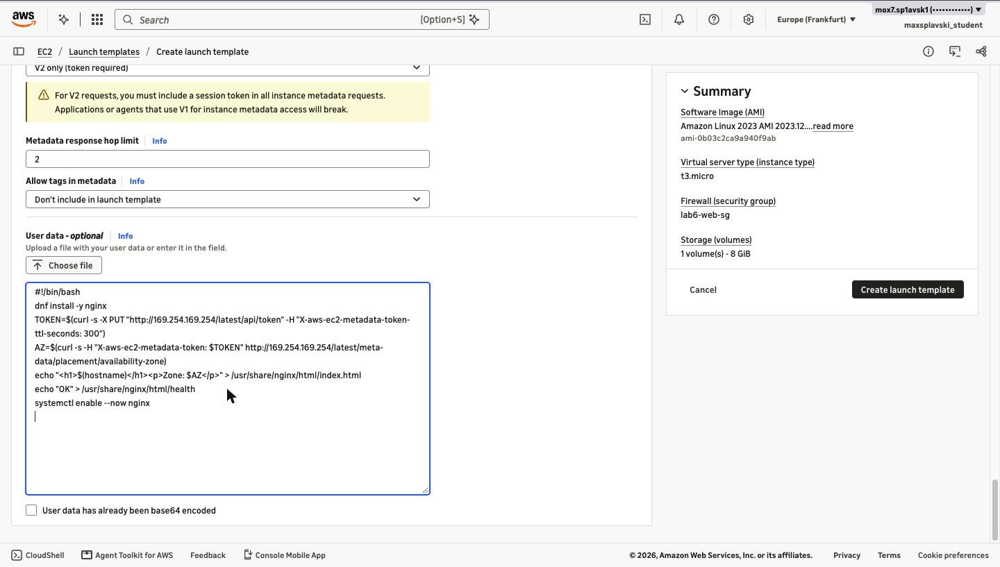
_User data из задания: nginx, страница с `hostname` и зоной (зона берётся из IMDSv2), файл `/health`._

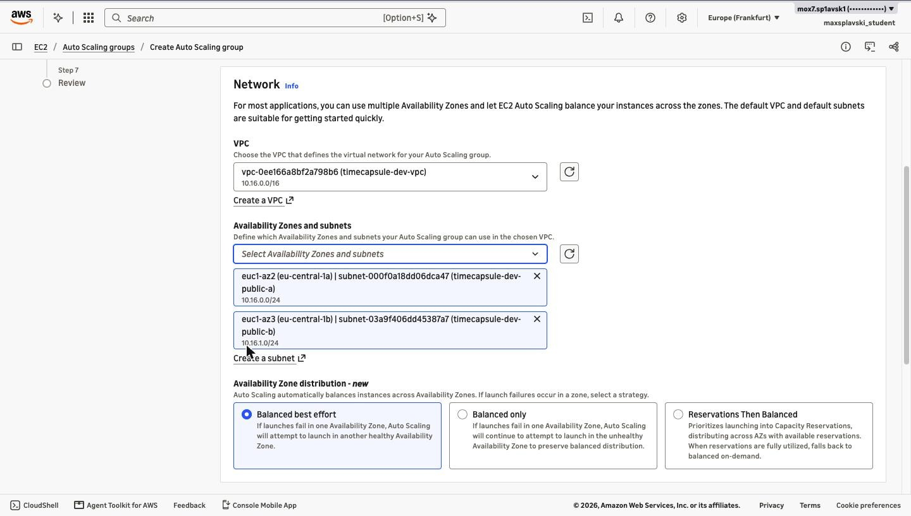
_Группа `lab6-asg`: VPC `timecapsule-dev-vpc`, подсети `public-a` и `public-b`._

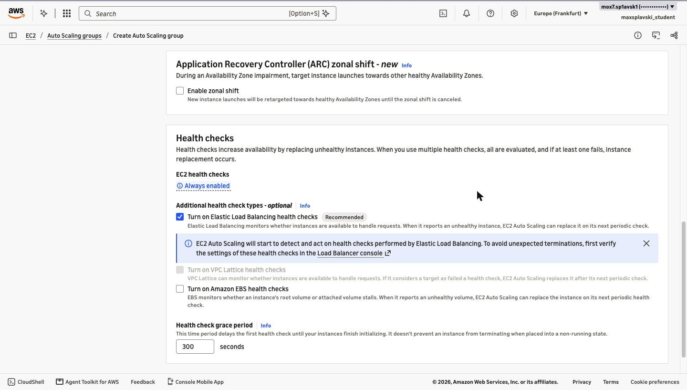
_Группа подключена к `lab6-tg`, включены `Elastic Load Balancing health checks`, grace period 300 с._

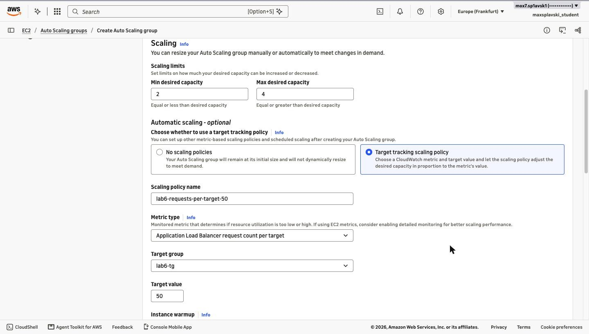
_Желаемое 2, минимум 2, максимум 4; target tracking по `Application Load Balancer request count per target` для `lab6-tg`, цель 50._

Политика при создании группы не создалась (`Failed to create 1 Scaling policy`): AWS в этот момент создавал служебную роль `AWSServiceRoleForAutoScaling` (её `CreateDate` совпадает со временем создания группы). Через минуту я добавил ту же политику на вкладке `Automatic scaling`, warmup 60 с:

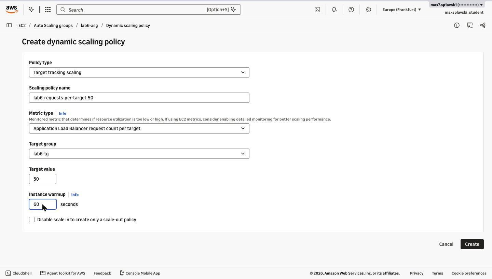

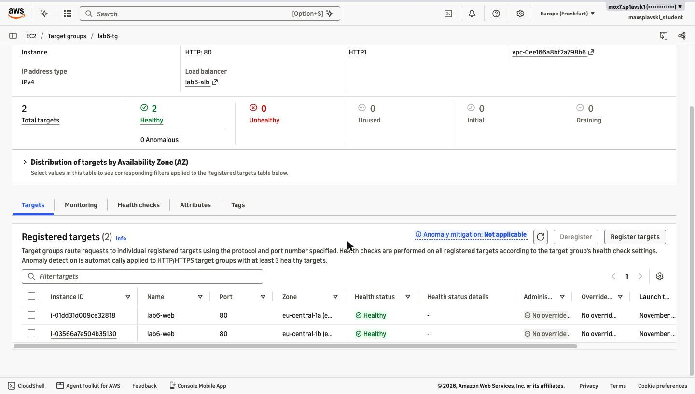
_Обе цели `lab6-web` в `lab6-tg` - `Healthy`, одна в `eu-central-1a`, другая в `eu-central-1b`._

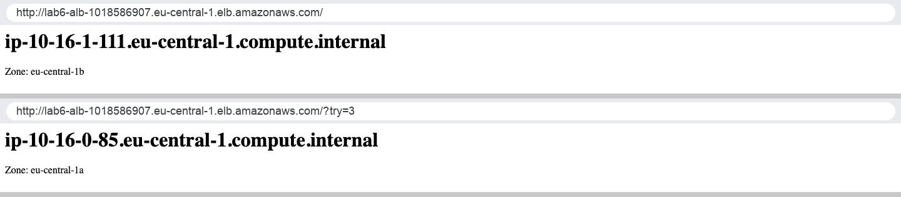
_Обновления страницы балансировщика: отвечают разные серверы - `ip-10-16-1-111` (зона `1b`) и `ip-10-16-0-85` (зона `1a`). Браузер держит keep-alive соединение, но ALB распределяет каждый запрос отдельно, поэтому сервер меняется между запросами._

> **Чем группа Auto Scaling отличается от целевой группы? Почему в шаблоне нет подсети?**
> Целевая группа - это список адресатов для балансировщика: куда слать запросы и как проверять, что адресат жив. Серверы она не создаёт и не удаляет. Группа Auto Scaling управляет самими серверами: сколько их должно быть, где их запускать, когда добавить или заменить; при запуске она регистрирует новый сервер в целевой группе, при удалении снимает. Подсеть в шаблоне не указана, потому что подсети выбирает группа: она распределяет серверы по зонам (`public-a`/`public-b`) и при отказе зоны запускает замену в другой. Подсеть в шаблоне привязала бы все серверы к одной зоне.

### Задание 3. Нагрузка

Нагрузку давал со своего компьютера скриптом из задания, запущенным сразу в двух параллельных циклах (`tools/load.sh`), чтобы нагрузка точно превысила цель:

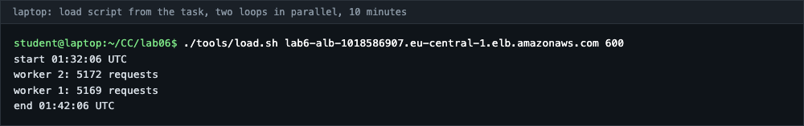
_Два цикла по 10 минут (01:32:06-01:42:06 UTC): 5169 + 5172 запроса, около 1030 запросов в минуту на балансировщик._

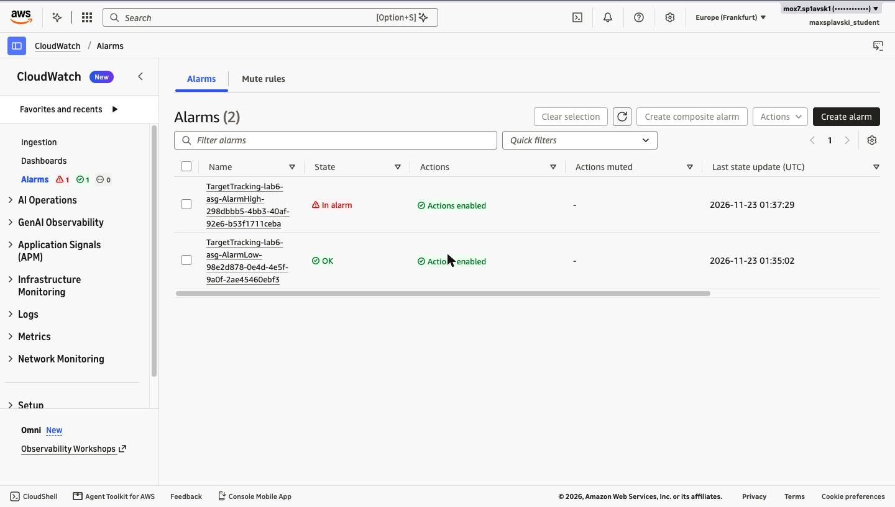
_Тревоги, которые политика target tracking создала сама: `TargetTracking-lab6-asg-AlarmHigh-...` и `...-AlarmLow-...`._

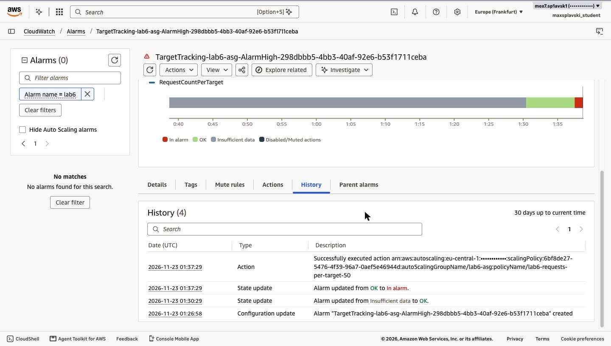
_`History` тревоги `AlarmHigh`: 01:37:29 UTC переход `OK` → `In alarm` и выполнено действие - политика `lab6-requests-per-target-50`._

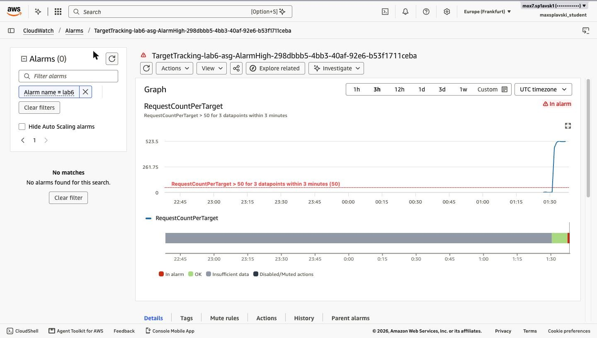
_Страница тревоги: график `RequestCountPerTarget` и линия порога._

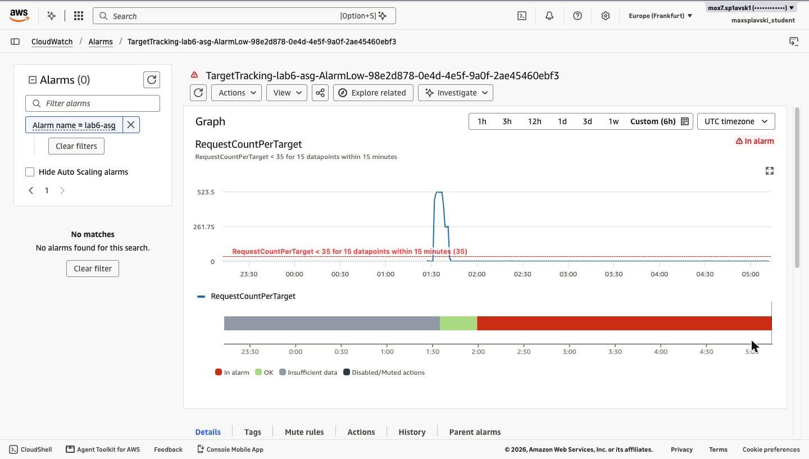
_Метрика `RequestCountPerTarget` для `lab6-tg` (Sum, 1 мин): около 520 запросов на сервер при двух серверах, после запуска ещё двух - около 260, после окончания нагрузки - ноль._

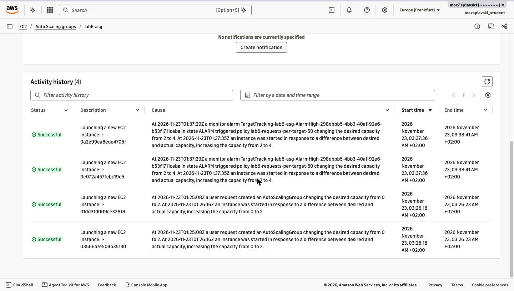
_`Activity`: в 01:37:29 UTC тревога `AlarmHigh` изменила желаемое число с 2 на 4, через 6 секунд запущены два сервера. Ниже - создание группы с двумя серверами._

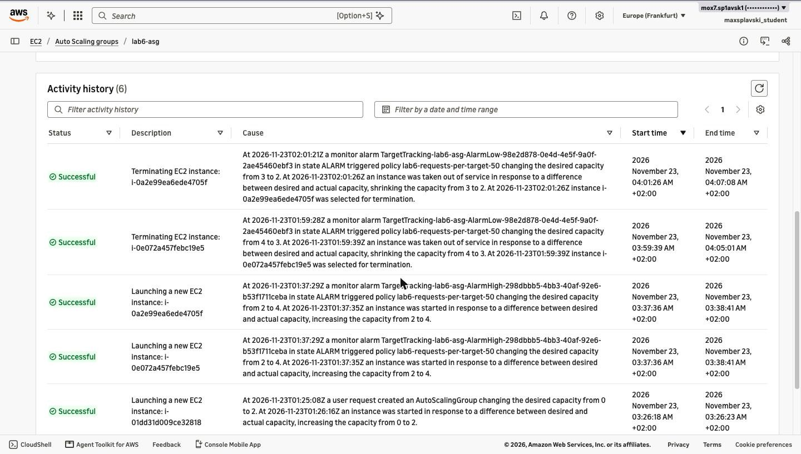
_После нагрузки (конец в 01:42) тревога `AlarmLow` уменьшила группу: в 01:59 и 02:01 UTC удалено по одному серверу, группа вернулась к двум. Это ~17-19 минут после конца нагрузки._

> **Сколько серверов запустила группа и почему не больше четырёх? Почему метрика упала после запуска новых серверов, хотя запросов не стало меньше? Почему группа добавляет серверы быстрее, чем убирает?**
> Группа запустила два сервера (2 → 4). По расчёту target tracking нужно было ~1030 / 50 ≈ 20 серверов, но максимум группы - 4, и выше него политика не поднимает желаемое число. Метрика - это запросы, делённые на число исправных целей: те же ~1030 запросов в минуту распределились на 4 сервера вместо 2, поэтому на каждый пришлось вдвое меньше (~520 → ~260). Рост срабатывает после 3 точек выше порога (~3 минуты), а уменьшение - только после 15 точек ниже порога (`AlarmLow` смотрит 15 минут) и по одному шагу: лишний сервер стоит немного денег, а нехватка серверов при новом всплеске - отказы пользователям, поэтому AWS масштабирует вверх агрессивно, а вниз осторожно.

### Завершение Части 1

Удалены группа `lab6-asg` (вместе с её серверами), балансировщик `lab6-alb`, целевая группа `lab6-tg`, шаблон `lab6-lt`, SG `lab6-alb-sg` и `lab6-web-sg`; тревоги target tracking удалились вместе с политикой. Проверка через API (`DescribeAutoScalingGroups`, `DescribeLoadBalancers`, `DescribeTargetGroups`, `DescribeLaunchTemplates`, `DescribeSecurityGroups`): ресурсов с префиксом `lab6-` не осталось.

## Часть 2. Продвинутый уровень

Ресурсы по соглашению ЛР3, теги `Project=timecapsule`, `Environment=dev`, `Owner=maxsplavski`, `Lab=lab6`.

| Ресурс | Имя | Настройки |
| --- | --- | --- |
| Таблица DynamoDB | `timecapsule-dev-sessions` | ключ `id` (String), On-demand, TTL по атрибуту `expires` |
| Политика IAM | `timecapsule-dev-app-sessions` | `dynamodb:GetItem`, `PutItem`, `UpdateItem`, `DeleteItem` только на ARN этой таблицы; прикреплена к `timecapsule-dev-app-role` |
| Образ | `timecapsule-dev-app-lab6` (`ami-0079e673870ff75eb`) | снят с `app-server` после выпуска версии с сессиями в DynamoDB (коммит `fc1ce0f`). В задании образ назван и `timecapsule-dev-app-lab6` (таблица), и `timecapsule-dev-app-image` (текст); я взял имя из таблицы |
| Шаблон | `timecapsule-dev-app-lt` | этот AMI, t3.micro, instance profile `timecapsule-dev-app-role`, SG `timecapsule-dev-web-sg`, IMDSv2 |
| SG балансировщика | `timecapsule-dev-alb-sg` | HTTP 80 из `0.0.0.0/0` |
| SG серверов | `timecapsule-dev-web-sg` (та же, что у `app-server`) | HTTP 80 **только от `timecapsule-dev-alb-sg`** (правило `0.0.0.0/0` удалено), SSH от bastion; база пускает эту SG по 5432 |
| Целевая группа | `timecapsule-dev-tg` | HTTP:80, проверка `GET /health` (приложение проверяет и базу), 10 с, пороги 2/2 |
| Балансировщик | `timecapsule-dev-alb` | Internet-facing, `public-a` + `public-b`, HTTP:80 → `timecapsule-dev-tg` |
| Группа | `timecapsule-dev-asg` | `public-a` + `public-b`, ELB health checks (grace 180 с), 2/2/4, политика `timecapsule-dev-requests-per-target-50` |

### Задание 4. Сессии в DynamoDB

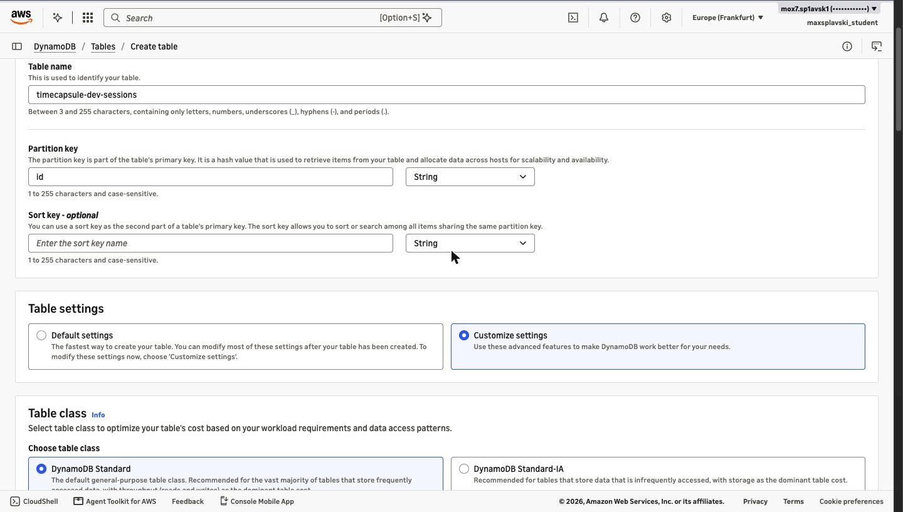
_Таблица `timecapsule-dev-sessions`, ключ раздела `id` типа String (вариант `open_capsules_php_functional`)._

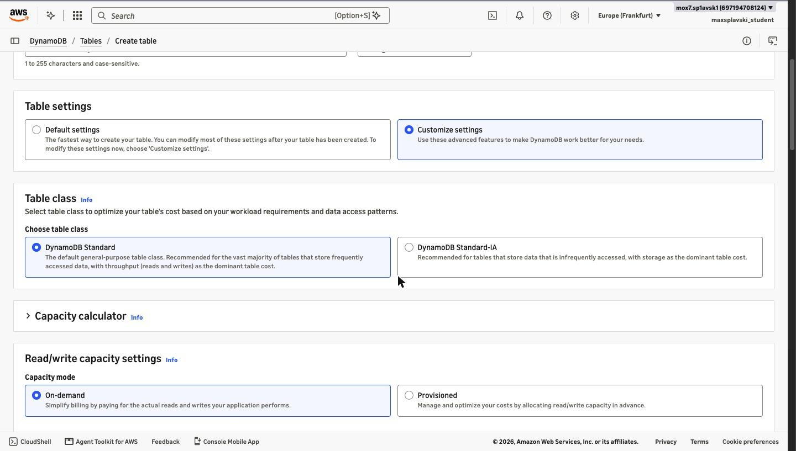
_`Customize settings` → `On-demand`: платим за запросы, мощность настраивать не нужно. TTL на атрибут `expires` включён сразу после создания._

Изменение кода (коммит [`fc1ce0f`](https://github.com/USM-Labs/timecapsule/commit/fc1ce0f)) - в [`src/bootstrap.php`](../../src/bootstrap.php) вместо `session_save_path()`:

```php
$table = config('SESSIONS_TABLE', '');
if ($table !== '') {
    $client = new Aws\DynamoDb\DynamoDbClient([
        'region' => config('AWS_REGION', 'eu-central-1'),
        'version' => 'latest',
    ]);
    Aws\DynamoDb\SessionHandler::fromClient($client, [
        'table_name' => $table,
        'hash_key' => 'id',
        'session_lifetime_attribute' => 'expires',
        'session_lifetime' => 3600,
    ])->register();   // до session_start()
} else {
    session_save_path(ROOT_DIR . '/storage/sessions');   // локальный Docker без AWS
}
```

В `.env` сервера добавлена строка `SESSIONS_TABLE=timecapsule-dev-sessions` (после правки - `chgrp apache .env`). Ключей доступа нет: SDK берёт временные учётные данные роли `timecapsule-dev-app-role` из IMDSv2, как в ЛР4. Выпуск - `deploy.sh` на `app-server` (`git pull`, `composer install`, `init-db.php`, `reload php-fpm`). Первый запуск `deploy.sh` упал на `init-db.php`: база RDS ещё стартовала после ночной остановки; после её запуска выпуск прошёл.

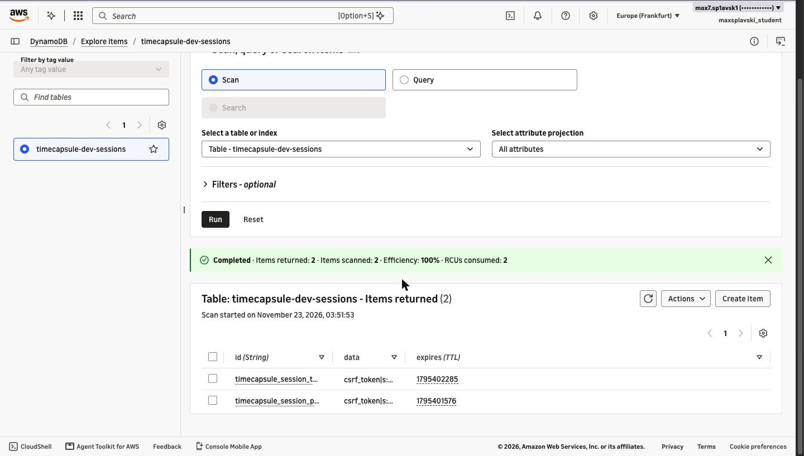
_`Explore table items`: элементы `timecapsule_session_...` с атрибутами `data` и `expires` (TTL). Первый элемент появился после проверочного `curl` к `/login` на сервере, второй - мой вход через балансировщик._

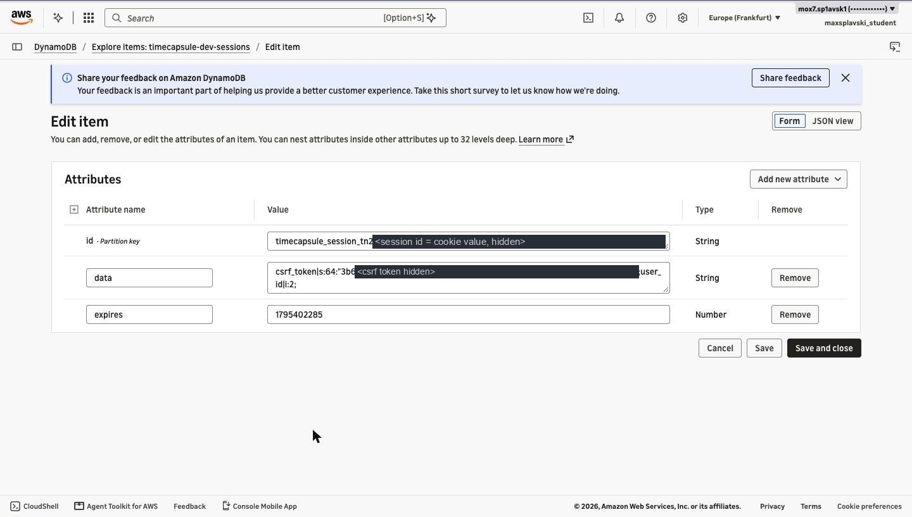
_Моя сессия: `data` = `csrf_token|s:64:"...";user_id|i:2;` (пользователь 2 - мой), `expires` - Unix-время истечения (через час). Значение `id` совпадает со значением cookie `timecapsule_session`, поэтому оно и CSRF-токен закрыты плашками._

> **Почему сессии нельзя оставить в файлах, когда серверов несколько? Зачем Node.js нужен `initialized: true`?**
> Файл сессии лежит на диске того сервера, где пользователь вошёл. Балансировщик отправляет следующий запрос на любой исправный сервер: там такого файла нет, и пользователь «разлогинен», а форма с CSRF-токеном не проходит проверку. Сервер из группы может быть удалён при уменьшении группы или заменён, и его файлы пропадут. Хранилище сессий должно быть общим для всех серверов - таблица DynamoDB. `connect-dynamodb` без `initialized: true` при старте пытается сам создать таблицу (`DescribeTable`/`CreateTable`). Роли приложения таких прав не дают (только Get/Put/Update/DeleteItem), поэтому пакет падал бы с `AccessDenied`; флаг говорит, что таблица уже создана и проверять её не нужно. В PHP-варианте `SessionHandler::fromClient` таблицу не создаёт.

### Задание 5. Приложение в группе Auto Scaling

Порядок был такой: выпуск версии с сессиями → проверка, что сессии пишутся в таблицу → `APP_URL` в `.env` заменён на DNS-имя балансировщика → из `~/.pgpass` удалена строка с паролем `dbadmin` (в образ попадает всё содержимое диска) → образ `timecapsule-dev-app-lab6` (с перезагрузкой, чтобы файловая система была согласованной).

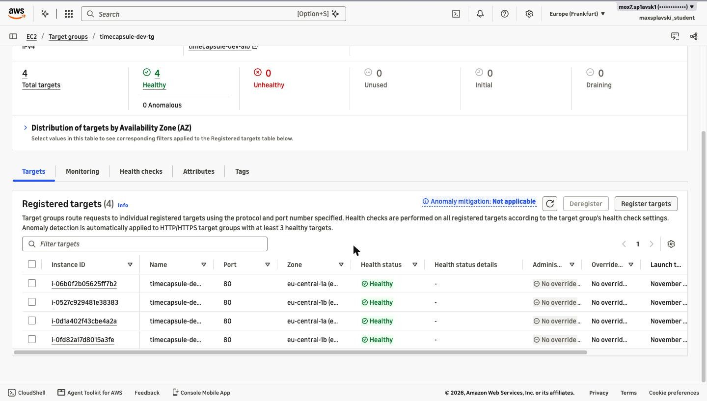
_`timecapsule-dev-tg` (снято во время задания 6, когда группа уже выросла): все четыре сервера группы, по два в зонах `1a` и `1b`, - `Healthy` по проверке `/health`, которая требует ответа от базы. До нагрузки их было два, по одному в зоне._

После этого `app-server` остановлен, Elastic IP `63.189.89.102` отвязан и освобождён, а из `timecapsule-dev-web-sg` удалено правило `HTTP 80 from 0.0.0.0/0` - теперь HTTP к серверам приложения проходит только от `timecapsule-dev-alb-sg`.

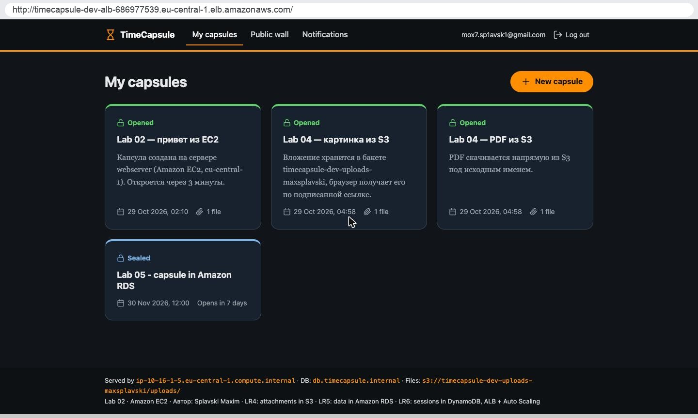
_Приложение по DNS-имени балансировщика, вход выполнен (`mox7.sp1avsk1@gmail.com`). В подвале `Served by ip-10-16-1-5` (зона `1b`)._


_Следующее обновление: `Served by ip-10-16-0-88` (зона `1a`), вход сохранился - сессия читается из DynamoDB, а не с диска сервера._

> **Почему Elastic IP больше не нужен? Почему у всех серверов группы одинаковые `.env` и секреты? Что станет с проверкой `/health`, если базу остановить?**
> Пользователи приходят на DNS-имя балансировщика, у которого свои адреса в каждой зоне; серверы группы появляются и исчезают, и постоянный адрес одного сервера ничего не даёт. Свободный Elastic IP к тому же стоит денег. Все серверы запускаются из одного образа, а в образе уже лежит `.env` с `DB_HOST`, `DB_PASSWORD`, `S3_BUCKET`, `SESSIONS_TABLE` - серверы взаимозаменяемы и обращаются к одним и тем же общим ресурсам (RDS, S3, DynamoDB) с одной ролью. Обратная сторона: смена пароля требует нового образа или внешнего хранилища секретов (Secrets Manager / Parameter Store). Если базу остановить, `/health` на всех серверах вернёт 500 `"db":"error"`, балансировщик через 2 проверки (~20 с) пометит все цели `unhealthy` и будет отвечать 502/503, а группа с ELB health checks начнёт заменять серверы, хотя причина не в них - новые серверы тоже будут «больными». Поэтому базу нужно запускать раньше группы.

### Задание 6. Нагрузка на приложение

Нагрузка тем же скриптом (два параллельных цикла, 10 минут) на `timecapsule-dev-alb`, в это время я пользовался приложением в браузере.

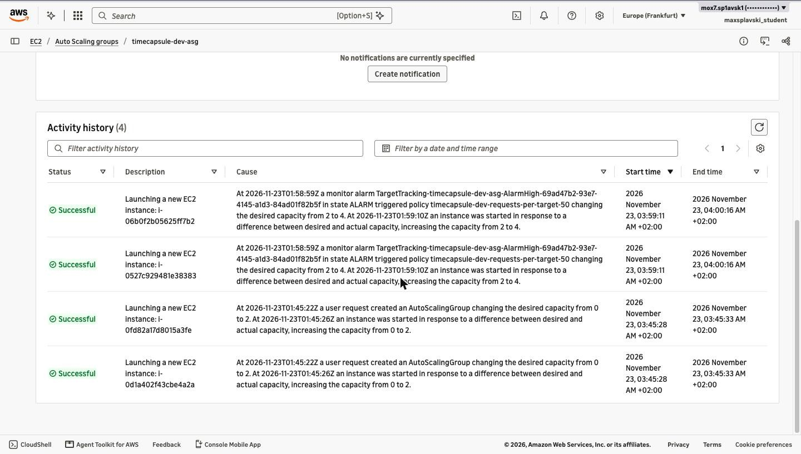
_`Activity` группы `timecapsule-dev-asg`: 01:45 создание с двумя серверами; 01:58:59 тревога `AlarmHigh` (`RequestCountPerTarget` около 220 при цели 50) переводит желаемое число с 2 на 4, запускаются два сервера._

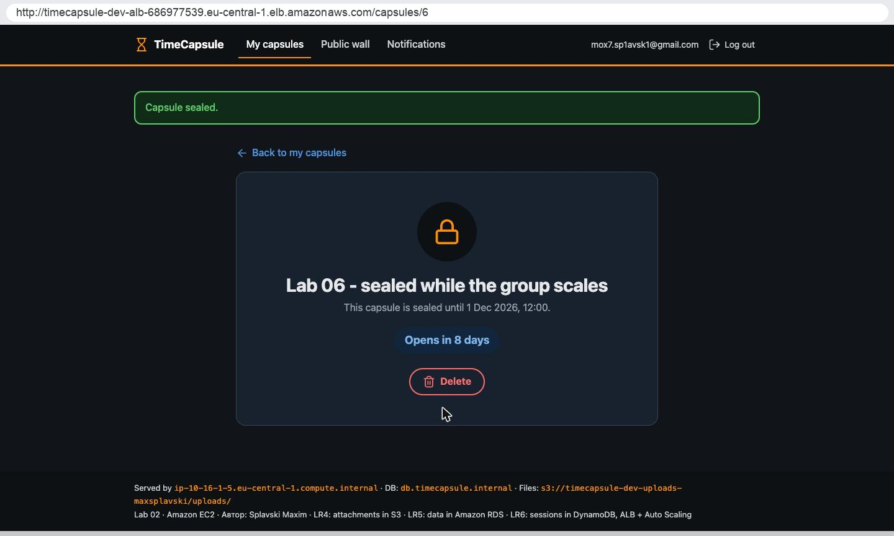
_Во время нагрузки создана капсула `Lab 06 - sealed while the group scales`._

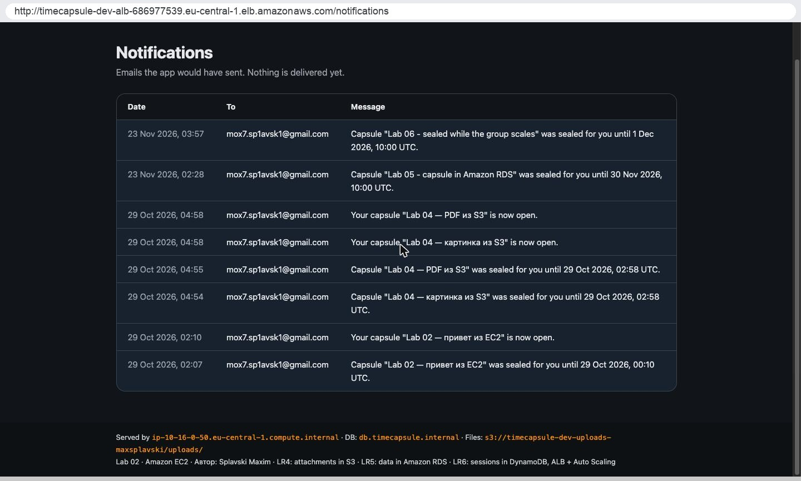
_Страница уведомлений после роста группы: `Served by ip-10-16-0-50` - это один из серверов, запущенных масштабированием, и я по-прежнему вошёл в приложение; в списке есть уведомление о только что запечатанной капсуле._

> **Пришлось ли входить заново, когда группа добавляла или удаляла серверы? Почему?**
> Нет. Cookie браузера хранит только идентификатор сессии, а сама сессия (кто вошёл, CSRF-токен) лежит в таблице DynamoDB. Новый сервер, запущенный из того же образа, с той же ролью и тем же `SESSIONS_TABLE`, по идентификатору из cookie читает ту же запись. Удаление сервера тоже ничего не теряет: на его диске сессий не было. Запросы, которые шли на удаляемый сервер в момент удаления, балансировщик успевает завершить (deregistration delay), а новые отправляет на оставшиеся.

### Задание 7. Архитектура и решение

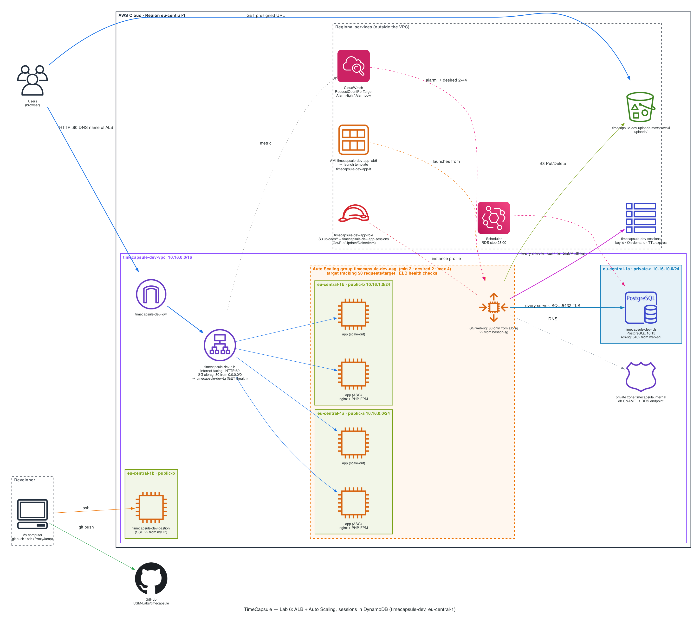
_Схема ЛР6 (AWS Architecture Icons, `tools/diagram6.py`): пользователи приходят на DNS-имя `timecapsule-dev-alb`, балансировщик распределяет запросы по серверам группы `timecapsule-dev-asg` в зонах `1a` и `1b`. Каждый сервер ходит в общую базу RDS (по `db.timecapsule.internal`), в таблицу сессий DynamoDB и в бакет S3 с одной ролью `timecapsule-dev-app-role`. Серверы запускаются из образа `timecapsule-dev-app-lab6` через шаблон `timecapsule-dev-app-lt`; CloudWatch по `RequestCountPerTarget` меняет желаемое число серверов. Elastic IP больше нет, HTTP к серверам приходит только от балансировщика._

Решение о хранении сессий: [ADR-0005](../adr/0005-session-storage.md). Сравнены sticky sessions с файлами на сервере, таблица в RDS и DynamoDB; выбрана DynamoDB - общее хранилище без серверов, TTL для старых сессий, права только на одну таблицу, правка ~15 строк кода.

### Завершение работы

Балансировщик `timecapsule-dev-alb` удалён. Группа `timecapsule-dev-asg` тоже удалена: без балансировщика её серверы никому не нужны, а для ЛР7 и защиты она пересоздаётся из сохранённого шаблона `timecapsule-dev-app-lt` за пару минут. Оставлены таблица `timecapsule-dev-sessions`, целевая группа `timecapsule-dev-tg`, политика `timecapsule-dev-app-sessions`, образ `timecapsule-dev-app-lab6` и шаблон `timecapsule-dev-app-lt`. Остановлены база `timecapsule-dev-rds`, `bastion` и `app-server`.

## Контрольные вопросы

**1. Как проходит запрос от браузера до базы и таблицы сессий?**
Браузер получает по DNS адреса узлов `timecapsule-dev-alb` и отправляет HTTP на порт 80 через Internet Gateway; SG балансировщика пускает его из интернета. Listener пересылает запрос одному из исправных серверов `timecapsule-dev-tg`, и SG серверов пропускает его только потому, что он пришёл от `timecapsule-dev-alb-sg`. На сервере nginx передаёт его PHP-FPM: `SessionHandler` по cookie `timecapsule_session` делает `GetItem` в `timecapsule-dev-sessions` (HTTPS к региональному endpoint DynamoDB, учётные данные роли из IMDSv2), приложение выполняет SQL к `db.timecapsule.internal` → CNAME → RDS в `private-a` (5432, SG базы пускает только `web-sg`). В конце запроса сессия записывается обратно (`PutItem`), а ответ идёт тем же путём через балансировщик.

**2. Чем проверка балансировщика отличается от проверки группы Auto Scaling?**
Балансировщик каждые 10 с запрашивает `GET /health` и по ответу решает, слать ли серверу трафик: `unhealthy` цель остаётся работать, просто не получает запросов, а при выздоровлении возвращается. Группа по умолчанию смотрит только на статус EC2 (сервер запущен, системные проверки прошли) и заменяет машину, которая сломалась на уровне железа или ОС. С включёнными ELB health checks группа учитывает и мнение балансировщика: сервер, который не отвечает на `/health`, после grace period удаляется и заменяется новым. Поэтому плохой `/health` (например, остановленная база) приводит не только к 503, но и к бесполезной замене серверов.

**3. Что произойдёт при отказе зоны `eu-central-1a`?**
Узел балансировщика в `1a` пропадёт из DNS, серверы группы в `1a` станут `unhealthy`, и запросы пойдут на серверы в `1b`; группа запустит замену в `public-b`, чтобы вернуть желаемое число. Сессии в DynamoDB (региональный сервис) и файлы в S3 останутся доступны, поэтому пользователи не потеряют вход. Но база `timecapsule-dev-rds` Single-AZ и находится в `1a`: страницы с данными и `/health` будут отвечать ошибкой, пока зона не вернётся или пока я не восстановлю базу из копии в `1b` (PITR, ADR-0004). Для настоящей отказоустойчивости нужна Multi-AZ база.
