# Лабораторная работа №7. Бессерверные вычисления и события. AWS Lambda, Amazon SQS, Amazon SNS

- **Студент:** Splavski Maxim
- **Группа:** I2402
- **Специальность:** Informatică
- **Уровень:** продвинутый (Часть 1 + Часть 2, задания 1-10)
- **Репозиторий приложения:** https://github.com/USM-Labs/timecapsule
- **Lambda-функции:** https://github.com/USM-Labs/timecapsule-mailer, https://github.com/USM-Labs/timecapsule-opener
- **Изменения в коде:** публикация `capsule.sealed` и отключение открытия капсул в запросах (`src/events.php`, коммит [`b2f8258`](https://github.com/USM-Labs/timecapsule/commit/b2f8258)), подвал и `docs/events.md` ([`63f6525`](https://github.com/USM-Labs/timecapsule/commit/63f6525))
- **Формат событий:** [docs/events.md](../events.md) · **ADR:** [docs/adr/0006-background-jobs.md](../adr/0006-background-jobs.md)
- **Предыдущие отчёты:** [ЛР2](../../README.md), [ЛР3](../lab3/README.md), [ЛР4](../lab4/README.md), [ЛР5](../lab5/README.md), [ЛР6](../lab6/README.md)

Все ресурсы в `eu-central-1`.

> **Как сделаны скриншоты.** Консоль AWS, приложение и почта сняты в Chrome под IAM-пользователем `maxsplavski_student`;
> номер аккаунта скрыт (`••••••••••••` или серая плашка). Пароли базы, переменные окружения функций со значениями и
> `.env` в отчёт не попали: пароль роли `timecapsule_worker` сгенерирован локально и передан в функции через временный
> объект S3, удалённый сразу после создания функций. Вывод `psql` - реальный вывод на `app-server`, отрисованный в
> нейтральное окно терминала.

---

## Часть 1. Базовый уровень

Ресурсы с префиксом `lab7-`, теги `Lab=lab7`, `Project=timecapsule`, `Environment=dev`, `Owner=maxsplavski`. Все удалены в конце части.

| Ресурс | Имя | Настройки |
| --- | --- | --- |
| Тема SNS | `lab7-reviews` | Standard |
| Очередь | `lab7-reviews-queue` | Standard, таймаут видимости **30 с**, хранение **4 дня**, redrive в `lab7-reviews-dlq` после **5** получений; политика доступа: `sqs:SendMessage` только для `sns.amazonaws.com` с `aws:SourceArn` = ARN темы |
| DLQ | `lab7-reviews-dlq` | Standard, хранение **14 дней** |
| Подписка очереди | `lab7-reviews` → `lab7-reviews-queue` | `Raw message delivery` сначала выключено, затем **включено** |
| Lambda-функция | `lab7-review-worker` | Python 3.13, arm64, 128 МБ, таймаут **5 с**, роль `lab7-review-worker-role` (`AWSLambdaSQSQueueExecutionRole`), код в [`files/review-worker`](files/review-worker/lambda_function.py) |
| Триггер | `lab7-reviews-queue` → `lab7-review-worker` | пачка до **10** сообщений, окно сбора пачки **3 с** |
| Подписка почты | `lab7-reviews` → `mox7.sp1avsk1@gmail.com` | фильтр по атрибутам `{"rating": [{"numeric": ["<", 3]}]}` |

Ресурсы создавал через API (AWS MCP), отзывы публиковал из консоли SNS (`Publish message`, первый отзыв) и вызовом `sns:Publish` через API (остальные), со скриншотами из консоли под IAM-пользователем. AWS CLI на этом компьютере в работе не использовался, поэтому вывода `aws sns publish` в отчёте нет.

### Задание 1. Тема и очередь отзывов

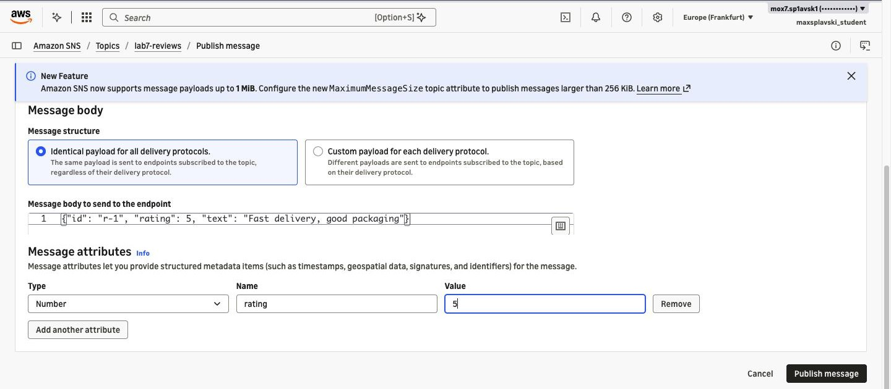
_Публикация отзыва `r-1` из консоли: тело `{"id": "r-1", "rating": 5, "text": "Fast delivery, good packaging"}` и атрибут `rating` типа `Number` = `5`._

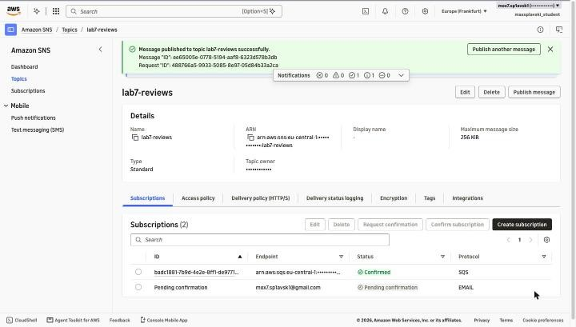
_Сообщение опубликовано; у темы две подписки: очередь (`Confirmed`) и почта (подтверждается письмом)._

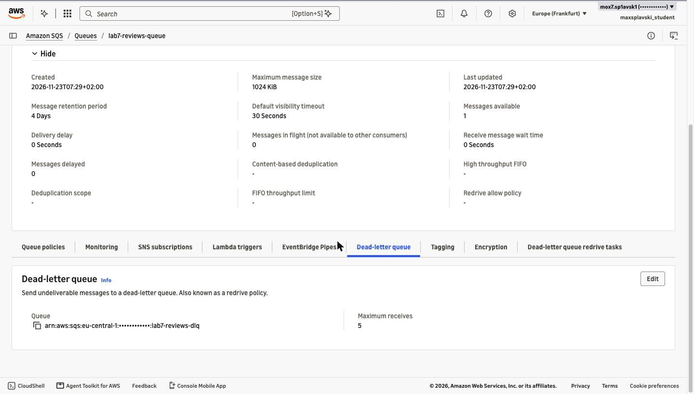
_`lab7-reviews-queue`: хранение 4 дня, таймаут видимости 30 с, DLQ `lab7-reviews-dlq` после 5 получений (`Maximum receives`)._

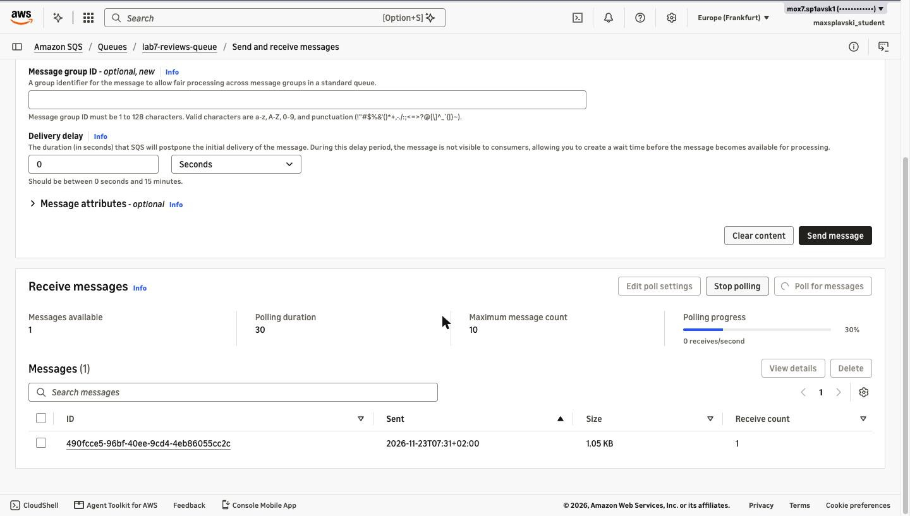
_`Poll for messages`: отзыв в очереди, `Receive count` = 1._

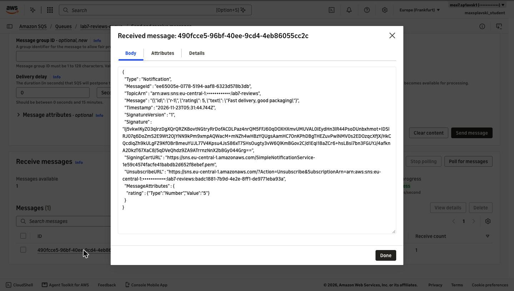
_Тело без `Raw message delivery`: конверт SNS в формате JSON (`Type`, `MessageId`, `TopicArn`, `Timestamp`, подпись, `UnsubscribeURL`, `MessageAttributes`), а сам отзыв лежит строкой с экранированными кавычками в поле `Message`._

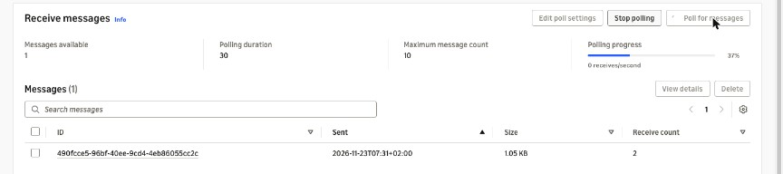
_Через 30 с то же сообщение снова в очереди, `Receive count` = 2._

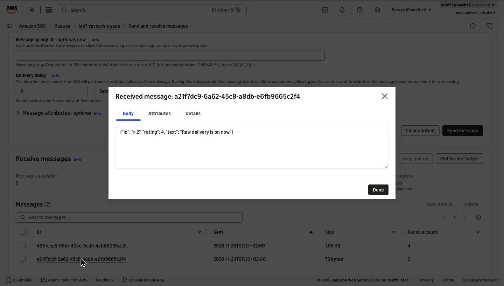
_После включения `Raw message delivery` (отзыв `r-2`): тело - ровно опубликованный JSON, 73 байта вместо 1,05 КБ._

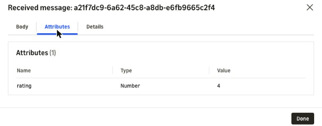
_Атрибут SNS `rating` стал атрибутом сообщения SQS._

> **Какие значения параметров вы выбрали и почему? Как выглядит тело сообщения в очереди с `Raw message delivery` и без него? Почему сообщение снова видно в очереди через некоторое время после того, как вы его получили?**
> Таймаут видимости 30 с: AWS рекомендует ставить его не меньше чем в 6 раз больше таймаута Lambda-функции плюс окно сбора пачки, чтобы сообщение не вернулось в очередь, пока его ещё обрабатывают. У меня 6 × 5 с = 30 с, а с окном 3 с по рекомендации нужно 33 с - окно я добавил уже после выбора таймаута, и строго правило не выполнено; на практике функция работает миллисекунды, повторов из-за этого не было, но правильно было поставить 35-40 с. Короче нельзя - пачку получил бы второй вызов и отзыв обработался бы дважды; намного длиннее - после ошибки повтор ждал бы долго. Хранение 4 дня (по умолчанию) хватает, чтобы пережить выходные без обработчика; у DLQ 14 дней (максимум): срок хранения в DLQ считается от исходной отправки, и там нужно время, чтобы разобраться и вернуть сообщения. `maxReceiveCount` = 5 - рекомендация AWS для очередей с Lambda: получение, которое служба Lambda сделала, но не успела отдать функции (throttling), тоже считается, и при 1-2 сообщение могло бы попасть в DLQ без единой настоящей попытки. Без `Raw message delivery` тело - конверт SNS (JSON с метаданными и подписью), отзыв приходится разбирать дважды (`json.loads(body)["Message"]`); с ним тело - сам отзыв, а атрибуты SNS переходят в атрибуты SQS. Я включил raw: получателю метаданные SNS не нужны, сообщение меньше, код проще. Сообщение снова видно, потому что получение его не удаляет, а только прячет на время таймаута видимости: консоль не вызывает `DeleteMessage`, и SQS считает, что получатель не справился, и отдаёт сообщение снова (`Receive count` растёт). Так SQS гарантирует доставку хотя бы один раз.

### Задание 2. Обработчик отзывов

```python
def lambda_handler(event, context):
    # Raw message delivery is on: the SQS body is the review JSON itself.
    for record in event["Records"]:
        review = json.loads(record["body"])
        print(f'{review["id"]}: {review["rating"]}/5 {review["text"][:20]}')
```

Перед подключением триггера очередь очищена (`PurgeQueue`), затем опубликованы три отзыва подряд.

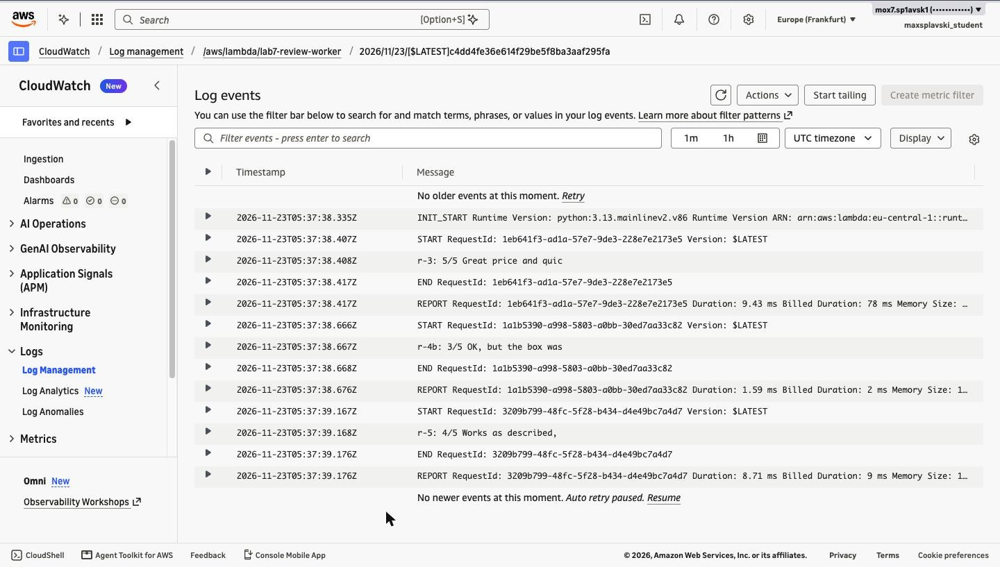
_Журнал `lab7-review-worker`: три строки `r-3: 5/5 Great price and quic`, `r-4b: 3/5 OK, but the box was`, `r-5: 4/5 Works as described,` - и три пары `START`/`REPORT`, то есть три вызова._

> **Сколько вызовов Lambda-функции понадобилось для трёх отзывов и от чего это зависит?**
> Здесь три: служба Lambda опрашивает очередь несколькими параллельными пулерами, и три сообщения, пришедшие с разницей в доли секунды, забрали разные пулеры - каждый отдал функции пачку из одного сообщения. Число вызовов зависит от размера пачки (`BatchSize`, у меня 10), окна сбора пачки (`MaximumBatchingWindowInSeconds`, 3 с), того, как сообщения распределены по пулерам и как быстро они приходят, и от ограничения одновременных вызовов. В задании 4 четыре отзыва, опубликованные один за другим, обработал **один** вызов (в журнале один поток и одна отметка времени) - пачка набралась за окно 3 с. Для 10 и более сообщений в секунду пачки почти всегда полные.

### Задание 3. Отзыв, который не удалось обработать

Опубликован `{"id": "r-4", "rating": 4}` без поля `text`.

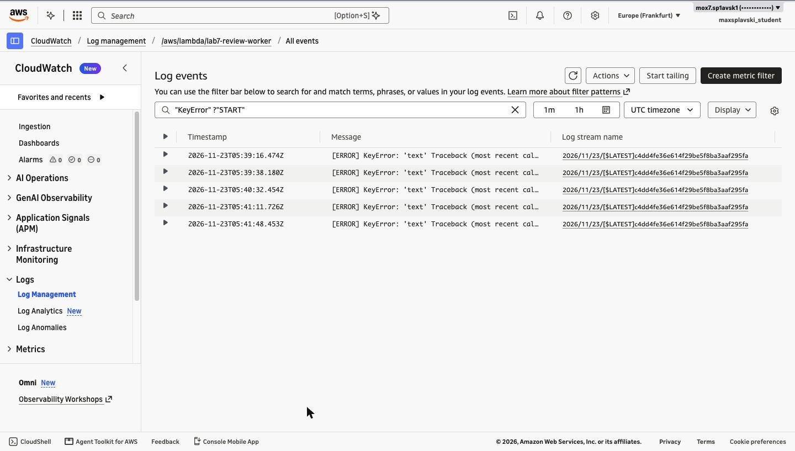
_Фильтр `KeyError`: пять ошибок `KeyError: 'text'` в 05:39:16, 05:39:38, 05:40:32, 05:41:11 и 05:41:48 UTC._

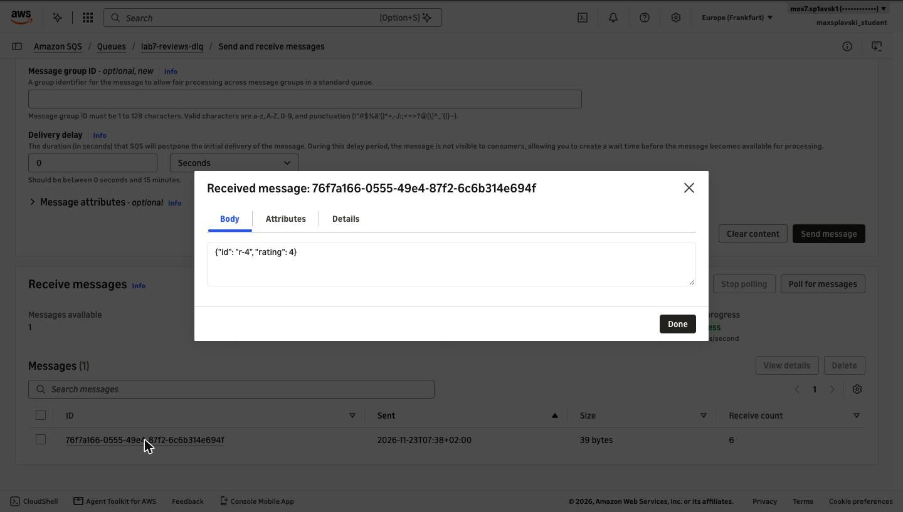
_После пятой неудачи отзыв в `lab7-reviews-dlq`, тело `{"id": "r-4", "rating": 4}`; `Receive count` = 6 (пять попыток Lambda и мой просмотр в консоли)._

Исправленная функция (`text = review.get("text") or "(no text)"`) загружена, затем `Start DLQ redrive` → `Redrive to source queue(s)`:

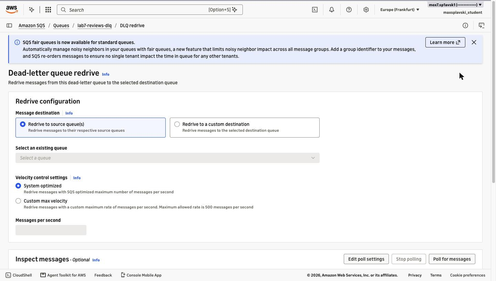

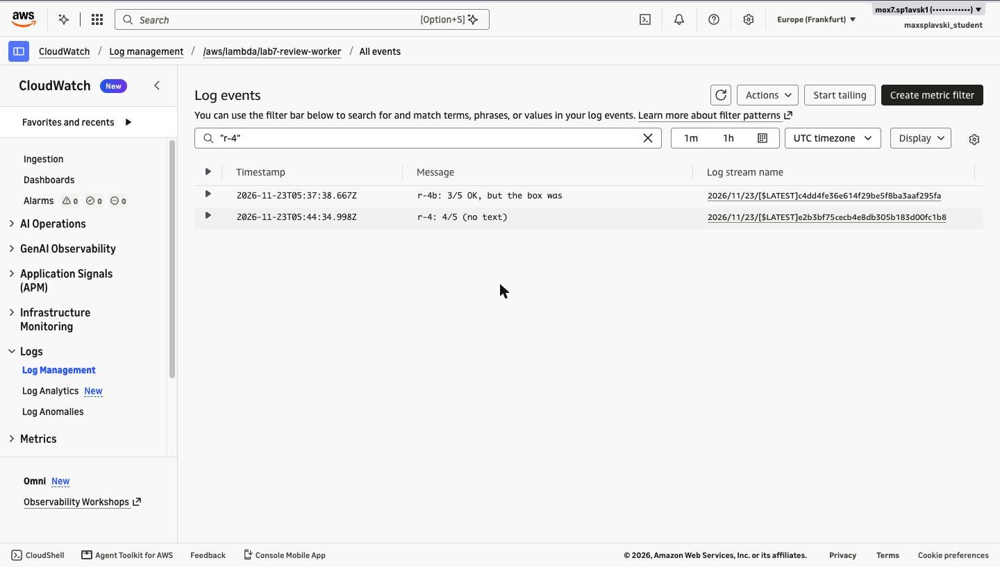
_В журнале строка `r-4: 4/5 (no text)` в 05:44:34._

> **Сколько раз обрабатывался отзыв с ошибкой и от какой настройки это зависит? Почему он попал в DLQ не сразу? Что произойдёт с остальными отзывами пачки, если ошибка случится на одном из десяти?**
> Пять раз - это `maxReceiveCount` в политике повторной доставки очереди. В DLQ он попал не сразу, потому что ошибка может быть временной (база перезагружается, сеть): после каждой неудачи сообщение остаётся в очереди и снова становится видимым только после таймаута видимости (30 с; интервалы в журнале 22-54 с, потому что после ошибок служба Lambda ещё и замедляет опрос). Только когда счётчик получений превысил 5, SQS переложил его в DLQ. Если ошибка случится на одном сообщении из пачки в десять, по умолчанию вся пачка считается необработанной: функция завершилась ошибкой, ни одно сообщение не удалено, все десять вернутся в очередь и будут обработаны снова, а успешные девять - повторно (поэтому обработчик должен выдерживать повторы). Исправить это можно ответом `batchItemFailures` с идентификаторами только неудачных сообщений и `ReportBatchItemFailures` в триггере - так сделано в Части 2.

### Задание 4. Плохие отзывы на почту

Политика фильтрации добавлена к **почтовой** подписке, а не к подписке очереди: очередь (журнал, будущая аналитика) должна получать все отзывы. Условие числовое: `{"rating": [{"numeric": ["<", 3]}]}`, область - атрибуты сообщения (`MessageAttributes`), поэтому сравнивается атрибут `rating`, а не поле в теле.

Опубликованы четыре отзыва: `r-11` (оценка 1), `r-13` (3), `r-15` (5) и `r-16` (оценка 1 в теле, но **без** атрибута `rating`).

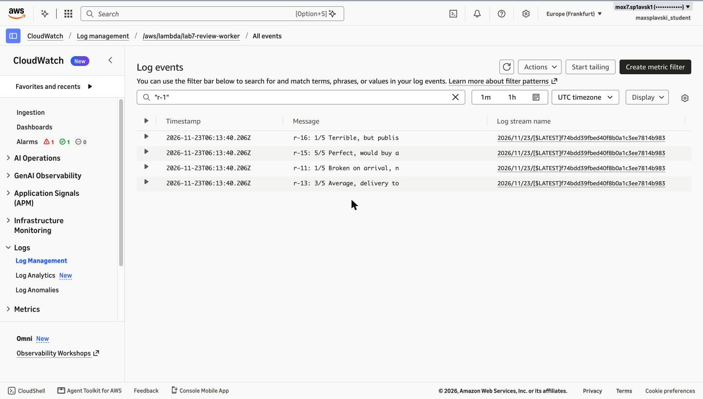
_Журнал: все четыре отзыва обработаны одним вызовом в 06:13:40._

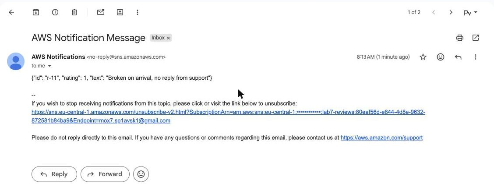
_Письмо от SNS пришло только про `r-11` (оценка 1)._

| Отзыв | Почта | Журнал `lab7-review-worker` |
| --- | --- | --- |
| `rating = 1` (`r-11`) | да | да |
| `rating = 3` (`r-13`) | нет | да |
| `rating = 5` (`r-15`) | нет | да |
| без `rating` (`r-16`, в теле оценка 1) | нет | да |

> **Почему отзыв без атрибута не пришёл на почту? Что пришлось бы менять в издателе, если бы он отправлял отзывы напрямую в каждую очередь, а появился новый получатель, например отдел аналитики?**
> Политика фильтрации проверяет атрибуты сообщения, а у `r-16` атрибута `rating` нет. Для SNS условие `rating < 3` в таком случае не выполнено (ключа нет вовсе), и подписка сообщение не получает, даже если в теле написано `"rating": 1`: тело при `FilterPolicyScope = MessageAttributes` не смотрится. Если бы издатель сам отправлял отзывы в каждую очередь, для нового получателя пришлось бы менять и перевыпускать издателя: добавить адрес новой очереди, права `sqs:SendMessage` на неё, обработку ошибок отправки в ещё одно место (что делать, если в одну очередь отправилось, а в другую нет). С темой издатель знает только одну тему; отдел аналитики создаёт свою очередь и подписывает её, а издатель не меняется. Фильтрация тоже переезжает к подписчику.

### Завершение Части 1

Удалены триггер, функция `lab7-review-worker` и её группа журналов, очереди `lab7-reviews-queue` и `lab7-reviews-dlq`, тема `lab7-reviews` (с подписками) и роль `lab7-review-worker-role`. Ресурсов с префиксом `lab7-` не осталось (проверка через API: `ListFunctions`, `ListQueues`, `ListTopics`, `ListRoles`, `DescribeLogGroups`).

## Часть 2. Продвинутый уровень

Ресурсы по соглашению ЛР3, теги `Project=timecapsule`, `Environment=dev`, `Owner=maxsplavski`, `Lab=lab7`.

| Ресурс | Имя | Настройки |
| --- | --- | --- |
| Тема SNS | `timecapsule-dev-events` | Standard |
| Очередь писем | `timecapsule-dev-mail` | таймаут видимости **120 с**, хранение **4 дня**, redrive после **3** получений; доступ `sqs:SendMessage` только для темы (`aws:SourceArn`) |
| DLQ | `timecapsule-dev-mail-dlq` | хранение **14 дней** |
| Подписка очереди | `timecapsule-dev-events` → `timecapsule-dev-mail` | `Raw message delivery`, фильтр по телу: `capsule.sealed` или `capsules.opened` с `count > 0` |
| Подписка почты | `timecapsule-dev-events` → `mox7.sp1avsk1@gmail.com` | фильтр по телу: `responsePayload.type = capsules.opened` и `count > 0` |
| Lambda-функции | `timecapsule-dev-mailer`, `timecapsule-dev-opener` | Python 3.13, arm64, 256 МБ, таймаут 20 с / 15 с, VPC: `private-a` + `private-b`, SG `timecapsule-dev-lambda-sg` |
| Код | [USM-Labs/timecapsule-mailer](https://github.com/USM-Labs/timecapsule-mailer), [USM-Labs/timecapsule-opener](https://github.com/USM-Labs/timecapsule-opener) | драйвер `pg8000` (чистый Python) в `requirements.txt`, zip-пакеты в репозитории не хранятся |
| Роли | `timecapsule-dev-mailer-role`, `timecapsule-dev-opener-role` | обе: `AWSLambdaVPCAccessExecutionRole`; mailer - Receive/Delete/GetQueueAttributes/ChangeMessageVisibility только на `timecapsule-dev-mail`; opener - `sns:Publish` только на тему (нужно назначению) |
| SG | `timecapsule-dev-lambda-sg` | входящих правил нет; исходящее **только** TCP 5432 к `timecapsule-dev-rds-sg`. У `timecapsule-dev-rds-sg` добавлено входящее 5432 от `timecapsule-dev-lambda-sg` |
| Роль в базе | `timecapsule_worker` | SELECT `users`, `capsules`; UPDATE только столбца `capsules.opened_at`; SELECT, INSERT `notifications`; `CONNECTION LIMIT 5` ([скрипт](files/worker-role.sql)) |
| Политика приложения | `timecapsule-dev-app-events` | `sns:Publish` только на `timecapsule-dev-events`, прикреплена к `timecapsule-dev-app-role` |
| Расписание | `timecapsule-dev-open-capsules` | `rate(1 minute)`, UTC, без гибкого окна, без повторов; роль `timecapsule-dev-opener-scheduler-role` (`lambda:InvokeFunction` только на opener, доверие с `aws:SourceAccount`) |
| Образ | `timecapsule-dev-app-lab7` (`ami-0eb6ee8018fdd5843`) | версия 2 шаблона `timecapsule-dev-app-lt`, выпуск на группу через instance refresh |

### Задание 5. Очередь писем и событие о запечатывании

Тема, очередь с DLQ и подписка созданы так же, как в Части 1. Формат событий описан в [`docs/events.md`](../events.md).

Значения для очереди писем выбраны от Lambda-функции: таймаут функции 20 с (пачка до 5 сообщений × 3 с `MAIL_DELAY_SECONDS` + подключение к базе), таймаут видимости 120 с = 6 × 20 с по рекомендации AWS. `maxReceiveCount` = 3 меньше, чем в Части 1: у триггера задан `MaximumConcurrency` = 2, поэтому служба Lambda не забирает сообщения больше, чем может отдать функции, и получения «впустую» из-за throttling не копятся; три попытки за ~6 минут отличают временный сбой от постоянного, а письмо в худшем случае ждёт в DLQ 14 дней.

> **Что в событии нужно получателю, а что лучше не передавать?**
> Получателю нужны тип события (`type`, по нему фильтр подписки и разбор), версия формата, идентификатор события (для журналов и поиска повторов), время, `capsule_id`, `user_id` и `open_at`. Этого хватает, чтобы найти всё остальное в базе. Не стоит передавать текст капсулы, вложение, заголовок и адреса почты: сообщение живёт в очереди и DLQ до 14 дней, видно в консоли (`Poll for messages`) и журналах, может уйти новым подписчикам темы, которым эти данные не нужны. Кроме того, данные в событии устаревают: если капсулу изменят или удалят, пока сообщение ждёт, письмо по актуальным данным из базы будет правильным, а по копии в событии - нет. Не передаются, конечно, и секреты (пароли, ключи, cookie сессии).

### Задание 6. Lambda-функция писем

Код - [`lambda_function.py`](https://github.com/USM-Labs/timecapsule-mailer/blob/main/lambda_function.py). Главное:

- подключение к базе создаётся один раз на экземпляр функции (вне обработчика) и пересоздаётся после ошибки; TLS включён (`ssl_context`), сертификат RDS не проверяется - аналог `PGSSLMODE=no-verify`;
- `capsule.sealed`: если уведомление `sealed` для капсулы уже есть - повтор пропускается без паузы; иначе пауза `MAIL_DELAY_SECONDS` и `INSERT ... ON CONFLICT (capsule_id, kind) DO NOTHING`;
- запись о вызове opener (`responsePayload.type = capsules.opened`): уведомление `opened` на каждую открытую капсулу;
- каждое сообщение пачки обрабатывается отдельно, ошибки возвращаются в `batchItemFailures` (у триггера включено `ReportBatchItemFailures`).

Для защиты от повторов в схему добавлены столбец и уникальный индекс (коммит [`b2f8258`](https://github.com/USM-Labs/timecapsule/commit/b2f8258), `database/schema.sql`):

```sql
ALTER TABLE notifications ADD COLUMN IF NOT EXISTS kind VARCHAR(20);
CREATE UNIQUE INDEX IF NOT EXISTS notifications_capsule_kind_key ON notifications (capsule_id, kind);
```

Проверка без приложения: создана капсула 7, и в очередь `SendMessage` дважды отправлено одно и то же `capsule.sealed` для неё.

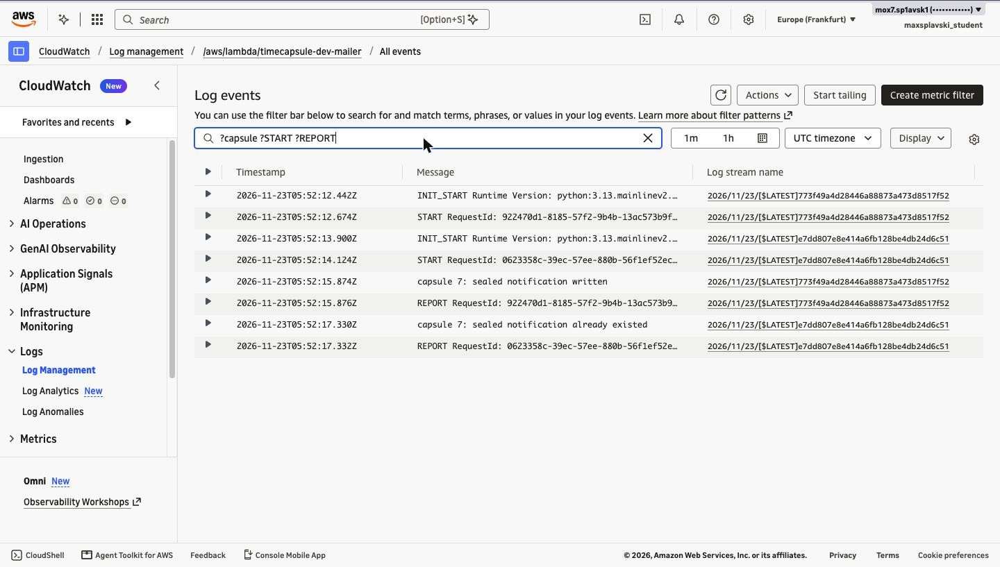
_Журнал: два разных потока (два экземпляра функции работали одновременно). Первый в 05:52:15 - `sealed notification written`, второй в 05:52:17 - `sealed notification already existed`. Оба прошли предварительную проверку (уведомления ещё не было) и оба ждали 3 с, но вставку второго отбросил уникальный индекс. Холодный старт в VPC - около 0,2 с (от `INIT_START` 05:52:12.44 до `START` 05:52:12.67)._

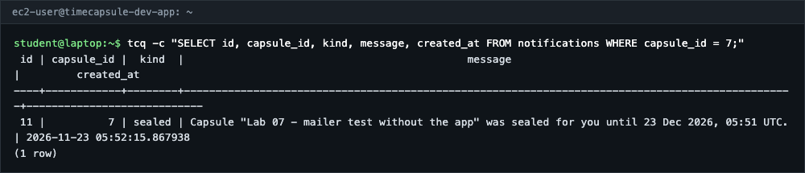
_В `notifications` для капсулы 7 одна строка `sealed`. `tcq` - обёртка `psql` на сервере, которая берёт подключение из `.env`, не показывая пароль._

> **Сколько уведомлений появилось после двух одинаковых сообщений и почему? Какой предел одновременных вызовов вы выбрали и из чего исходили?**
> Одно. Проверка «уведомление уже есть» перед паузой спасает только от последовательных повторов, а здесь два сообщения разобрали два экземпляра функции одновременно, и проверку прошли оба. Решает уникальный индекс `(capsule_id, kind)`: база атомарно примет только одну вставку, вторая с `ON CONFLICT DO NOTHING` ничего не делает и не падает. Предел - 2 одновременных вызова (`MaximumConcurrency` у триггера, это минимум, который допускает SQS). Исходил из базы: `db.t4g.micro` с 1 ГиБ памяти держит около 80 подключений, и их делят веб-серверы (2-4 PHP-FPM с пулом) и обе функции; у роли `timecapsule_worker` ещё и `CONNECTION LIMIT 5`. Каждый одновременный вызов держит своё подключение, поэтому без предела всплеск писем мог бы открыть сотни подключений и уронить сайт. Писем мало, и задержка в несколько секунд не важна - пропускной способности 2 × 5 сообщений за ~15 с хватает с запасом. Зарезервированную конкурентность (`reserved concurrency`) задать нельзя: у аккаунта бесплатного плана лимит 10 одновременных вызовов на регион, а AWS требует оставлять 10 незарезервированными - попытка `PutFunctionConcurrency` = 2 вернула `Specified ReservedConcurrentExecutions for function decreases account's UnreservedConcurrentExecution below its minimum value of [10]`.

### Задание 7. Публикация событий из приложения

Изменения в приложении (коммиты [`b2f8258`](https://github.com/USM-Labs/timecapsule/commit/b2f8258), [`63f6525`](https://github.com/USM-Labs/timecapsule/commit/63f6525)):

- новый [`src/events.php`](../../src/events.php): `event_publish()` через `Aws\Sns\SnsClient` (учётные данные роли из IMDSv2, без ключей), атрибут сообщения `type`;
- `capsules_store()`: при заданном `EVENTS_TOPIC_ARN` вместо `mail_send()` публикуется `capsule.sealed`; ошибка публикации пишется в журнал, но не мешает сохранить капсулу;
- `public/index.php`: `open_due_capsules()` вызывается только без `EVENTS_TOPIC_ARN` (локальный Docker);
- `.env` сервера: `EVENTS_TOPIC_ARN=arn:aws:sns:eu-central-1:<account>:timecapsule-dev-events`.

Порядок выпуска на группу Auto Scaling: `deploy.sh` на `app-server` (запущен на время работы) → проверка публикации из PHP (событие для капсулы 7 дошло до функции и было пропущено как повтор) → образ `timecapsule-dev-app-lab7` → версия 2 шаблона `timecapsule-dev-app-lt` (по умолчанию) → `Start instance refresh` (минимум 50% исправных, прогрев 60 с): группа по одному заменила оба сервера.

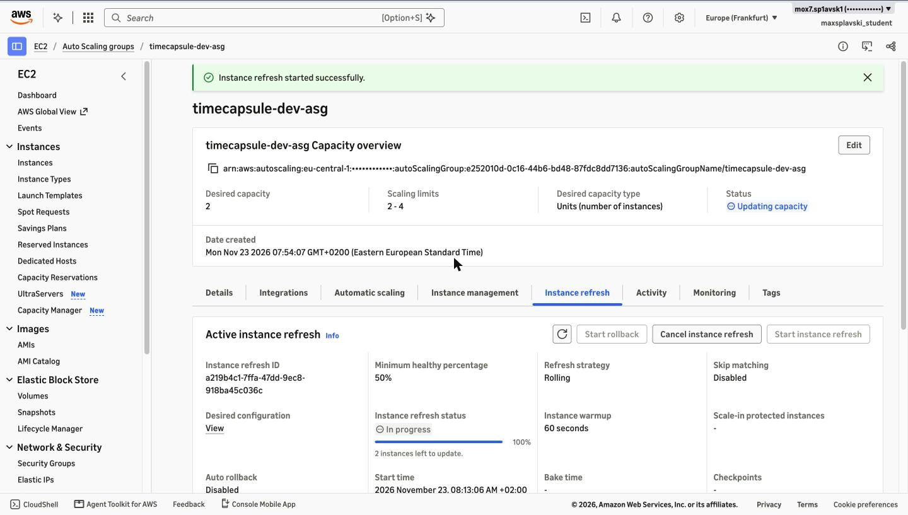
_Instance refresh группы `timecapsule-dev-asg` - серверы заменяются на версию 2 шаблона (статус `Successful` через ~4 минуты)._

Время запроса я мерил в той же вкладке Chrome сразу после `Seal capsule`: скрипт на странице прочитал запись Navigation Timing (`performance.getEntriesByType('navigation')[0]`) - это те же замеры, что показывает вкладка `Network`: `redirectEnd - redirectStart` - запрос `POST /capsules` до ответа `302`, `responseEnd - fetchStart` - `GET` страницы капсулы. Значения скопированы и отрисованы ниже. **Скриншота вкладки `Network` в отчёте нет**: DevTools в управляемой вкладке открыть не удалось; на защите я покажу `Network` вживую.

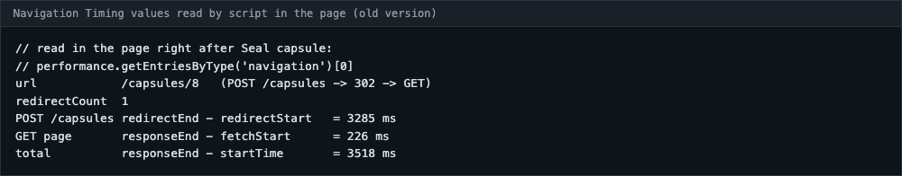
_До изменения (старый образ), значения Navigation Timing для капсулы 8: `POST /capsules` **3285 мс**, из них 3 с - ожидание «почтового сервера» внутри запроса._

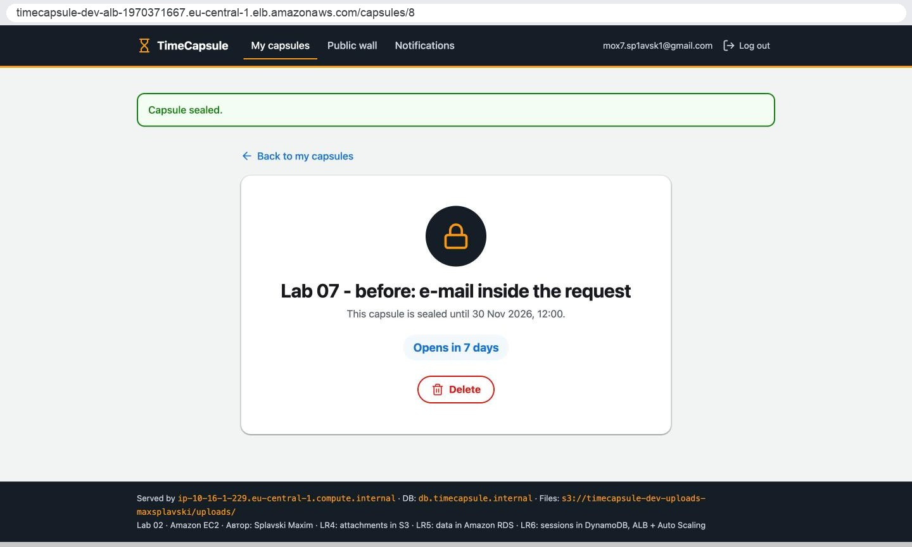

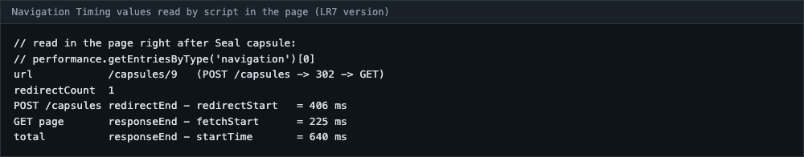
_После выпуска, капсула 9: **406 мс**; веб-сервер только публикует событие (запрос к SNS - десятки миллисекунд), остальное - сохранение в RDS._

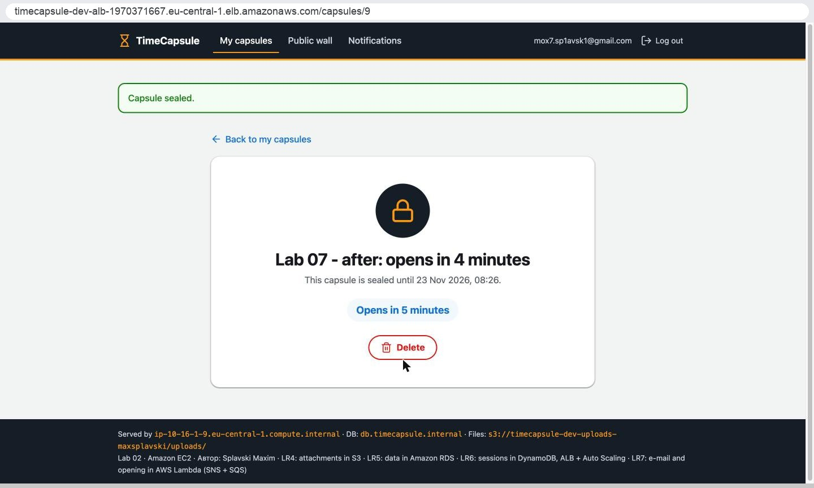
_В подвале новая строка `LR7: e-mail and opening in AWS Lambda` и новый сервер группы `ip-10-16-1-9`._

Уведомление для капсулы 9 записала Lambda-функция примерно через 4 с после ответа пользователю (ответ ~06:21:41,6, строка 06:21:45,5: 3 с `MAIL_DELAY_SECONDS` и ~1 с на путь SNS → SQS → Lambda) - пользователь ждал 0,4 с, а письмо всё равно «ушло», для капсулы 8 (старая версия) - сам веб-сервер, поэтому у неё `kind` пустой:

```
 id | capsule_id |  kind  | message                                                               | created_at
 13 |          8 |        | Capsule "Lab 07 - before: e-mail inside the request" was sealed ...  | 06:08:31
 14 |          9 | sealed | Capsule "Lab 07 - after: opens in 4 minutes" was sealed ...          | 06:21:45
```

> **Что увидит пользователь, если Lambda-функция писем сломана? Где в это время находится его письмо?**
> Пользователь ничего не заметит при запечатывании: страница отвечает так же быстро, капсула сохранена и показана. Единственное отличие - на странице `Notifications` ещё нет строки о запечатывании (задание 9). Письмо - сообщение `capsule.sealed` - лежит в очереди `timecapsule-dev-mail`: после каждой неудачной попытки оно снова становится видимым через 120 с, а после трёх попыток переходит в `timecapsule-dev-mail-dlq` и хранится там до 14 дней, пока функцию не исправят и не вернут его кнопкой `Start DLQ redrive`.

### Задание 8. Открытие капсул по расписанию

[`lambda_function.py`](https://github.com/USM-Labs/timecapsule-opener/blob/main/lambda_function.py) делает один `UPDATE capsules SET opened_at = :now WHERE opened_at IS NULL AND open_at <= :now RETURNING id, title, open_at` и возвращает `{"type": "capsules.opened", "count": N, "capsules": [...]}`. В SNS функция не обращается - публикует служба Lambda через назначение (destination). Асинхронный вызов настроен без повторов и с возрастом события до 60 с: следующий запуск всё равно через минуту, а повтор старого вызова только создал бы лишнюю нагрузку на базу.

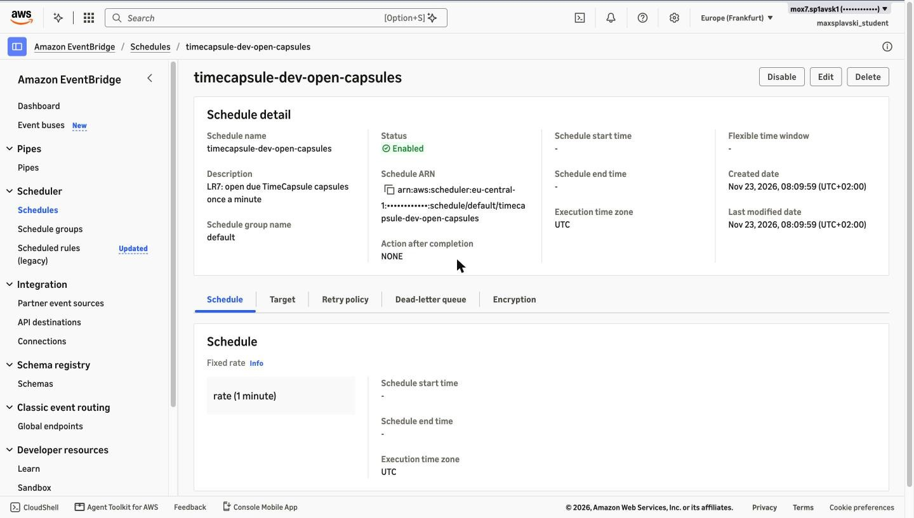
_Расписание `timecapsule-dev-open-capsules`: `rate(1 minute)`, `Enabled`._

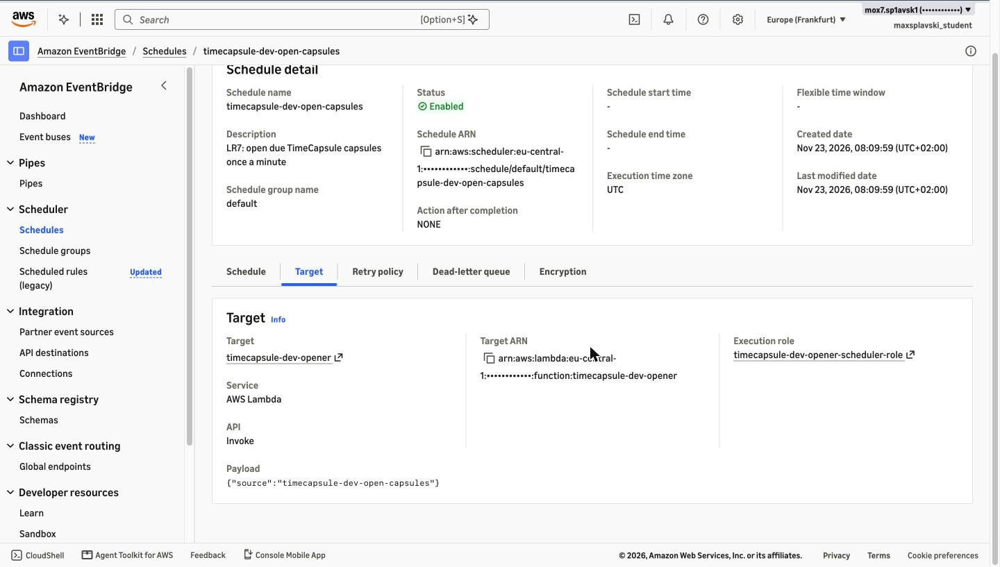
_Цель - `timecapsule-dev-opener`, роль `timecapsule-dev-opener-scheduler-role`._

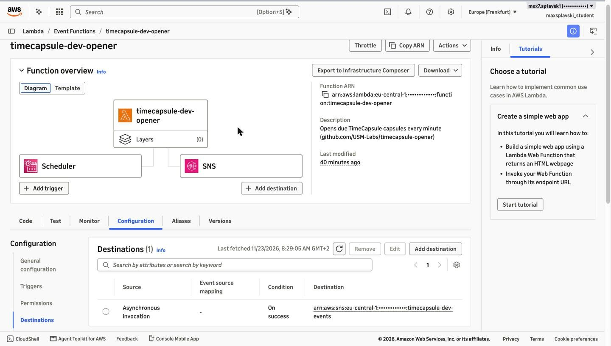
_Функция: слева триггер `Scheduler`, справа назначение `SNS`; `Asynchronous invocation` → `On success` → `timecapsule-dev-events`._

Проверка: капсула `Lab 07 - after: opens in 4 minutes` запечатана в 06:21:44 UTC с `open_at` = 06:26:00 UTC. Сайт после этого я не открывал до прихода письма.

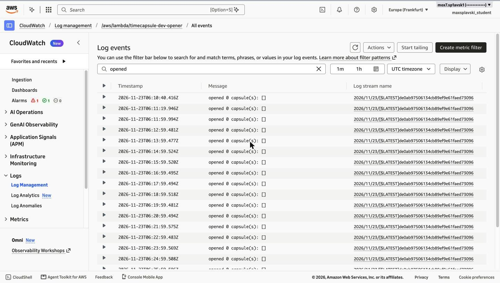
_Журнал opener: вызов в :59 каждой минуты, до 06:26 - `opened 0 capsule(s)`._

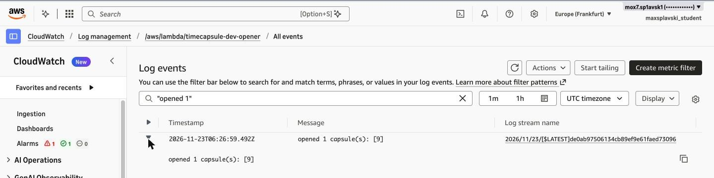
_06:26:59 - `opened 1 capsule(s): [9]`._

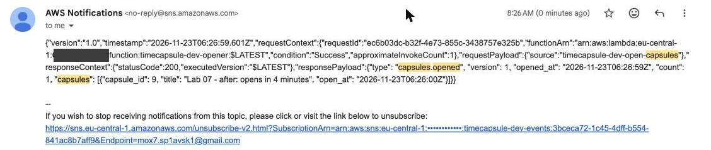
_Письмо от SNS в 08:26 по Кишинёву: запись о вызове с `"condition":"Success"` и `responsePayload` - `type: capsules.opened`, `count: 1`, капсула 9. Номер аккаунта в ARN функции закрыт._

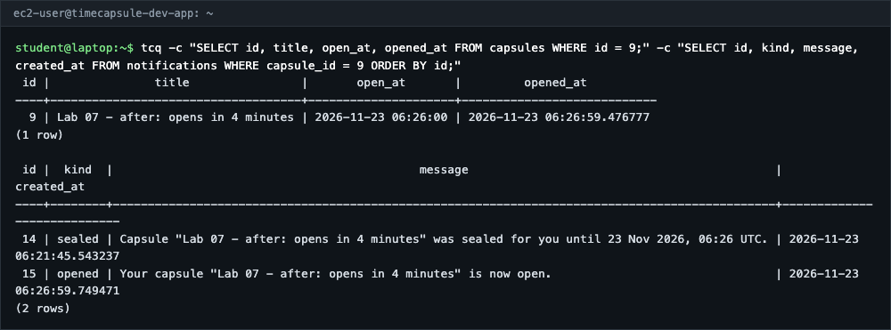
_База: `opened_at` = 06:26:59.48, уведомление `opened` записано `timecapsule-dev-mailer` в 06:26:59.75 - через 0,3 с после открытия._

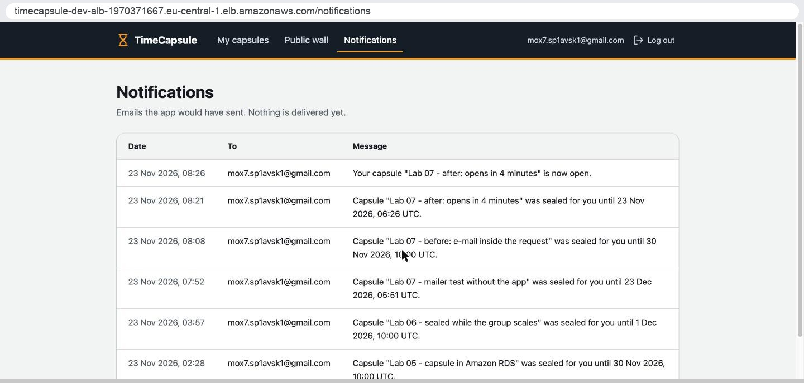
_Страница `Notifications`: «is now open» и «was sealed» для капсулы 9._

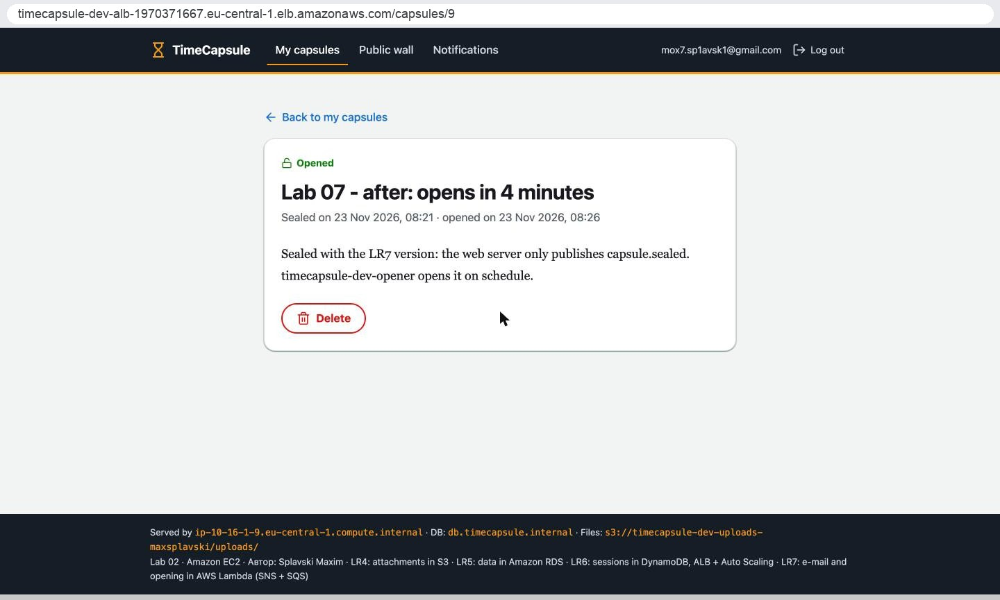
_Капсула открыта: `opened on 23 Nov 2026, 08:26`._

> **Что будет, если Lambda-функция открыла капсулы, но служба Lambda не смогла доставить запись в тему? Что пришлось бы добавить в сеть, если бы код Lambda-функции сам публиковал события в SNS, и сколько бы это стоило? Чем открытие капсул по расписанию хуже открытия при запросе?**
> Капсулы останутся открытыми (`UPDATE` уже выполнен), но уведомления `opened` и письма не будет: следующие вызовы эти капсулы уже не вернут (`opened_at IS NULL` больше не выполняется). Служба Lambda повторяет доставку в назначение какое-то время, но если тема удалена или у роли нет `sns:Publish`, запись теряется. Защититься можно назначением `OnFailure` в очередь или периодической сверкой «открытые капсулы без уведомления `opened`». Если бы код сам вызывал SNS, функции в приватных подсетях нужен был бы выход к API SNS: NAT Gateway (≈ $0,052 в час ≈ $38 в месяц на одну зону плюс $0,052 за ГБ, и для двух зон вдвое больше) или интерфейсный VPC endpoint `com.amazonaws.eu-central-1.sns` (≈ $0,012 в час на зону ≈ $9 в месяц на зону, ≈ $18 на две). Назначение ничего не стоит: запись публикует служба Lambda вне VPC. Минусы расписания: капсула открывается с задержкой до минуты (и при остановленной базе - позже), функция работает раз в минуту, даже когда открывать нечего (1440 вызовов и пустых записей в тему в сутки, базу будят ради пустого `UPDATE`), а для пользователя, который смотрит на страницу в момент открытия, капсула не откроется до следующего запуска. При запросе капсула открывалась ровно в момент, когда кто-то на неё смотрел, без лишних вызовов, но только если сайт кто-то открывал.

### Задание 9. Сбой обработчика

В 06:30:30 UTC в переменных `timecapsule-dev-mailer` задан неверный пароль базы, затем в приложении запечатаны капсулы 10 и 11 (запрос `Seal capsule` - 283 мс, как обычно).

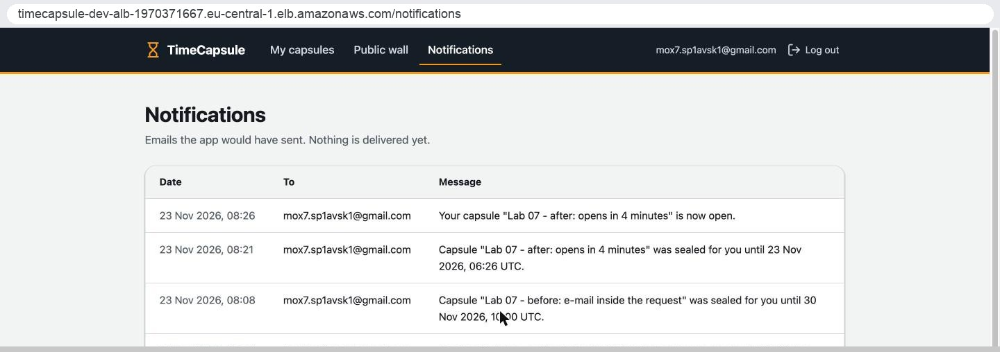
_Во время сбоя в `Notifications` нет строк о `failure test 1/2`, хотя обе капсулы сохранены._

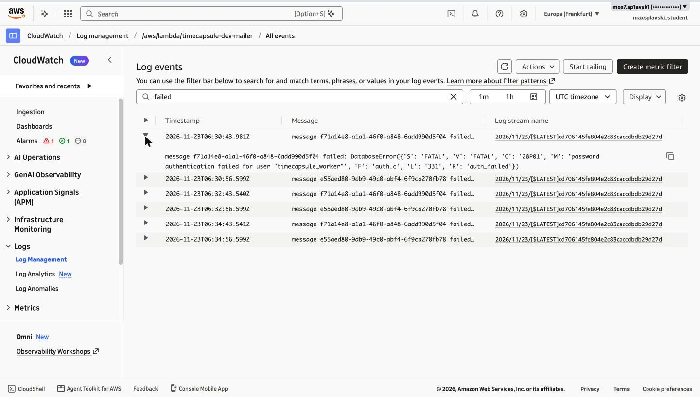
_Журнал `timecapsule-dev-mailer`: по три ошибки на каждое сообщение - 06:30:43, 06:32:43, 06:34:43 и 06:30:56, 06:32:56, 06:34:56 (ровно через таймаут видимости 120 с), `password authentication failed for user "timecapsule_worker"`. Функция вернула оба сообщения в `batchItemFailures` и завершилась без ошибки, поэтому служба Lambda не замедляла опрос._

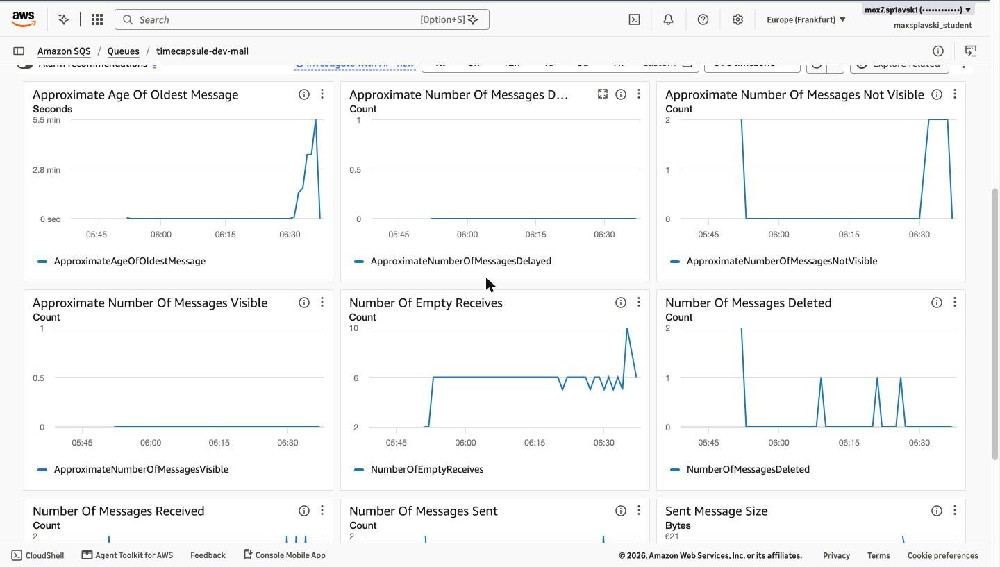
_Метрики `timecapsule-dev-mail` (1 час): `ApproximateNumberOfMessagesNotVisible` = 2 с 06:31 до 06:37 (сообщения «в работе» между попытками), `ApproximateAgeOfOldestMessage` растёт до 5,5 минут, `Visible` = 0 - сообщения почти сразу снова забирались._

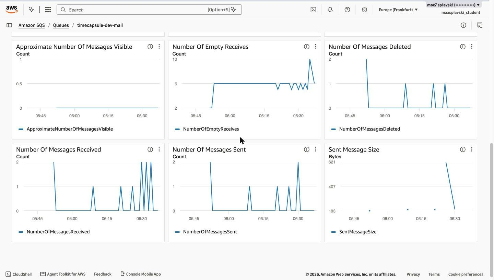
_`NumberOfMessagesReceived` - три пика по 2 (06:31, 06:33, 06:35), `NumberOfMessagesDeleted` в это время 0: ни одно сообщение не обработано._

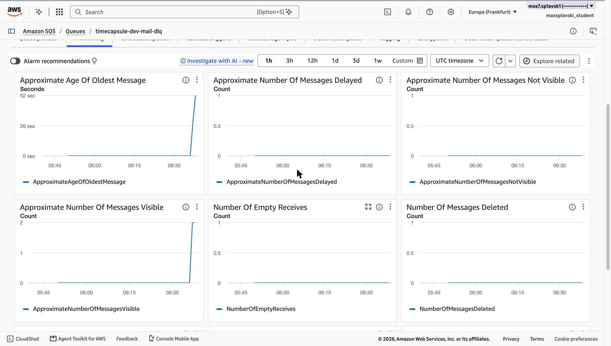
_Метрики `timecapsule-dev-mail-dlq`: в 06:37 `ApproximateNumberOfMessagesVisible` = 2 - оба письма в DLQ._

В 06:38 пароль в функции восстановлен (тем же способом, через временный объект S3), затем `Start DLQ redrive` → `Redrive to source queue(s)`:

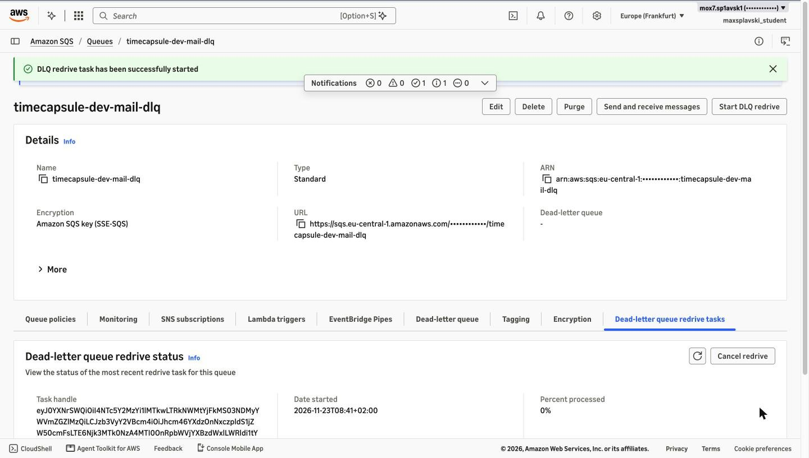

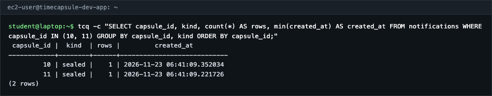
_В 06:41:09 функция записала уведомления; у капсул 10 и 11 ровно по одной строке `sealed`._

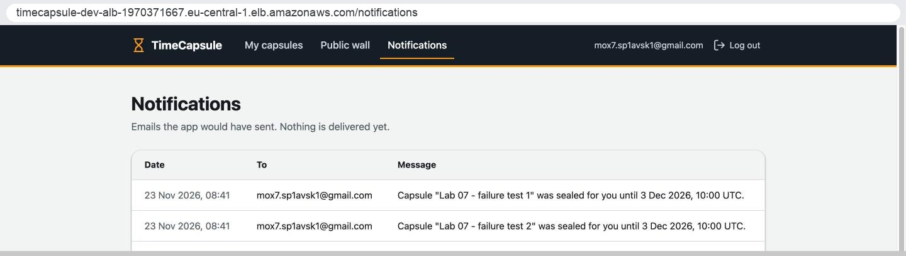
_Страница `Notifications` после redrive._

> **Через сколько попыток сообщения оказались в DLQ и от каких настроек это зависело? Что произошло бы с письмами при той же поломке в ЛР6?**
> После трёх попыток - `maxReceiveCount` = 3 в политике повторной доставки `timecapsule-dev-mail`. Время между попытками задаёт таймаут видимости (120 с), поэтому в DLQ сообщения попали примерно через 6 минут (06:30:43 → 06:36:45). Влияют также `ReportBatchItemFailures` (возвращаются только неудачные сообщения пачки, а не вся пачка), размер пачки и `MaximumConcurrency` (сколько сообщений берётся одновременно), а срок, сколько письмо может ждать исправления, - хранение DLQ (14 дней). В ЛР6 письмо «отправлял» сам веб-сервер внутри запроса: с неверным паролем базы не работало бы вообще всё приложение (`/health` 500, балансировщик снимает цели, `Seal capsule` - ошибка 500), а если бы ломался только «почтовый сервер», запрос `Seal capsule` падал бы или висел, и письмо терялось бы безвозвратно: ни очереди, ни повторов, ни DLQ, вернуть его было бы нечем.

### Задание 10. Архитектура и решение

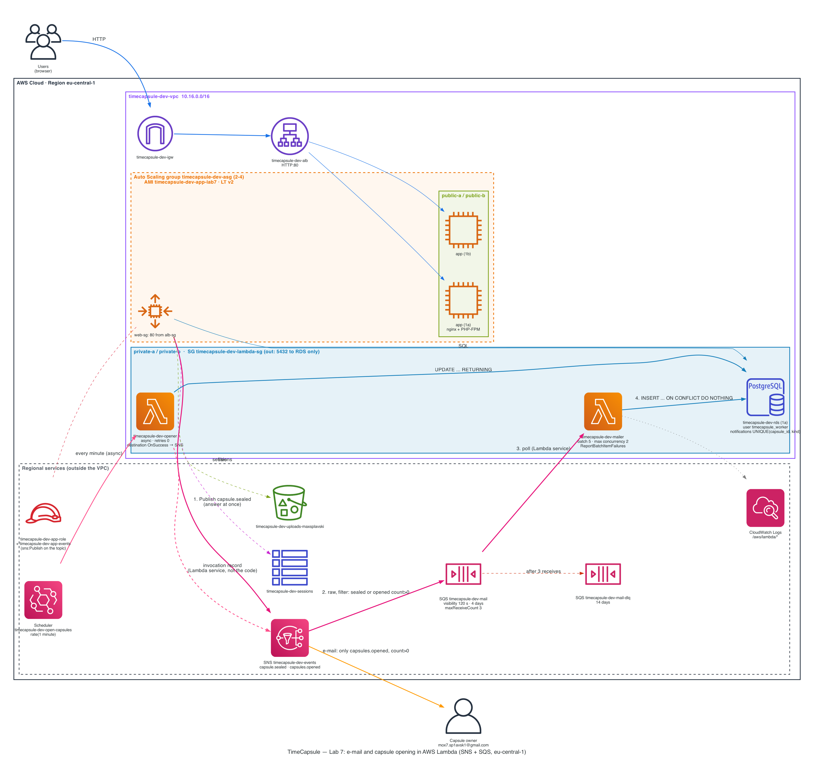
_Схема ЛР7 (AWS Architecture Icons, [`tools/diagram7.py`](tools/diagram7.py)). Путь письма: сервер группы публикует `capsule.sealed` в `timecapsule-dev-events` (1) и сразу отвечает; тема с фильтром доставляет событие в `timecapsule-dev-mail` (2); служба Lambda забирает пачку и вызывает `timecapsule-dev-mailer` (3), который пишет уведомление в RDS (4); после трёх неудач сообщение уходит в DLQ. Путь открытия: Scheduler раз в минуту асинхронно вызывает `timecapsule-dev-opener`, тот открывает капсулы в RDS, а запись о вызове служба Lambda публикует в ту же тему; оттуда - в очередь писем и на почту владельца. Обе функции в приватных подсетях без NAT, SG разрешает им только 5432 к базе._

Решение о фоновой работе: [ADR-0006](../adr/0006-background-jobs.md). Сравнены выполнение внутри веб-запроса, `cron` на сервере приложения и Lambda с SNS и SQS; выбран последний вариант. В разделе «Последствия» - что происходит с письмами при сбое функции и при остановке базы и как работает защита от повторов.

### Завершение работы

В конце занятия:

- отключено расписание `timecapsule-dev-open-capsules` (`State = DISABLED`) и триггер `timecapsule-dev-mail` → `timecapsule-dev-mailer` (`Enabled = false`): служба Lambda больше не опрашивает очередь;
- удалены балансировщик `timecapsule-dev-alb` и группа `timecapsule-dev-asg` (пересоздаются `start-lab.sh` из шаблона, версия 2 - образ `timecapsule-dev-app-lab7`);
- остановлены база `timecapsule-dev-rds`, `bastion` и `app-server`.

Защита ещё впереди, а для ЛР8 эти ресурсы понадобятся, поэтому тема, очереди, функции, таблица сессий, бакет и база не удалены. Удалить всё с тегом `Project = timecapsule` через `Tag Editor` нужно будет только после защиты, если ЛР8 выполняться не будет.

## Контрольные вопросы

**1. Как проходит событие от нажатия `Seal capsule` до строки в таблице `notifications`? Где оно может задержаться и где потеряться?**
Браузер отправляет `POST /capsules` через ALB на сервер группы; PHP сохраняет капсулу в RDS, публикует `capsule.sealed` в `timecapsule-dev-events` (`sns:Publish` с ролью сервера) и отвечает `302`. SNS проверяет фильтр подписки и кладёт событие в `timecapsule-dev-mail`; служба Lambda опрашивает очередь и вызывает `timecapsule-dev-mailer` с пачкой, функция ждёт `MAIL_DELAY_SECONDS`, пишет строку `sealed` в `notifications` и сообщение удаляется из очереди. Задержаться событие может в очереди (функция падает - повтор через 120 с, база остановлена, триггер выключен, `MaximumConcurrency` занят) и в DLQ до redrive. Потеряться - если SNS недоступен в момент публикации (капсула сохранена, события нет - нужен outbox), если сообщение пролежало в DLQ больше 14 дней или если фильтр подписки настроен неправильно и отбросил событие.

**2. Чем очередь SQS отличается от темы SNS и зачем в этой работе нужны обе?**
Тема SNS - рассылка: она ничего не хранит, а сразу доставляет копию сообщения каждому подписчику (очереди, почте, Lambda), с фильтрами на подписках. Очередь SQS - хранилище: сообщение лежит, пока получатель его не заберёт и не удалит, с таймаутом видимости, повторами и DLQ; получатель сам решает, когда и сколько брать. Тема даёт развязку издателя и получателей: приложение и opener публикуют в одно место, а письма в очередь и на почту (и в будущем аналитика) подписываются сами. Очередь даёт надёжность и сглаживание: письмо переживает сбой функции или остановку базы и обрабатывается с ограниченной конкурентностью, а не вызовом на каждое событие.

**3. Какую работу с SQS и SNS выполняет за Lambda-функции в VPC служба Lambda и почему Lambda-функциям не нужен выход в интернет?**
Для `timecapsule-dev-mailer` очередь опрашивает служба Lambda (event source mapping): она получает пачки, вызывает функцию, удаляет обработанные сообщения и возвращает неудачные из `batchItemFailures`, - всё это вне VPC, со своими учётными данными роли. Для `timecapsule-dev-opener` запись о вызове в тему публикует тоже служба Lambda (назначение `OnSuccess`), а не код. Код функций ходит только в RDS по частному адресу внутри VPC, поэтому ни NAT Gateway, ни VPC endpoint-ы не нужны, а SG разрешает им один исходящий порт 5432. Журналы в CloudWatch Logs тоже пишет среда выполнения Lambda, а не код через сеть VPC.

**4. Как изменилась архитектура приложения по сравнению с ЛР2? Какие обязанности перешли к AWS, а какие остались за вами?**
В ЛР2 всё было на одном EC2-сервере с публичным адресом: nginx, PHP, PostgreSQL, файлы, сессии, «почта» и открытие капсул в запросе. Теперь: своя VPC с публичными и приватными подсетями в двух зонах (ЛР3), файлы в S3 (ЛР4), база в RDS (ЛР5), сессии в DynamoDB и одинаковые серверы за ALB в группе Auto Scaling (ЛР6), фоновая работа в Lambda через SNS и SQS (ЛР7). К AWS перешли железо и ОС базы, резервные копии и PITR, хранение и надёжность файлов, распределение нагрузки и замена упавших серверов, хранение и доставка сообщений с повторами, запуск и масштабирование обработчиков, расписание. За мной остались код приложения и функций (в том числе идемпотентность), схема данных и миграции, IAM-политики и Security Groups (наименьшие права), образы серверов и обновление ОС на них, выбор параметров (таймауты, повторы, лимиты), секреты, наблюдение за метриками и DLQ, стоимость и выключение ресурсов.
